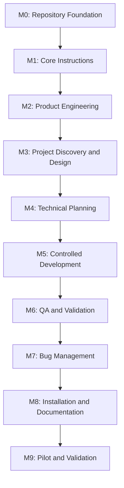

# Dev-Team — Implementation Plan

**Document type:** Technical Implementation Plan  
**Project:** Dev-Team  
**Repository:** `dev-team`  
**Version:** 1.0  
**Status:** approved  
**Last updated:** 2026-11-05  
**Based on:**
- `requirements.md` — Approved
- `system-design.md` — Approved

---

# 1. Implementation Overview

## 1.1 Objective

Implement Dev-Team as a reusable, local AI-powered software engineering framework using OpenAI Codex CLI.

The implementation must establish a system capable of managing the complete software development lifecycle:

1. Product requirements.
2. Requirement validation.
3. Project discovery.
4. System design.
5. Technical planning.
6. Controlled implementation.
7. Code review.
8. Feature validation.
9. Bug diagnosis and fixing.
10. Feature status reporting.

Dev-Team itself will be developed using the same engineering principles it is designed to provide to other projects.

## 1.2 Implementation strategy

The project will follow a milestone-based implementation strategy.

Each milestone will contain small, independently verifiable tasks.

The execution process will be:

```text
Approved Implementation Plan
          |
          v
Select Next Pending Task
          |
          v
Inspect Dependencies and Context
          |
          v
Implement One Task
          |
          v
Run Relevant Validation
          |
          v
Review Deliverables
          |
          v
Update Task Status
          |
          v
Proceed to Next Task
```

No task should be marked complete without satisfying its acceptance criteria.

## 1.3 Implementation principles

- Implement the smallest useful solution first.
- Follow the approved system architecture.
- Avoid unnecessary agents and automation.
- Prefer Codex-native capabilities.
- Keep reusable instructions separate from project-specific instructions.
- Use deterministic scripts for deterministic checks.
- Keep approval gates explicit.
- Validate each milestone before proceeding.
- Avoid implementing future capabilities during the MVP.

---

# 2. Milestone Overview

| ID | Milestone | Priority | Expected outcome |
|---|---|---|---|
| M0 | Repository Foundation | Must Have | Establish the Dev-Team repository |
| M1 | Core Instructions & Configuration | Must Have | Establish system operating rules |
| M2 | Product Engineering Workflow | Must Have | Requirements creation and validation |
| M3 | Project Discovery & Architecture | Must Have | Project-aware feature design |
| M4 | Technical Planning Workflow | Must Have | Structured implementation planning |
| M5 | Controlled Development Workflow | Must Have | One-task-at-a-time implementation |
| M6 | QA & Feature Validation | Must Have | Independent implementation verification |
| M7 | Bug Management & Status | Must Have | Bug fixing and progress reporting |
| M8 | Installation & Documentation | Must Have | Reusable cross-project installation |
| M9 | Pilot & System Validation | Must Have | Validate Dev-Team on real projects |

Milestones must be completed sequentially unless a task is explicitly identified as independent.

---

# 3. Milestone 0 — Repository Foundation

**Objective:** Establish the repository and its initial organizational structure.

**Dependencies:** None.

## Task M0-T01 — Initialize repository

**Scope:**
- Initialize the `dev-team` Git repository.
- Establish the default branch.
- Create the initial README.
- Add an appropriate license if selected.
- Add a basic `.gitignore`.

**Expected files:**

```text
dev-team/
├── README.md
├── .gitignore
└── LICENSE
```

**Acceptance criteria:**
- Repository is initialized successfully.
- Repository name is `dev-team`.
- README explains the product purpose.
- Git ignores temporary and environment-specific files.
- No credentials or secrets are committed.

**Validation:**
- Run `git status`.
- Verify repository structure.
- Verify ignored files.

## Task M0-T02 — Establish directory structure

**Scope:**

Create the approved initial directory organization.

```text
dev-team/
├── config/
├── agents/
├── skills/
├── workflows/
├── templates/
├── scripts/
└── docs/
```

**Acceptance criteria:**
- All required directories exist.
- Directory responsibilities are documented.
- No unnecessary placeholder files are introduced.

**Validation:**
- Inspect directory tree.
- Verify structure against `system-design.md`.

**Milestone completion criteria:**

The repository is initialized and ready for the system instructions and reusable components.

---

# 4. Milestone 1 — Core Instructions & Configuration

**Objective:** Establish the operating rules that govern every Dev-Team workflow.

**Dependencies:** M0.

## Task M1-T01 — Create root AGENTS.md

**Scope:**

Define the primary instructions for Codex when working inside the Dev-Team repository.

The document must cover:

- Dev-Team purpose and architecture.
- Repository organization.
- Engineering principles.
- Workflow execution expectations.
- Skill discovery and usage.
- Task execution rules.
- Approval requirements.
- Safety boundaries.
- Documentation conventions.

**Acceptance criteria:**
- Instructions are clear and concise.
- No project-specific Gotilo assumptions are introduced.
- Instructions distinguish reusable system behavior from application-specific behavior.
- Codex can discover and follow the instructions.
- The document does not duplicate entire skill definitions.

**Validation:**
- Review instruction completeness.
- Check references to existing directories and files.
- Verify consistency with the approved system design.

## Task M1-T02 — Define workflow configuration

**Scope:**

Create `config/workflow.yaml`.

Define:

- Default workflow settings.
- Approval requirements.
- Task execution limits.
- Enabled workflow definitions.
- Workflow defaults.

**Acceptance criteria:**
- Configuration follows valid YAML syntax.
- Defaults reflect the approved architecture.
- One-task-at-a-time execution is the default.
- No unnecessary configuration options are introduced.

**Validation:**
- Parse YAML.
- Verify configuration values against system requirements.

## Task M1-T03 — Define quality-gate configuration

**Scope:**

Create `config/quality-gates.yaml`.

Define quality requirements for:

- Requirements.
- Architecture.
- Planning.
- Implementation.
- Testing.
- Code review.
- Final acceptance.

**Acceptance criteria:**
- Mandatory quality gates are represented.
- Approval requirements are consistent with `AGENTS.md`.
- Verification requirements are clearly defined.

**Validation:**
- Parse YAML.
- Cross-check against approved safety requirements.

## Task M1-T04 — Define default system configuration

**Scope:**

Create `config/defaults.yaml`.

Define only the genuinely reusable defaults required by the system.

**Acceptance criteria:**
- Configuration contains no application-specific values.
- Defaults do not override project-specific instructions.
- Duplicate configuration is avoided.

**Validation:**
- YAML parsing.
- Configuration consistency review.

**Milestone completion criteria:**

Codex has a clear operating instruction set and a consistent configuration foundation.

---

# 5. Milestone 2 — Product Engineering Workflow

**Objective:** Implement the first complete engineering workflow: converting an idea into approved, validated requirements.

**Dependencies:** M1.

## Task M2-T01 — Define Product Analyst role

**Scope:**

Create `agents/product-analyst.toml`.

Define:

- Agent purpose.
- Responsibilities.
- Expected inputs.
- Expected outputs.
- Skill usage.
- Scope boundaries.

**Acceptance criteria:**
- Agent responsibilities are clearly defined.
- Requirements creation is its primary responsibility.
- It cannot independently approve requirements.
- It distinguishes confirmed facts from assumptions.

**Validation:**
- Verify agent configuration against the installed Codex configuration format.
- Review role boundaries.

## Task M2-T02 — Create Product Requirements skill

**Scope:**

Create:

`skills/product-requirements/SKILL.md`

Define the reusable process for converting informal feature ideas into structured requirements.

The skill should cover:

- Problem identification.
- User identification.
- Goals and non-goals.
- Functional requirements.
- Non-functional requirements.
- User scenarios.
- Edge cases.
- Acceptance criteria.
- Constraints.
- Assumptions and open questions.

**Acceptance criteria:**
- Skill follows the supported Codex skill structure.
- Activation description clearly identifies when it should be used.
- Instructions are reusable across projects.
- Output follows the requirement template.

**Validation:**
- Verify skill structure and metadata.
- Test using a sample feature idea.

## Task M2-T03 — Create requirement template

**Scope:**

Create `templates/requirement.md`.

The template should contain:

- Document metadata.
- Product overview.
- Problem statement.
- Goals.
- Non-goals.
- User roles.
- Functional requirements.
- Non-functional requirements.
- Business rules.
- User flows.
- Edge cases.
- Acceptance criteria.
- Dependencies.
- Assumptions.
- Open questions.
- Approval information.

**Acceptance criteria:**
- Requirements have stable identifiers.
- Sections can be omitted when irrelevant.
- The template does not force unnecessary documentation for small features.

**Validation:**
- Generate a sample requirement document.
- Check completeness and usability.

## Task M2-T04 — Define Product Reviewer role

**Scope:**

Create `agents/product-reviewer.toml`.

Define independent requirement-review responsibilities.

**Acceptance criteria:**
- Reviewer evaluates requirements independently.
- Findings include severity and recommended resolution.
- Reviewer identifies missing and conflicting requirements.
- Reviewer does not silently rewrite approved requirements.

**Validation:**
- Test against an intentionally incomplete sample requirement.

## Task M2-T05 — Create Requirement Validation skill

**Scope:**

Create `skills/requirement-validation/SKILL.md`.

Define the validation procedure for:

- Clarity.
- Completeness.
- Consistency.
- Feasibility.
- Testability.
- Security.
- Missing user scenarios.
- Error and empty states.

**Acceptance criteria:**
- Review findings are actionable.
- Findings are classified by importance.
- Validation outcome uses the approved review states.
- Blocking questions are identified.

**Validation:**
- Test with incomplete, conflicting, and complete sample requirements.

## Task M2-T06 — Implement requirements workflow

**Scope:**

Create:

- `workflows/new-feature.md`
- `workflows/validate-requirement.md`

Define the complete idea-to-requirements process.

**Acceptance criteria:**
- Workflow invokes the appropriate skills.
- Project context is inspected when applicable.
- Requirement review occurs before approval.
- Developer approval is mandatory.
- Existing approved documents are not overwritten silently.

**Validation:**
- Execute the workflow using a sample feature.
- Verify generated artifact.
- Verify approval behavior.

**Milestone completion criteria:**

A developer can provide an informal feature idea and receive a structured, independently reviewed requirement document requiring explicit approval.

---

# 6. Milestone 3 — Project Discovery & Architecture

**Objective:** Enable Dev-Team to understand an existing application and produce architecture appropriate to its actual technology and conventions.

**Dependencies:** M2.

## Task M3-T01 — Create project discovery skill

**Scope:**

Create:

`skills/project-discovery/SKILL.md`

Define repository inspection procedures.

Inspect relevant:

- Project instructions.
- Technology metadata.
- Source structure.
- Existing modules.
- State management.
- Routing.
- Dependency injection.
- Backend integrations.
- Database migrations.
- Tests.
- Design system.

**Acceptance criteria:**
- Project discovery is technology-aware.
- Existing conventions are identified.
- Only relevant files are inspected.
- Secrets are never exposed.
- Unknown project details remain unknown until verified.

**Validation:**
- Test on an existing Flutter project.
- Test on a project with a different architecture.

## Task M3-T02 — Define System Architect role

**Scope:**

Create `agents/system-architect.toml`.

Define responsibilities for:

- Architecture analysis.
- Design decisions.
- Application layer responsibilities.
- Data flow.
- Database design.
- Integration design.
- Security considerations.

**Acceptance criteria:**
- Architect uses actual project context.
- Architecture recommendations are justified.
- Major decisions requiring approval are identified.

**Validation:**
- Review against project discovery output.

## Task M3-T03 — Create System Design skill

**Scope:**

Create:

`skills/system-design/SKILL.md`

Define the reusable process for designing features.

**Acceptance criteria:**
- Skill follows approved requirements.
- It considers relevant application layers.
- It avoids unnecessary complexity.
- It includes integration and security considerations.
- It identifies approval-required decisions.

**Validation:**
- Generate a sample feature design.
- Review requirement coverage.

## Task M3-T04 — Create system design template

**Scope:**

Create `templates/system-design.md`.

Include reusable sections for:

- Introduction.
- Architecture overview.
- Component responsibilities.
- Data flow.
- Database changes.
- API integrations.
- UI and state management.
- Security.
- Error handling.
- Testing.
- Design decisions.
- Risks.
- Approval.

**Acceptance criteria:**
- Template is technology-neutral.
- Irrelevant sections can be omitted.
- Technical decisions are traceable to requirements.

**Validation:**
- Generate a sample design for a Flutter feature.
- Verify template flexibility.

## Task M3-T05 — Implement feature design workflow

**Scope:**

Create `workflows/design-feature.md`.

**Acceptance criteria:**
- Workflow reads approved requirements.
- Project discovery runs before implementation design.
- System Architect uses existing project patterns.
- Design document is generated in the agreed documentation location.
- Developer approval is requested for significant decisions.

**Validation:**
- Test using an existing application feature.
- Compare design with actual project architecture.

**Milestone completion criteria:**

Dev-Team can inspect an existing application and design a feature without imposing an unrelated architecture or technology stack.

---

# 7. Milestone 4 — Technical Planning Workflow

**Objective:** Convert approved requirements and designs into small, sequenced, independently verifiable implementation tasks.

**Dependencies:** M3.

## Task M4-T01 — Define Technical Planner role

**Scope:**

Create `agents/technical-planner.toml`.

Define responsibilities for:

- Task decomposition.
- Dependency identification.
- Milestone creation.
- Implementation ordering.
- Acceptance criteria.
- Validation planning.

**Acceptance criteria:**
- Planner creates actionable tasks.
- Tasks remain appropriately small.
- Dependencies are explicit.
- Each task maps to relevant requirement identifiers.

**Validation:**
- Review a sample implementation plan.

## Task M4-T02 — Create Technical Planning skill

**Scope:**

Create:

`skills/technical-planning/SKILL.md`

Define how approved designs become implementation plans.

**Acceptance criteria:**
- Tasks have clear objectives.
- Expected files or modules are identified when known.
- Dependencies are recorded.
- Deliverables and validation steps are specified.
- Parallelizable work is identified when appropriate.

**Validation:**
- Test on a medium-complexity feature.

## Task M4-T03 — Create implementation plan template

**Scope:**

Create `templates/plan.md`.

Include:

- Document metadata.
- Implementation overview.
- Milestone overview.
- Task definitions.
- Dependencies.
- Acceptance criteria.
- Validation strategy.
- Approval information.

**Acceptance criteria:**
- Every meaningful task has a unique identifier.
- Tasks map to requirements.
- Tasks can be tracked independently.
- The template supports multiple milestones.

**Validation:**
- Generate a sample plan and inspect its task structure.

## Task M4-T04 — Create task template

**Scope:**

Create `templates/task.md`.

Define a reusable task format.

Each task should contain:

- Task ID.
- Title.
- Objective.
- Requirements covered.
- Dependencies.
- Scope.
- Expected files.
- Deliverables.
- Acceptance criteria.
- Validation steps.
- Status.

**Acceptance criteria:**
- Tasks are independently understandable.
- Tasks can be executed without repeatedly interpreting the entire plan.
- Validation expectations are explicit.

**Validation:**
- Generate sample tasks from a feature plan.

## Task M4-T05 — Implement planning workflow

**Scope:**

Create `workflows/create-plan.md`.

**Acceptance criteria:**
- Approved requirements and design are used as inputs.
- Tasks are properly sequenced.
- Dependencies are validated.
- Plan review is performed.
- Developer approval is required before implementation.

**Validation:**
- Generate an implementation plan from a sample feature.
- Verify task ordering and coverage.

**Milestone completion criteria:**

Dev-Team can produce an approved, actionable implementation plan that can guide controlled development.

---

# 8. Milestone 5 — Controlled Development Workflow

**Objective:** Implement approved tasks individually while following the target application's existing conventions.

**Dependencies:** M4.

## Task M5-T01 — Define Developer role

**Scope:**

Create `agents/developer.toml`.

Define responsibilities and implementation boundaries.

**Acceptance criteria:**
- Developer reads the approved task before editing.
- Existing code conventions are respected.
- Unrelated refactoring is avoided.
- Scope expansion requires approval.
- Relevant validation is performed.

**Validation:**
- Review against the approved implementation workflow.

## Task M5-T02 — Create Flutter Development skill

**Scope:**

Create:

`skills/flutter-development/SKILL.md`

Define reusable Flutter/Dart engineering guidance.

Cover:

- Flutter project inspection.
- Existing architecture conventions.
- Dart coding practices.
- Widget composition.
- State management.
- Routing.
- Dependency injection.
- Repository and data-layer patterns.
- Error handling.
- Testing.
- Formatting and static analysis.

**Acceptance criteria:**
- Skill is reusable across Flutter repositories.
- It does not force BLoC, Riverpod, Supabase, Firebase, or any particular library.
- Project instructions take precedence over generic recommendations.

**Validation:**
- Test on projects using different state-management approaches.

## Task M5-T03 — Implement next-task workflow

**Scope:**

Create:

`workflows/implement-next.md`

Define one-task-at-a-time execution.

**Acceptance criteria:**
- The workflow selects the next eligible task.
- Dependencies are checked.
- Git status is inspected.
- Relevant source files are inspected.
- Only approved scope is implemented.
- Relevant checks are executed.
- Task status is updated based on evidence.
- Workflow stops after one task by default.

**Validation:**
- Execute one sample implementation task.
- Verify changed files.
- Verify task status.
- Verify reported validation results.

## Task M5-T04 — Implement task progress tracking

**Scope:**

Define a consistent task-status convention.

Recommended statuses:

- PENDING
- IN_PROGRESS
- BLOCKED
- COMPLETED
- NEEDS_REVIEW

**Acceptance criteria:**
- Status is stored in the relevant implementation artifact.
- Task completion requires acceptance criteria to be addressed.
- Blocked tasks explain the blocker.
- Completed tasks include validation evidence.

**Validation:**
- Test status transitions.
- Confirm completed tasks cannot be inferred from an agent's unsupported claim.

**Milestone completion criteria:**

Dev-Team can execute one approved task at a time, preserve unrelated changes, and report actual implementation results.

---

# 9. Milestone 6 — QA & Feature Validation

**Objective:** Independently verify implementations against approved requirements and engineering quality standards.

**Dependencies:** M5.

## Task M6-T01 — Define QA Engineer role

**Scope:**

Create `agents/qa-engineer.toml`.

Define independent validation responsibilities.

**Acceptance criteria:**
- QA uses approved requirements and plans.
- QA independently inspects changed code.
- Findings include severity and evidence.
- Unexecuted checks are not reported as passed.

**Validation:**
- Test against an implementation with intentional defects.

## Task M6-T02 — Create Code Review skill

**Scope:**

Create:

`skills/code-review/SKILL.md`

Review areas:

- Correctness.
- Maintainability.
- Security.
- Performance.
- Data integrity.
- Error handling.
- Regression risks.
- Code conventions.

**Acceptance criteria:**
- Findings are actionable.
- Severity is identified.
- Affected files or components are referenced.
- False positives are minimized.

**Validation:**
- Review sample implementations containing known defects.

## Task M6-T03 — Create Feature Validation skill

**Scope:**

Create:

`skills/feature-validation/SKILL.md`

Define requirement-to-implementation validation.

**Acceptance criteria:**
- Every mandatory acceptance criterion is evaluated.
- Tests and validation results are recorded.
- Unmet criteria are identified.
- Validation limitations are documented.

**Validation:**
- Compare a sample implementation against its requirements.

## Task M6-T04 — Create QA report template

**Scope:**

Create `templates/qa-report.md`.

Include:

- Feature information.
- Review summary.
- Requirements coverage.
- Findings.
- Severity.
- Evidence.
- Tests executed.
- Test outcomes.
- Unverified areas.
- Remaining issues.
- Recommendation.

**Acceptance criteria:**
- Report distinguishes verified and unverified outcomes.
- Findings are traceable to affected requirements and implementation tasks.

**Validation:**
- Generate a sample QA report.

## Task M6-T05 — Implement feature validation workflow

**Scope:**

Create:

`workflows/validate-feature.md`

**Acceptance criteria:**
- Independent QA is performed.
- Relevant automated checks are executed.
- Findings are reported with evidence.
- Blocking defects prevent full completion.
- Final acceptance remains with the developer.

**Validation:**
- Run against a completed sample feature.
- Verify the workflow identifies intentionally introduced defects.

**Milestone completion criteria:**

Dev-Team can independently assess whether a feature meets its approved requirements and quality expectations.

---

# 10. Milestone 7 — Bug Management & Feature Status

**Objective:** Provide controlled defect management and reliable project progress reporting.

**Dependencies:** M6.

## Task M7-T01 — Create Bug Fixing skill

**Scope:**

Create:

`skills/bug-fixing/SKILL.md`

Define the bug lifecycle:

- Defect capture.
- Reproduction.
- Root-cause analysis.
- Impact assessment.
- Fix planning.
- Implementation.
- Regression testing.
- Validation.

**Acceptance criteria:**
- Root causes are distinguished from symptoms.
- Unverified hypotheses are labeled.
- Minimal fixes are preferred.
- Regression tests are considered.

**Validation:**
- Test against a reproducible sample defect.

## Task M7-T02 — Create Bug Report template

**Scope:**

Create `templates/bug-report.md`.

Include:

- Bug identifier.
- Title.
- Environment.
- Expected behavior.
- Actual behavior.
- Reproduction steps.
- Severity.
- Evidence.
- Root cause.
- Proposed fix.
- Regression coverage.
- Validation result.

**Acceptance criteria:**
- A developer can report a defect without unnecessary information.
- Unknown details remain optional.
- The document supports bug lifecycle tracking.

**Validation:**
- Create a sample bug report.

## Task M7-T03 — Implement bug-fixing workflow

**Scope:**

Create `workflows/fix-bug.md`.

**Acceptance criteria:**
- Workflow attempts reproduction before modification.
- Root cause is investigated.
- Risky fixes require approval.
- Regression tests are added where practical.
- Fixes are independently validated.

**Validation:**
- Execute against a sample defect.
- Verify regression coverage.

## Task M7-T04 — Implement feature status workflow

**Scope:**

Create `workflows/feature-status.md`.

**Acceptance criteria:**
- Workflow reads actual feature documentation.
- Completed and pending tasks are accurately identified.
- Approval states are reported.
- Blockers and open decisions are visible.
- No progress is invented.

**Validation:**
- Test against features in different workflow stages.

**Milestone completion criteria:**

Dev-Team supports both controlled bug fixing and reliable feature-progress reporting.

---

# 11. Milestone 8 — Installation & Documentation

**Objective:** Make Dev-Team reusable across multiple independent application repositories.

**Dependencies:** M7.

## Task M8-T01 — Document installation architecture

**Scope:**

Create `docs/installation.md`.

Document:

- Prerequisites.
- Supported Codex environment.
- Skill installation.
- Shared installation strategy.
- Symbolic-link strategy.
- Target repository configuration.
- Troubleshooting.
- Uninstallation.

**Acceptance criteria:**
- Instructions are understandable.
- No hardcoded developer-specific absolute paths are required.
- Supported Codex mechanisms are verified against the installed version.

**Validation:**
- Follow installation instructions in a clean test environment.

## Task M8-T02 — Implement Windows installer

**Scope:**

Create `scripts/install.ps1`.

Responsibilities:

- Detect the Dev-Team root.
- Locate the appropriate Codex skill directory.
- Validate installation prerequisites.
- Install or link reusable skills.
- Avoid overwriting existing configuration.
- Report installation results.

**Acceptance criteria:**
- Installer works on the developer's Windows environment.
- Existing unrelated skills remain untouched.
- Repeated execution does not create duplicate installations.
- Errors are reported clearly.

**Validation:**
- Fresh installation.
- Repeated installation.
- Existing-directory handling.
- Invalid-path handling.

## Task M8-T03 — Implement Unix-like installer

**Scope:**

Create `scripts/install.sh`.

**Acceptance criteria:**
- Provides equivalent core installation behavior.
- Uses portable shell practices where practical.
- Preserves existing user configuration.

**Validation:**
- Execute in a compatible Unix-like environment when available.
- Verify installed skill paths.

## Task M8-T04 — Create workspace validation script

**Scope:**

Create `scripts/validate-workspace.py`.

Responsibilities:

- Validate expected directory structure.
- Check required configuration files.
- Validate YAML syntax.
- Check required skill metadata.
- Identify missing referenced templates or workflows.

**Acceptance criteria:**
- Script performs deterministic checks.
- Errors identify affected files.
- Does not modify project files.
- Returns a meaningful exit code.

**Validation:**
- Test against a valid workspace.
- Test against deliberately broken configurations.
- Verify exit codes.

## Task M8-T05 — Complete system documentation

**Scope:**

Create or update:

- `README.md`
- `docs/architecture.md`
- `docs/workflows.md`
- `docs/contribution-guide.md`

**Acceptance criteria:**
- Installation is documented.
- Workflow entry points are documented.
- Architecture is consistent with implementation.
- Contribution instructions explain how to add skills and agents.
- Unsupported capabilities are not advertised.

**Validation:**
- Follow documentation from a clean checkout.
- Cross-check documentation against actual files.

**Milestone completion criteria:**

Dev-Team can be installed and used from a separate application repository without copying the entire framework into it.

---

# 12. Milestone 9 — Pilot & System Validation

**Objective:** Verify the complete Dev-Team workflow using real development projects.

**Dependencies:** M8.

## Task M9-T01 — Pilot on Gotilo

**Scope:**

Use Dev-Team to implement one real Gotilo feature.

The pilot should cover:

- Feature requirements.
- Requirement review.
- Project discovery.
- System design.
- Implementation planning.
- Task execution.
- QA.
- Final acceptance.

The Property Rating & Review feature is a suitable candidate.

**Acceptance criteria:**
- The complete workflow can be executed.
- Gotilo-specific information stays within Gotilo.
- Existing architecture is respected.
- Approval gates are respected.
- Implementation and QA results are recorded.

**Validation:**
- Review the complete artifact chain.
- Identify workflow failures and unnecessary steps.

## Task M9-T02 — Validate cross-project portability

**Scope:**

Install and test Dev-Team in a second independent Flutter repository with a different project configuration.

**Acceptance criteria:**
- Installation succeeds.
- Project discovery identifies the second project's actual architecture.
- No Gotilo-specific assumptions appear.
- Requirements, design, planning, and development workflows remain usable.

**Validation:**
- Execute representative workflows.
- Compare generated artifacts.

## Task M9-T03 — Evaluate workflow quality

**Scope:**

Review the entire implementation based on actual pilot results.

Evaluate:

- Workflow clarity.
- Agent responsibilities.
- Skill usefulness.
- Context efficiency.
- Approval behavior.
- Task size.
- Validation quality.
- Installation reliability.

**Acceptance criteria:**
- Problems are documented with evidence.
- Unnecessary complexity is identified.
- Required corrections are prioritized.
- Improvements do not silently expand MVP scope.

**Validation:**
- Produce a concise system evaluation report.

## Task M9-T04 — MVP readiness review

**Scope:**

Perform a final review against the approved product requirements.

**Acceptance criteria:**
- All mandatory MVP acceptance criteria are evaluated.
- Outstanding defects and limitations are documented.
- Documentation matches the actual implementation.
- Developer makes the final MVP acceptance decision.

**Validation:**
- Complete requirement traceability review.
- Run available workspace validation.
- Verify both pilot environments.

**Milestone completion criteria:**

Dev-Team demonstrates reliable operation across at least two independent Flutter repositories.

---

# 13. Task Dependencies

The primary execution dependency is:



Some documentation and template tasks may be performed independently within their respective milestones, but milestone completion should respect the required dependencies.

---

# 14. Requirement Traceability

The following table connects the major implementation milestones to the approved requirements.

| Milestone | Requirement coverage |
|---|---|
| M0 | REQ-059, REQ-060 |
| M1 | REQ-066, REQ-068, SAFE-001 to SAFE-012 |
| M2 | REQ-001 to REQ-012 |
| M3 | REQ-013 to REQ-021, REQ-063 to REQ-065 |
| M4 | REQ-022 to REQ-030 |
| M5 | REQ-031 to REQ-039 |
| M6 | REQ-040 to REQ-047 |
| M7 | REQ-048 to REQ-058 |
| M8 | REQ-067 to REQ-072, REQ-017 |
| M9 | REQ-059 to REQ-065 and MVP acceptance criteria |

All applicable safety and non-functional requirements must be considered throughout implementation, not only in M1.

---

# 15. Global Definition of Ready

A task is ready for implementation when:

- Its objective is clear.
- Required dependencies are completed.
- Its scope is defined.
- Expected deliverables are known.
- Acceptance criteria are testable.
- Relevant project instructions have been inspected.
- Required approvals are available.

If any missing information could materially affect correctness or safety, implementation must pause for clarification.

# 16. Global Definition of Done

A task is complete when:

- Its approved scope has been implemented.
- Expected deliverables exist.
- Acceptance criteria have been addressed.
- Relevant validation has been executed.
- Results have been observed and recorded.
- Documentation has been updated where necessary.
- No unrelated modifications have been introduced.
- Task status reflects the actual result.

A milestone is complete when all its mandatory tasks satisfy the Definition of Done and the milestone acceptance criteria.

The complete MVP is done only when the developer accepts the final readiness review.

---

# 17. Execution Rules

The following rules govern implementation of this plan.

1. Work on one task at a time by default.
2. Do not start a dependent task before its dependencies are completed.
3. Read the task and relevant project instructions before editing.
4. Inspect Git status before potentially disruptive changes.
5. Never overwrite existing approved documents without authorization.
6. Do not introduce unnecessary dependencies or orchestration infrastructure.
7. Do not add future capabilities to the MVP without approval.
8. Run relevant validation after each task.
9. Update task status only after validation.
10. Report changed files and observed validation results.
11. Stop after completing the selected task.
12. Request approval when a change affects the approved architecture, requirements, or implementation scope.

---

# 18. MVP Completion Criteria

Dev-Team will be considered ready for MVP acceptance when:

- All nine milestones have been completed.
- All mandatory implementation tasks have passed their acceptance criteria.
- Reusable skills work across independent Flutter projects.
- Codex integration is verified.
- All core workflows are operational.
- Developer approval gates are respected.
- Implementation and QA are independently performed.
- Installation and usage are documented.
- The Gotilo pilot is successful.
- Cross-project portability is demonstrated.
- No unresolved critical issues remain.

---

# 19. Approval

| Field | Value |
|---|---|
| Project | Dev-Team |
| Requirements | Approved |
| System Design | Approved |
| Implementation Plan | Pending approval |
| Plan Version | 1.0 |
| Approved By | Pending |
| Approval Date | Pending |

**Plan status:** Draft — pending developer approval.

This document becomes the implementation baseline after explicit developer approval.

Any significant changes to milestone scope, architectural decisions, or safety requirements must be reviewed and approved before implementation.