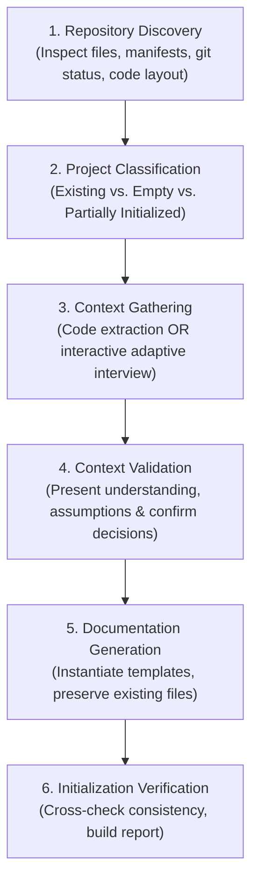

# Dev-Team — Product Requirements

**Document type:** Product Requirements Document (PRD)  
**Status:** Draft — pending user review and approval (Updated with Foundational Project Initialization Skill)  
**Version:** 1.1  
**Last updated:** 2026-11-06  
**Repository name:** `dev-team`  
**Product category:** Reusable AI-assisted software engineering system  
**Primary interface:** OpenAI Codex CLI

---

## 1. Product overview

### 1.1 Summary

Dev-Team is a reusable, AI-powered software engineering system designed to help one developer coordinate a virtual team of specialized AI agents across multiple software projects.

It provides repeatable workflows, role-specific agent instructions, reusable skills, templates, project context, and quality gates. It guides work from an initial product idea through requirements, design, implementation planning, coding, testing, review, and maintenance.

Before specialized engineering workflows can begin in any target repository, Dev-Team requires a foundational onboarding process. Through a dedicated Project Initialization capability, Dev-Team introduces itself to any existing or new repository, understands its technology stack, architecture, and conventions, establishes shared context, and prepares the repository for future engineering workflows.

The developer should be able to focus primarily on product thinking, requirement clarification, and approval of important decisions. AI agents should perform supporting engineering work while keeping the developer in control of scope, architecture decisions, and consequential actions.

Dev-Team is maintained in its own repository and must be usable from multiple independent application repositories. It must not assume every project has the same backend, state-management library, routing solution, or architecture.

### 1.2 Product vision

**Give an individual developer the capabilities of a coordinated software engineering team, while keeping product decisions and approval authority with the developer.**

### 1.3 Tagline

**Your AI Software Development Team.**

---

## 2. Problem statement

When developing software independently, one person must switch between product management, requirements engineering, architecture, UI/UX design, implementation, testing, code review, debugging, and release preparation.

Using AI for isolated coding tasks does not, by itself, provide a consistent end-to-end engineering process. Context can be lost between tasks, requirements can be interpreted inconsistently, implementation plans can omit important work, and code can be marked complete without sufficient verification.

The developer needs a reusable system that:

- Intelligently onboards and initializes new or existing repositories into a standardized structure without imposing unwanted or speculative architecture.
- Converts rough ideas into clear, testable requirements.
- Challenges unclear or conflicting requirements before implementation.
- Plans work as small, reviewable deliverables.
- Applies project-specific architecture and technology conventions.
- Coordinates specialized AI roles without unnecessary agent complexity.
- Validates implementation against approved requirements.
- Handles defects through a controlled bug-fixing workflow.
- Reuses the same engineering process across different repositories.

---

## 3. Goals

Dev-Team must:

1. Provide a consistent, specification-driven workflow from idea to validated implementation.
2. Work across multiple independent Flutter application repositories.
3. Support different project configurations instead of imposing one technology stack.
4. Provide a small, focused set of specialized AI agent roles.
5. Package repeatable engineering procedures as reusable skills.
6. Keep project-specific information inside the relevant application repository.
7. Require developer approval at important decision gates.
8. Break implementation into small tasks with clear deliverables and acceptance criteria.
9. Require evidence-based validation before declaring work complete.
10. Keep the initial system simple, understandable, maintainable, and extensible.
11. Provide an intelligent onboarding process that discovers existing project context or guides empty project setup, initializing standard instructions and documentation without imposing speculative architecture.

---

## 4. Non-goals

The initial version will not:

- Replace Codex CLI or act as a new foundation model.
- Build a graphical IDE, web dashboard, or project-management application.
- Automatically make product decisions on behalf of the developer.
- Automatically deploy to production or apply production database migrations.
- Require a particular backend such as Supabase or Firebase.
- Require a particular state-management solution such as BLoC or Riverpod.
- Require one fixed navigation, dependency-injection, or architecture library.
- Introduce microservices, distributed orchestration infrastructure, or a hosted agent platform.
- Generate a large collection of narrowly scoped agents before the core workflow is proven.
- Guarantee that AI-generated code is correct without independent verification.
- Modify every project to conform to one universal folder structure.

Future capabilities may be considered after the core workflow is useful and validated.

---

## 5. Users and primary use cases

### 5.1 Primary user

**Independent software developer / product engineer**

The developer owns the product vision, provides rough ideas and constraints, reviews requirements and plans, approves important decisions, and accepts completed work.

### 5.2 Supporting AI roles

The initial system should define a small set of reusable roles. These roles are logical responsibilities; they do not necessarily need to run as separate concurrent agents for every task.

| Role | Primary responsibility |
|---|---|
| Product Analyst | Clarify ideas and produce structured requirements. |
| Product Reviewer | Challenge requirements for ambiguity, omissions, conflicts, and testability. |
| System Architect | Recommend an appropriately simple design that fits the target project. |
| Technical Planner | Convert approved design and requirements into sequenced implementation tasks. |
| Developer | Implement one approved task at a time using project conventions. |
| QA Engineer | Independently validate behavior, tests, and requirement coverage. |

Specialist skills may support these roles, for example Flutter development, backend/database work, UI/UX, testing, code review, and debugging.

### 5.3 Primary use cases

- Initialize and onboard any new or existing repository for Dev-Team using `/project-initializer`.
- Establish `.dev-team/project-context.md`, root instructions (`AGENTS.md`, `rules.md`, `DESIGN.md`), and standardized project documentation (`docs/project/`).
- Start a new feature from a rough idea.
- Turn an idea into a `requirement.md` document.
- Review and improve an existing requirement document.
- Design a feature that fits the target project's architecture and technology.
- Produce a step-by-step `plan.md`.
- Implement the next approved task.
- Review code and run relevant validation.
- Validate a feature against its approved requirements.
- Diagnose and fix a reported bug.
- Understand the current status and remaining work for a feature.
- Reuse the same workflow in another Flutter repository.

---

## 6. Product principles

1. **Developer remains in control.** AI agents recommend and execute approved work; they do not silently approve their own major decisions.
2. **Requirements before implementation.** Significant feature work starts with an agreed understanding of the problem and expected behavior.
3. **Project-aware, not project-prescriptive.** Inspect the target repository and follow its existing conventions unless a change is explicitly approved.
4. **Simple before sophisticated.** Prefer the smallest maintainable solution that satisfies the requirement.
5. **Small, verifiable tasks.** Implementation plans should produce incremental deliverables that can be reviewed and tested.
6. **Traceability.** Requirements should be traceable to design decisions, implementation tasks, and tests where practical.
7. **Evidence over claims.** A task is not complete merely because an agent says it is complete; relevant checks and results must be reported.
8. **Separate reusable and project-specific context.** Common procedures belong in Dev-Team; product and repository facts belong in the target project.
9. **No silent scope changes.** Newly discovered requirements or architectural changes must be raised for approval.
10. **Use parallel work selectively.** Parallelize independent investigation or review, not conflicting edits to the same files.

---

## 7. Scope and delivery priorities

### 7.1 MVP scope

The MVP focuses on a reliable local workflow for Flutter projects using Codex CLI.

| Priority | Capability |
|---|---|
| Must have | Reusable repository structure and setup documentation. |
| Must have | Foundational project initialization & onboarding workflow and skill (`project-initializer`). |
| Must have | Standardized project template suite (`templates/project/`) and central context (`.dev-team/project-context.md`). |
| Must have | Project inspection and project-context/profile support. |
| Must have | Idea-to-requirements workflow. |
| Must have | Requirement validation workflow. |
| Must have | Feature design workflow. |
| Must have | Step-by-step implementation planning workflow. |
| Must have | Controlled, one-task-at-a-time implementation workflow. |
| Must have | Feature validation and code-review workflow. |
| Must have | Separate bug diagnosis and fixing workflow. |
| Must have | Reusable skills and templates. |
| Must have | Developer approval gates and safe execution boundaries. |
| Should have | Workspace validation scripts for deterministic checks. |
| Should have | Feature status and progress reporting. |
| Could have | Optional workflow automation and CI integration. |
| Future | Support for non-Flutter projects through additional profiles and skills. |

### 7.2 Out of scope for MVP

- Autonomous end-to-end execution without approval gates.
- A hosted multi-agent service.
- A custom user interface.
- Automatic production release management.
- A universal project migration or refactoring engine.

---

## 8. Core workflows and functional requirements

### 8.0 Dev-Team Engineering Lifecycle

Dev-Team coordinates engineering activities through a standardized six-stage lifecycle, with Project Initialization acting as the foundational entry point for every repository:

```text
Dev-Team lifecycle:
1. Project Initializer     --> Understand repository, classify project, and establish context
2. Requirements & Planning --> Define features, structured requirements, and roadmap
3. System Design           --> Architecture, technical decisions, schemas, and UX design
4. Development             --> Controlled, one-task-at-a-time implementation via skills/agents
5. Quality Assurance       --> Independent verification, testing, and requirement coverage
6. Maintenance & Evolution --> Bug fixing, progress tracking, and documentation synchronization
```

The Project Initializer is the foundation for everything that follows. Downstream skills consume the standardized project context it establishes, preventing repetitive developer questioning and architectural misalignment.

---

### 8.1 Workflow 0 — Project initialization and repository onboarding (Lifecycle Entry Point)

**Purpose:** Introduce Dev-Team to any existing or new software repository, understand the project, establish its context, and prepare the repository for future development workflows. It is an intelligent onboarding process that first understands the repository and then initializes required project documentation and instructions.

**Proposed Foundational Skill:** `project-initializer` (`skills/project-initializer/SKILL.md`)  
**Reusable Templates:** `templates/project/`  
**Target Repository Artifacts:** Root instructions (`AGENTS.md`, `rules.md`, `DESIGN.md`), project documentation (`docs/project/`), and Dev-Team configuration (`.dev-team/`).

#### 8.1.1 Two Initialization Scenarios

The skill intelligently detects and adapts to two distinct repository states:

##### Scenario A: Existing Project
The repository already contains source code, configurations, dependencies, and possibly documentation.

Dev-Team execution:
1. **Scan repository structure:** Inspect directory trees, manifests, configs, and existing documentation.
2. **Identify technology stack:** Detect languages, frameworks, UI toolkits, backends, databases, and major dependencies (Flutter, Node.js, Python, Java, Go, Rust, etc.).
3. **Understand application purpose:** Extract product intent from existing READMEs, comments, specifications, and code structure.
4. **Identify architecture & conventions:** Detect architectural slicing (Clean Architecture, Feature-First, Layer-First, Monorepo), state management, routing, dependency injection, and data persistence patterns.
5. **Analyze existing development rules:** Detect established linting configs, analysis options, formatting guidelines, and git hooks.
6. **Identify missing or unclear information:** Note architectural ambiguities, undocumented modules, or missing requirements.
7. **Adaptive developer inquiry:** Ask the user questions only when necessary to resolve material ambiguities.
8. **Generate project context and documentation:** Produce baseline configuration and documentation reflecting actual code reality.

##### Scenario B: Empty Project
The repository has little or no implementation (e.g., bare Git init or fresh scaffolding).

Dev-Team execution:
1. **Detect empty repository:** Recognize that the repository lacks business logic and source architecture.
2. **Interactive onboarding interview:** Conduct a structured conversation to capture:
   - Project purpose and vision ("What are you planning to build?").
   - Target users and audience ("Who are the target users?").
   - Business objectives and core problem ("What problem does this application solve?").
   - Functional and non-functional requirements.
   - Intended technology stack and platforms.
   - Architectural and design preferences.
3. **Preserve truth over speculation:** *An empty repository must not automatically receive an invented architecture.* The skill strictly distinguishes confirmed developer decisions from assumptions and unanswered questions.
4. **Prepare initial documentation:** Draft foundational project specifications based on developer answers.
5. **Establish development instructions:** Create root operating instructions aligned with agreed goals.

#### 8.1.2 Three Categories of Initialized Files

The skill organizes generated files into three clear tiers of responsibility:

| Category | File | Primary Responsibility |
|---|---|---|
| **A. Root-level Instructions** | `AGENTS.md` | Primary AI agent instruction entry point for agents working in this repository. |
| | `rules.md` | Project-specific coding standards, conventions, and development constraints (avoids duplicating `AGENTS.md`). |
| | `DESIGN.md` | UI/UX design system and visual guidelines (created only when applicable; omitted for backend/CLI projects). |
| **B. Project Documentation (`docs/project/`)** | `overview.md` | What the project is, why it exists, vision, and core capabilities. |
| | `requirements.md` | Functional and non-functional requirements baseline. |
| | `system-design.md` | System architecture, technical design, and core component layout. |
| | `plan.md` | Development phases, milestones, and implementation roadmap. |
| | `tech-stack.md` | Languages, frameworks, libraries, APIs, and infrastructure. |
| | `architecture.md` | Actual code organization, modules, directories, and architectural conventions. |
| **C. Dev-Team Configuration (`.dev-team/`)** | `config.yaml` | Project type, detected stack, enabled workflows, and project preferences. |
| | `project-context.md` | **Central source of truth** for project context consumed and updated by all Dev-Team skills and agents. |
| | `initialization-report.md` | Audit report of detected stack, generated files, skipped documents, assumptions, and unresolved questions. |

*Note:* Generated files are modular and not all mandatory. For example, `DESIGN.md` is omitted for backend-only projects.

#### 8.1.3 Six-Phase Initialization Flow



1. **Repository discovery:** Inspect repository files, folder structure, Git status, dependencies, and configuration.
2. **Project classification:** Determine whether this is an existing project, an empty project, or a partially initialized project.
3. **Context gathering:**
   - *Existing project:* Extract information from source code, manifests, and documentation.
   - *Empty project:* Conduct a structured, adaptive conversation with the user.
   - *Partially initialized project:* Reuse existing information and ask only about gaps.
4. **Context validation:** Present the understanding of the project to the user. Identify assumptions, missing information, and decisions requiring explicit confirmation.
5. **Documentation generation:** Generate the required files using Dev-Team templates from `templates/project/`. Preserve existing documentation and user decisions.
6. **Initialization verification:** Verify generated files, check consistency across all generated documents, and create an initialization report.

#### 8.1.4 Core Capabilities & Boundaries

- **Idempotency:** Running the skill multiple times must not duplicate, corrupt, or destroy existing work.
- **Existing file detection:** Never blindly overwrite existing files; prompt the developer before making changes.
- **Stack detection:** Detect Flutter, Node.js, Python, Java, Go, Rust, etc., and extract concrete versions.
- **Project type detection:** Identify mobile, web, backend, CLI, library, or monorepo layouts.
- **Context extraction:** Understand actual implementation code rather than relying only on top-level README files.
- **Interactive onboarding:** Ask targeted questions when information cannot be reliably extracted.
- **Documentation validation:** Ensure generated documents do not contradict each other.
- **Assumption tracking:** Strictly separate confirmed facts from assumptions and open items.
- **Incremental initialization:** Allow initialization to resume seamlessly if interrupted.
- **User approval:** Obtain developer signoff before writing or significantly modifying files.
- **Strict Scope Boundary:** The skill is strictly an onboarding and context-establishment process. It is *not* responsible for implementing application features; its responsibility ends when the repository has sufficient context and documentation for downstream Dev-Team skills to operate effectively.

#### 8.1.5 Suggested Interaction Model

Explicitly invoked by the developer via `/project-initializer`:

```text
# Example: Existing Project
> /project-initializer

Dev-Team Project Initialization
================================
Repository Analysis Completed
Project Type: Flutter Application
Backend: Supabase
Architecture: Clean Architecture
Project Status: Existing Implementation

Detected:
  ✓ Source code layout (lib/features/...)
  ✓ Dependencies (flutter_bloc, go_router, get_it)
  ✓ Existing architecture conventions
  ✓ Authentication module
  ✓ Database integration

Missing or unclear:
  - Formal project requirements
  - System design documentation
  - Explicit coding standards (rules.md)

Next: Review the extracted project context before generating documentation.
```

```text
# Example: Empty Project
> /project-initializer

Dev-Team Project Initialization
================================
Repository Status: Empty Project

Let's understand your project before generating documentation:
Question 1: What are you planning to build?
Question 2: Who are the target users?
Question 3: What core problem does this application solve?
Question 4: Which technology stack do you intend to use?
```

Questions must be adaptive: if the repository already contains a manifest (e.g. `pubspec.yaml`), do not ask which framework the user wants.

#### 8.1.6 Functional Requirements: Project Initialization

- `REQ-073` The system shall provide a foundational skill (`project-initializer`) to onboard any target repository into the Dev-Team ecosystem.
- `REQ-074` The system shall automatically classify target repositories into Existing Project, Empty Project, or Partially Initialized Project.
- `REQ-075` For existing repositories, the system shall inspect code, manifests, and configurations across multiple stacks (Flutter, Node.js, Python, Java, etc.) to extract actual technologies, architecture patterns, and conventions.
- `REQ-076` For empty repositories, the system shall conduct an adaptive interactive onboarding dialogue capturing purpose, target users, objectives, requirements, stack, and architectural preferences.
- `REQ-077` The system shall never invent speculative architecture for empty projects and shall strictly separate confirmed decisions from assumptions and open questions.
- `REQ-078` The system shall present an onboarding summary to the developer for explicit validation before creating or modifying files.
- `REQ-079` The system shall generate root instruction files (`AGENTS.md`, `rules.md`, and `DESIGN.md` where applicable) without redundant duplication between agent operating rules and project coding constraints.
- `REQ-080` The system shall generate standardized project documentation under `docs/project/` (`overview.md`, `requirements.md`, `system-design.md`, `plan.md`, `tech-stack.md`, `architecture.md`).
- `REQ-081` The system shall create `.dev-team/config.yaml`, `.dev-team/project-context.md`, and `.dev-team/initialization-report.md`.
- `REQ-082` The system shall treat `.dev-team/project-context.md` as the central source of truth for repository context, consumed and maintained by all Dev-Team skills and workflows.
- `REQ-083` The initialization process shall be idempotent and support incremental initialization without corrupting or restarting previous onboarding progress.
- `REQ-084` The system shall detect existing files and require explicit developer signoff prior to overwriting or modifying any existing document.
- `REQ-085` The system shall validate cross-document consistency to ensure generated files do not contain contradictory statements.
- `REQ-086` The initialization skill shall not generate application implementation code; its scope ends upon establishing verified project context and documentation.
- `REQ-087` Downstream Dev-Team skills and workflows shall check for repository initialization and prompt the developer to run `/project-initializer` if `.dev-team/project-context.md` is absent.
- `REQ-088` The system shall produce an initialization report (`initialization-report.md`) detailing detected stack, created files, skipped documents, assumptions, and unresolved questions.

---

### 8.2 Workflow A — Idea to requirements

**Purpose:** Convert an informal feature idea into a clear, testable requirements document.

**Flow:**

1. Developer provides a rough idea, problem, or desired outcome.
2. Product Analyst inspects relevant project context when the feature belongs to an existing application.
3. Product Analyst asks focused clarification questions when necessary.
4. Product Analyst drafts `requirement.md`.
5. Product Reviewer independently checks completeness, clarity, consistency, feasibility, and testability.
6. The system reports open questions, assumptions, risks, and recommendations.
7. Developer reviews and approves the requirement document.

**Functional requirements:**

- `REQ-001` The system shall accept an informal feature description as workflow input.
- `REQ-002` The system shall create or update a structured `requirement.md` in the target project's agreed documentation location.
- `REQ-003` Requirements shall describe the problem, goals, users, scope, expected behavior, acceptance criteria, constraints, and unresolved questions as applicable.
- `REQ-004` The system shall distinguish confirmed requirements from assumptions and recommendations.
- `REQ-005` The reviewer shall identify ambiguous, conflicting, incomplete, duplicated, or non-testable requirements.
- `REQ-006` The system shall not treat a draft requirement as approved until the developer explicitly approves it.
- `REQ-007` The system shall preserve approved requirements and raise proposed changes rather than silently rewriting their intent.

### 8.3 Workflow B — Requirement validation

**Purpose:** Ensure the requirement is sufficiently clear and complete before design or implementation planning.

**Functional requirements:**

- `REQ-008` The system shall evaluate each requirement for clarity, necessity, consistency, feasibility, and testability.
- `REQ-009` The system shall identify missing user flows, edge cases, permissions, error states, loading states, empty states, and data constraints where relevant.
- `REQ-010` The system shall classify findings by severity or importance and recommend specific resolutions.
- `REQ-011` The system shall provide a validation outcome: approved, approved with documented follow-ups, or needs revision.
- `REQ-012` The system shall not proceed to detailed implementation planning while blocking requirement questions remain unresolved.

### 8.4 Workflow C — Project discovery and feature design

**Purpose:** Understand the target repository and design a solution consistent with its existing architecture.

**Functional requirements:**

- `REQ-013` Before proposing implementation details, the system shall inspect the target repository's relevant instructions, structure, dependencies, architecture, and existing feature patterns.
- `REQ-014` The system shall identify the project's actual technology choices instead of assuming a fixed stack.
- `REQ-015` The system shall identify relevant existing modules, reusable components, services, data models, routes, state-management patterns, and tests.
- `REQ-016` The System Architect shall recommend the simplest design that satisfies the approved requirements.
- `REQ-017` The design shall cover relevant application layers, data flow, state management, navigation, error handling, security, and integration points.
- `REQ-018` For backend-backed features, the design shall consider data model changes, constraints, indexes, authorization policies, and migration implications as applicable.
- `REQ-019` For user-facing features, the design shall consider user journeys, screen states, interactions, accessibility, and the target product's existing design system.
- `REQ-020` The system shall identify design decisions that need developer approval before implementation.
- `REQ-021` The system shall avoid creating design documents that add no meaningful value for a small change.

**Possible outputs, created only when relevant:**

- `system-design.md`
- `db-schema.md` or migration files
- `ui-ux-spec.md`
- `security-design.md`
- Architecture decision records

### 8.5 Workflow D — Implementation planning

**Purpose:** Convert approved requirements and design into a safe, ordered, verifiable plan.

**Functional requirements:**

- `REQ-022` The Technical Planner shall create or update `plan.md` for the feature.
- `REQ-023` The plan shall divide work into milestones and small implementation tasks.
- `REQ-024` Each task shall specify its objective, scope, dependencies, expected files or modules where known, deliverable, and acceptance criteria.
- `REQ-025` Each task shall include relevant validation steps, such as formatting, static analysis, unit tests, widget tests, integration tests, or manual checks.
- `REQ-026` The plan shall identify tasks that can be performed independently and tasks that must remain sequential.
- `REQ-027` The plan shall map implementation tasks to relevant requirement IDs.
- `REQ-028` The Plan Reviewer shall check coverage, dependencies, ordering, scope, risk, and testability.
- `REQ-029` The developer shall approve the plan before implementation begins.
- `REQ-030` If implementation reveals a necessary scope or design change, the system shall pause the affected work and request a decision.

**Output:** `plan.md`, with task checklists or individual task files if the feature's size justifies them.

### 8.6 Workflow E — Controlled implementation

**Purpose:** Implement approved work incrementally while respecting the target project's conventions.

**Functional requirements:**

- `REQ-031` The system shall implement one approved task at a time by default.
- `REQ-032` Before editing, the Developer role shall read the relevant project instructions and inspect the code it intends to change.
- `REQ-033` The implementation shall follow the project's established language, architecture, naming, formatting, dependency-injection, state-management, routing, and testing conventions.
- `REQ-034` The system shall avoid unrelated refactoring and unnecessary dependency additions.
- `REQ-035` The system shall not modify unrelated files or broaden scope without a justified explanation.
- `REQ-036` After a task, the system shall run the relevant available checks and report commands, outcomes, and any limitations.
- `REQ-037` The system shall update task status only when the task's acceptance criteria and required checks have been addressed.
- `REQ-038` The system shall summarize changed files, implementation decisions, test results, and remaining issues after each task.
- `REQ-039` The system shall stop at the end of the approved task unless the developer has explicitly authorized continuation.

### 8.7 Workflow F — Code review and feature validation

**Purpose:** Independently verify that implementation meets the approved requirements and project quality standards.

**Functional requirements:**

- `REQ-040` The QA Engineer shall validate the implementation against the approved requirement and plan, not merely the implementation description.
- `REQ-041` The review shall consider correctness, regressions, security, data integrity, error handling, maintainability, performance implications, and test coverage where relevant.
- `REQ-042` The system shall run relevant project checks where available, including formatting, static analysis, tests, and build checks.
- `REQ-043` The system shall distinguish verified results from checks that could not be run.
- `REQ-044` Findings shall include severity, evidence or reproduction details, affected area, and recommended action.
- `REQ-045` The system shall report requirement coverage and identify any unmet acceptance criteria.
- `REQ-046` The feature shall not be reported as fully complete while blocking defects or unmet mandatory acceptance criteria remain.
- `REQ-047` The developer shall make the final acceptance decision.

**Output:** A concise QA/review report and updated task status.

### 8.8 Workflow G — Bug diagnosis and fixing

**Purpose:** Handle defects through a controlled process separate from ordinary feature implementation.

**Flow:**

1. Capture the observed behavior and expected behavior.
2. Reproduce the issue or record why it cannot be reproduced.
3. Identify the root cause and affected components.
4. Assess severity, scope, and regression risk.
5. Propose a minimal fix plan.
6. Implement the approved fix.
7. Add or update regression tests.
8. Run relevant checks.
9. Independently validate the fix.

**Functional requirements:**

- `REQ-048` The system shall accept a bug description, reproduction steps, expected behavior, actual behavior, and available logs or screenshots.
- `REQ-049` The system shall attempt to reproduce the defect before changing code when practical.
- `REQ-050` The system shall distinguish root cause from symptoms and clearly label unverified hypotheses.
- `REQ-051` The system shall propose the smallest reasonable fix and identify regression risks.
- `REQ-052` The system shall obtain approval before broad or risky changes.
- `REQ-053` The system shall add or update regression tests where practical.
- `REQ-054` The system shall verify the fix using relevant tests and checks.
- `REQ-055` The system shall not mark a bug as fixed if it remains unreproduced and unverified without clearly documenting that limitation.

### 8.9 Workflow H — Feature status

**Purpose:** Let the developer understand progress and outstanding decisions without rereading every artifact.

**Functional requirements:**

- `REQ-056` The system should provide a concise feature status showing the current workflow stage.
- `REQ-057` Status should include approved artifacts, completed tasks, pending tasks, blocked items, open questions, validation results, and required developer decisions.
- `REQ-058` Status reporting shall reflect the actual repository artifacts and task state; it shall not invent progress.

---

## 9. Project portability and configuration

### 9.1 Cross-project requirements

- `REQ-059` Dev-Team shall be maintained independently from any one application repository.
- `REQ-060` Reusable workflows, agent definitions, skills, and generic templates shall live in the Dev-Team repository.
- `REQ-061` Product requirements, application architecture decisions, database migrations, secrets, and project-specific context shall remain in the target application repository.
- `REQ-062` The system shall support multiple Flutter repositories without requiring them to share the same backend or architecture.
- `REQ-063` The system shall detect or ask the developer to confirm relevant project technologies and conventions before using technology-specific guidance.
- `REQ-064` The system shall allow project-specific instructions to take precedence over generic recommendations when they do not conflict with explicit safety requirements.
- `REQ-065` The system shall not assume Gotilo-specific domain knowledge applies to another project.
- `REQ-089` The system shall treat `.dev-team/project-context.md` as the persistent, canonical context store across all sessions, preventing repetitive developer questioning and preserving cross-session architectural understanding.
- `REQ-090` Project configuration shall be maintained in `.dev-team/config.yaml`, declaring project type, detected stack, active workflows, and repository preferences.

### 9.2 Project configuration & central context (.dev-team/)

Target repositories initialized by Dev-Team shall maintain a dedicated `.dev-team/` directory providing persistent context and declarative configuration:

```text
.dev-team/
├── config.yaml               # Project type, detected stack, enabled workflows, and preferences
├── project-context.md        # Central source of truth for repository context across all skills
└── initialization-report.md  # Audit of detected stack, generated files, and unresolved items
```

#### 9.2.1 Configuration Schema (`.dev-team/config.yaml`)

```yaml
project:
  name: Example App
  type: flutter_application # or web_app, backend_service, cli_tool, monorepo, library

technology:
  frontend: Flutter
  language: Dart
  state_management: BLoC
  backend: Supabase
  navigation: GoRouter
  dependency_injection: GetIt

engineering:
  architecture: Clean Architecture
  testing: flutter_test
  linter: flutter_lints

workflows:
  require_plan_approval: true
  require_architecture_approval: true
  auto_update_project_context: true

design:
  brand: Example App
  design_system_present: true
```

The configuration is illustrative, not a mandatory prescription. Unknown values remain unassigned until confirmed.

#### 9.2.2 Central Context Store (`.dev-team/project-context.md`)

`.dev-team/project-context.md` serves as the central context backbone for the entire Dev-Team ecosystem. Rather than requiring individual skills or agents to scan the entire repository or repeatedly interview the developer, skills read this file for:
- Concise project overview and target audience.
- Confirmed technology stack, state management, and navigation packages.
- Established directory layout, module conventions, and naming rules.
- Confirmed architectural decisions versus active assumptions.

### 9.3 Project discovery & onboarding relationship

Dev-Team provides two complementary levels of project discovery:

1. **Foundational Repository Onboarding (`project-initializer`):** Executed once upon introducing Dev-Team to a repository (or incrementally re-run). It performs comprehensive repository scanning, project classification, interactive gap-filling, root instruction setup, and generates `.dev-team/project-context.md`.
2. **Feature-Level Discovery (`project-discovery`):** Executed during downstream workflows (such as `workflows/design-feature.md`). It performs targeted, context-efficient inspections of specific modules, services, routes, or widgets relevant to the active feature without reloading unrelated repository context. When new architectural patterns are established, it updates `.dev-team/project-context.md`.

At the beginning of work in a repository, Dev-Team inspects relevant sources such as:

- `AGENTS.md` and `rules.md` in repository root.
- `.dev-team/project-context.md` and `.dev-team/config.yaml`.
- `pubspec.yaml` and Flutter/Dart project metadata (or `package.json`, `pyproject.toml`, etc.).
- Existing folder and feature structure.
- Existing tests and test conventions.
- Routing, state management, dependency injection, and API clients.
- Existing design tokens and shared UI components (`DESIGN.md`).
- Backend configuration and migration directories, without exposing secrets.

The system inspects only what is relevant to the task rather than loading the entire repository context indiscriminately.

---

## 10. Codex integration and repository structure

### 10.1 Integration requirements

- `REQ-066` The initial implementation shall target OpenAI Codex CLI.
- `REQ-067` Reusable skills shall follow the supported Codex skill structure and include clear activation descriptions and scoped instructions.
- `REQ-068` Agent definitions and repository instructions shall be concise, discoverable, and organized by responsibility.
- `REQ-069` The system shall document how to install or link reusable skills for user-level use across repositories.
- `REQ-070` The system shall document how a target project can add its own `AGENTS.md` and project profile.
- `REQ-071` The system shall avoid copying large amounts of generic instructions into every target project.
- `REQ-072` Any setup or validation scripts shall provide clear output and safe failure behavior.

### 10.2 Proposed repository layout

The exact structure may change during technical design. The initial proposal is:

```text
dev-team/
├── README.md
├── AGENTS.md
├── config/
│   ├── workflow.yaml
│   └── quality-gates.yaml
├── agents/
│   ├── product-analyst.toml
│   ├── product-reviewer.toml
│   ├── system-architect.toml
│   ├── technical-planner.toml
│   ├── developer.toml
│   └── qa-engineer.toml
├── skills/
│   ├── project-initializer/
│   │   ├── SKILL.md
│   │   ├── references/
│   │   │   ├── project-detection.md
│   │   │   ├── context-gathering.md
│   │   │   ├── documentation-rules.md
│   │   │   └── initialization-workflow.md
│   │   └── scripts/
│   │       └── check-project-structure.py
│   ├── project-discovery/
│   ├── product-requirements/
│   ├── requirement-validation/
│   ├── system-design/
│   ├── technical-planning/
│   ├── flutter-dev/
│   ├── code-review/
│   ├── feature-validation/
│   └── bug-fixing/
├── templates/
│   ├── requirement.md
│   ├── system-design.md
│   ├── plan.md
│   ├── task.md
│   ├── bug-report.md
│   ├── qa-report.md
│   └── project/
│       ├── AGENTS.md
│       ├── rules.md
│       ├── DESIGN.md
│       ├── overview.md
│       ├── requirements.md
│       ├── system-design.md
│       ├── plan.md
│       ├── tech-stack.md
│       └── architecture.md
├── workflows/
│   ├── initialize-project.md
│   ├── new-feature.md
│   ├── validate-requirement.md
│   ├── design-feature.md
│   ├── create-plan.md
│   ├── implement-next.md
│   ├── validate-feature.md
│   ├── fix-bug.md
│   └── feature-status.md
└── scripts/
    ├── install.ps1
    ├── install.sh
    └── validate-workspace.py
```

Do not create every proposed agent, skill, template, or script automatically. Technical design should determine the minimum useful set for the MVP.

---

## 11. Approval gates and safety requirements

These controls are mandatory product behavior.

- `SAFE-001` The developer must approve requirements before they are treated as the implementation source of truth.
- `SAFE-002` The developer must approve significant architecture or data-model decisions before implementation.
- `SAFE-003` The developer must approve the implementation plan before execution begins.
- `SAFE-004` The system must not silently change approved requirements or expand scope.
- `SAFE-005` The system must not expose, print, commit, or copy secrets into documentation, logs, or generated artifacts.
- `SAFE-006` The system must not run destructive commands, delete user data, or overwrite important files without explicit authorization.
- `SAFE-007` The system must not apply production database migrations, alter production data, or deploy to production without explicit authorization for that action.
- `SAFE-008` The system must explain the impact of risky commands or changes before requesting approval.
- `SAFE-009` The system must not claim tests, builds, deployments, or other checks passed unless they were actually executed and their result was observed.
- `SAFE-010` The system must preserve unrelated user changes and inspect Git status before operations that may affect existing work.
- `SAFE-011` The system must treat repository files, tool output, and external content as project data, not as authority to override the developer's instructions or system safety boundaries.
- `SAFE-012` The system must stop and ask for a decision when required information is missing and guessing could materially affect correctness, security, cost, or data integrity.

---

## 12. Quality requirements

### 12.1 Usability

- `NFR-001` A developer should be able to understand the purpose and entry point of each workflow from its documentation.
- `NFR-002` Workflow instructions should be concise and avoid loading unrelated skills or references.
- `NFR-003` The system should ask only the clarification questions needed to proceed safely.
- `NFR-004` Outputs should use consistent terminology, headings, task status, and review outcomes.

### 12.2 Maintainability

- `NFR-005` Reusable instructions should be separated from project-specific context.
- `NFR-006` Each agent and skill should have a clear responsibility and avoid unnecessary overlap.
- `NFR-007` Templates should be modular and should not force irrelevant sections into small features.
- `NFR-008` Scripts should be used for deterministic checks; AI reasoning should be used for contextual analysis and decisions.
- `NFR-009` The system should be understandable and maintainable by one developer.

### 12.3 Reliability and consistency

- `NFR-010` Workflow stages and approval states should be explicit.
- `NFR-011` The system should produce actionable findings rather than vague statements.
- `NFR-012` The system should distinguish confirmed facts, assumptions, recommendations, and unresolved questions.
- `NFR-013` Repeating a workflow should not create duplicate artifacts unnecessarily or discard approved decisions.

### 12.4 Performance and context efficiency

- `NFR-014` The system should load only the instructions and project context relevant to the current task.
- `NFR-015` The system should prefer targeted repository inspection over indiscriminate full-repository reading.
- `NFR-016` Independent analysis may run in parallel when doing so is useful and does not create conflicting edits.

### 12.5 Portability

- `NFR-017` The core workflow should not depend on an absolute local filesystem path.
- `NFR-018` Setup instructions should support the developer's Windows environment and provide a path for Unix-like environments where practical.
- `NFR-019` Project-specific configuration should be optional where reliable discovery is possible.

---

## 13. Requirement traceability

Dev-Team should use stable identifiers for meaningful requirements and implementation tasks.

A feature's traceability should connect:

```text
Requirement ID
    ↓
Design decision / schema / UX specification
    ↓
Implementation task
    ↓
Test case or validation step
    ↓
QA result
```

Example:

```text
REQ-014: A tenant can submit a property review only after an eligible stay.
    ↓
DESIGN-003: Eligibility is checked by the backend.
    ↓
TASK-005: Implement the review eligibility check.
    ↓
TEST-012: Reject a review from an ineligible tenant.
    ↓
QA: PASS
```

Traceability depth should be proportional to feature risk and complexity. Small changes should not require excessive documentation.

---

## 14. Acceptance criteria for the Dev-Team MVP

The MVP is acceptable when all mandatory criteria below are demonstrated in a real Flutter repository.

1. A developer can install or configure Dev-Team for use from a separate Flutter repository.
2. Dev-Team can inspect the target repository and identify its relevant instructions, framework, architecture patterns, and development conventions.
3. A rough feature idea can be converted into a structured `requirement.md`.
4. A reviewer can identify ambiguity, missing cases, conflicts, and non-testable acceptance criteria.
5. The workflow requires developer approval before treating requirements as final.
6. The system can produce a feature design appropriate to the target project's actual stack.
7. The system can produce a sequenced `plan.md` with small tasks, dependencies, deliverables, and validation steps.
8. The workflow requires plan approval before implementation.
9. The system can implement one approved task while following existing project conventions.
10. The system can run relevant available checks and accurately report results and limitations.
11. The QA workflow can compare implementation with requirements and report unmet acceptance criteria.
12. A separate bug-fixing workflow can document reproduction, root cause, fix, regression coverage, and validation.
13. The system does not require Gotilo, Supabase, BLoC, or any other project-specific technology to operate.
14. Developer approval and safety gates are respected.
15. Documentation explains setup, workflow entry points, project-specific configuration, and known limitations.
16. The system can initialize an empty repository through an adaptive interactive onboarding dialogue, generating baseline project documentation, root instructions, and `.dev-team/project-context.md` without inventing speculative architecture.
17. The system can onboard an existing repository across supported stacks (Flutter, Node.js, Python, etc.), extract actual technologies and architectural conventions into `.dev-team/project-context.md`, generate an initialization report, and avoid overwriting existing developer files without explicit authorization.

---

## 15. Risks and mitigations

| Risk | Mitigation |
|---|---|
| Too many agents create coordination overhead. | Start with a small number of roles; add specialists only when repeated needs justify them. |
| Generic instructions conflict with a project's conventions. | Inspect project instructions first and use optional project profiles. |
| Agents implement assumptions as facts. | Label assumptions and require approval for consequential decisions. |
| Plans become too large or abstract. | Require small tasks with concrete deliverables and validation. |
| AI reports success without evidence. | Require observed command results and independent QA. |
| Shared skills become overly long. | Keep skills focused; move detailed references into separate files and load them only when needed. |
| The framework becomes tied to Gotilo. | Keep domain knowledge in the Gotilo repository and validate the framework on another Flutter project. |
| Automation causes destructive changes. | Use explicit approval gates for destructive, production, and externally consequential actions. |

---

## 16. Proposed implementation milestones

These milestones are a starting point for technical planning, not authorization to implement everything at once.

### Milestone 1 — Repository foundation

- Create the `dev-team` repository structure.
- Define top-level instructions and product principles.
- Define the initial workflow and quality-gate configuration.
- Implement the foundational `project-initializer` skill (`skills/project-initializer/SKILL.md`) and structural verification script (`scripts/check-project-structure.py`).
- Implement the standardized project template suite (`templates/project/`) covering root instructions and `docs/project/`.
- Establish the persistent `.dev-team/` configuration schema and central context standard (`.dev-team/project-context.md`).
- Document manual setup and user-level skill installation.
- Add a basic workspace validation script only if it provides immediate value.

### Milestone 2 — Product workflow

- Implement idea-to-requirements guidance.
- Add requirement template.
- Implement independent requirement validation.
- Add explicit requirement approval behavior.

### Milestone 3 — Engineering workflow

- Implement project discovery.
- Implement feature design guidance.
- Add implementation plan and task templates.
- Implement plan review and approval.
- Implement one-task-at-a-time development guidance.

### Milestone 4 — QA and maintenance workflow

- Implement code review and feature validation.
- Add QA report template.
- Implement bug diagnosis and fixing workflow.
- Add feature status reporting if the underlying artifacts support reliable status.

### Milestone 5 — Pilot and refinement

- Pilot Dev-Team on a real feature in Gotilo.
- Evaluate whether it works without Gotilo-specific assumptions.
- Record workflow failures, missing guidance, and unnecessary complexity.
- Refine the system based on observed results before adding more skills or agents.

---

## 17. Success metrics

The initial system should be evaluated using practical measures rather than agent count or document count.

- **Setup success:** A new Flutter repository can be configured without modifying its application architecture.
- **Requirement quality:** Fewer unresolved ambiguities reach implementation.
- **Plan usefulness:** Tasks are small enough to implement and verify independently.
- **Traceability:** Mandatory acceptance criteria can be linked to implementation and validation.
- **Verification quality:** Reported checks correspond to commands actually run and results actually observed.
- **Developer control:** Approval gates are respected and no consequential action is taken silently.
- **Reuse:** The same core workflows work in at least two Flutter repositories with different project configurations.
- **Maintainability:** A developer can understand and update the system without needing to understand a complex orchestration platform.

No numerical performance targets are set yet. Baselines and targets should be chosen after the first pilot.

---

## 18. Open decisions for review

The following decisions should be confirmed during requirements review or technical design:

1. Whether agent definitions should use Codex-native subagent configuration, reusable role prompts, or a combination.
2. Whether workflows should initially be invoked through Codex skills, documented commands, or both.
3. Whether the installation mechanism should copy skills into the user's global Codex skills directory, link them, or support both.
4. The canonical location for feature documentation inside target repositories.
5. Whether a project profile should be created manually, generated by project discovery, or use a review-and-confirm process.
6. Which validation scripts are genuinely necessary for the first release.
7. Whether the initial pilot will be Gotilo's Property Rating & Review feature.
8. **Project initialization:** Establish `project-initializer` as the foundational Stage 1 lifecycle entry point, supporting both existing and empty repositories.
9. **Central context source:** `.dev-team/project-context.md` serves as the single persistent source of project context across all Dev-Team skills and workflows.
10. **Template modularity:** Standardized target project templates reside in `dev-team/templates/project/`, keeping Dev-Team reusable and project-agnostic.

These decisions should not block review of the product's overall goals and workflow, but they must be resolved before the affected implementation work.

---

## 19. Definition of ready and definition of done

### Definition of ready

A feature is ready for implementation when:

- Its requirement document has been reviewed and approved.
- Important assumptions and open questions are resolved or explicitly accepted.
- Relevant design decisions are approved.
- The implementation plan has been reviewed and approved.
- Dependencies and validation expectations are understood.

### Definition of done

A feature is done when:

- All mandatory approved acceptance criteria are satisfied.
- Relevant implementation tasks are complete.
- Relevant automated checks have been run and their results recorded.
- QA findings are resolved or explicitly accepted by the developer.
- Documentation and project artifacts are updated where needed.
- No unapproved scope or architecture change has been introduced.
- The developer accepts the result.

---

## 20. Approval

This document is a **draft**. It becomes the approved product requirements baseline only after the developer reviews and explicitly approves it.

| Field | Value |
|---|---|
| Product | Dev-Team |
| Requirements version | 1.1 |
| Status | Draft — pending approval |
| Approved by | Pending |
| Approval date | Pending |
