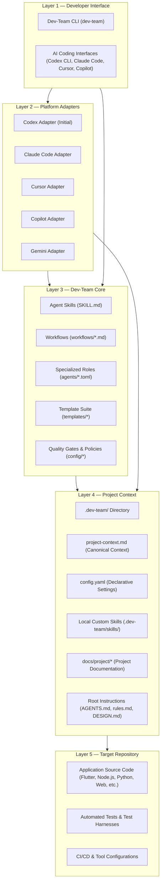
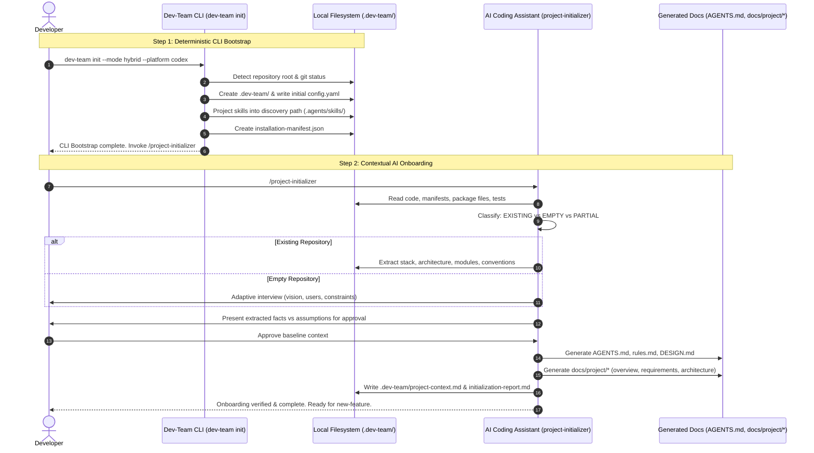

# Dev-Team — System Design

**Document type:** System Design Document (SDD)  
**Product:** Dev-Team  
**Repository:** `dev-team`  
**Version:** 1.1  
**Status:** Proposed Update (Approved Architecture Baseline v1.1)  
**Last updated:** 2026-11-06  
**Primary execution environments:** Dedicated Dev-Team CLI, Agent Skills (`SKILL.md`), and Platform Adapters (Initial integration: OpenAI Codex CLI)

---

# 1. Introduction

## 1.1 Purpose

This document defines the technical architecture, component boundaries, and execution models of Dev-Team.

Dev-Team is a cross-platform, reusable AI-assisted software engineering toolkit. It enables an individual software developer to coordinate a virtual team of specialized AI agents across multiple independent software projects using a dedicated CLI, standardized skills, and modular platform adapters.

The architecture satisfies two foundational design decisions:
1. **Hybrid distribution:** Dev-Team skills can be installed globally and reused across repositories, while each repository maintains its own project context, declarative configuration, and optional local skills.
2. **CLI-first installation:** A dedicated Dev-Team CLI (`dev-team`) manages installation, initialization, updates, and diagnostics deterministically without requiring an LLM dependency.

Dev-Team remains strictly **independent of any specific AI coding platform**. While OpenAI Codex CLI serves as the initial reference integration, platform adapters isolate platform-specific mechanics from the core engineering knowledge.

## 1.2 Core Architectural Principles

1. **Platform-Independent Core:** Reusable development workflows and skills must not depend on any single AI coding platform.
2. **Hybrid Distribution:** Centrally maintain reusable skills while isolating project-specific context and configuration inside the target repository.
3. **Adapter-Based Integration:** Platform-specific discovery directories, instruction formats, and tool integration are encapsulated in modular adapters.
4. **CLI-Managed Lifecycle:** Installation, updates, synchronization, and diagnostics are deterministic CLI operations.
5. **Source-of-Truth Separation:** Generated platform files (e.g. projections in `.agents/skills/` or `AGENTS.md`) are transient projections; central Dev-Team assets and `.dev-team/project-context.md` remain authoritative.
6. **Non-Destructive Operation:** Existing project files, custom skills, and user modifications are strictly preserved and never silently overwritten.
7. **Project-Aware Execution:** AI workflows inspect the actual target repository before recommending or implementing solutions.
8. **Smallest Useful Solution First:** Deliver clean, maintainable solutions without unnecessary abstractions or complex multi-agent message routing.

---

# 2. Five-Layer System Architecture

Dev-Team is organized into five decoupled architectural layers:



### Layer Responsibilities

| Layer | Component | Primary Responsibility |
|---|---|---|
| **Layer 1: Developer Interface** | `dev-team` CLI & AI Shells | Entry point for developer commands, installation, lifecycle tasks, and AI interaction. |
| **Layer 2: Platform Adapters** | Platform Adapters (`adapters/`) | Translate platform-independent Dev-Team skills and instructions into platform-specific discovery paths and capabilities. |
| **Layer 3: Dev-Team Core** | Core Skills, Workflows, Agents | Reusable software engineering knowledge, role specifications, templates, and quality gates packaged as Agent Skills (`SKILL.md`). |
| **Layer 4: Project Context** | Target `.dev-team/` & Root Docs | Repository-specific instructions, architectural decisions, confirmed facts, active assumptions, and local skill specializations. |
| **Layer 5: Target Repository** | Application Codebase | The actual software application being designed, implemented, tested, and maintained. |

> **Architectural Separation:** The CLI handles deterministic filesystem and configuration tasks. AI skills handle contextual reasoning, repository discovery, requirements engineering, and coding. The CLI never pretends to understand code semantics through simplistic heuristic parsing.

---

# 3. Repository Architecture

The canonical `dev-team` repository is organized as follows:

```text
dev-team/
│
├── cli/                                # Dedicated Dev-Team CLI
│   ├── src/
│   │   ├── commands/                   # Command handlers
│   │   │   ├── init.py                 # Repository bootstrap
│   │   │   ├── install.py              # Skill installation (global/local)
│   │   │   ├── update.py               # Managed updates
│   │   │   ├── doctor.py               # Diagnostics & verification
│   │   │   ├── uninstall.py            # Clean artifact removal
│   │   │   ├── list.py                 # Skill & platform catalog
│   │   │   └── status.py               # Installation state
│   │   ├── core/                       # Manifest, hashing, resolution logic
│   │   ├── installation/               # Linking, copying, symlinks, junctions
│   │   ├── detection/                  # Stack & platform detection
│   │   └── reporting/                  # Terminal summaries and logs
│   └── tests/                          # CLI unit and integration tests
│
├── skills/                             # Canonical Agent Skills (SKILL.md)
│   ├── project-initializer/            # Foundational AI onboarding
│   │   ├── SKILL.md
│   │   ├── references/
│   │   └── scripts/
│   ├── project-discovery/              # Feature-level context inspection
│   ├── product-requirements/           # Idea-to-requirements workflow
│   ├── requirement-validation/         # Independent criteria audit
│   ├── system-design/                  # Technical architecture & schemas
│   ├── technical-planning/             # Granular task slicing
│   ├── flutter-development/            # Controlled implementation
│   ├── code-review/                    # Static code inspection
│   ├── feature-validation/             # QA requirement coverage
│   └── bug-fixing/                     # Defect reproduction and fix
│
├── agents/                             # Declarative role specifications
│   ├── product-analyst.toml
│   ├── product-reviewer.toml
│   ├── system-architect.toml
│   ├── technical-planner.toml
│   ├── developer.toml
│   └── qa-engineer.toml
│
├── workflows/                          # Standard operating procedures
│   ├── initialize-project.md
│   ├── new-feature.md
│   ├── validate-requirement.md
│   ├── design-feature.md
│   ├── create-plan.md
│   ├── implement-next.md
│   ├── validate-feature.md
│   ├── fix-bug.md
│   └── feature-status.md
│
├── templates/                          # Standardized artifact formats
│   ├── requirement.md
│   ├── system-design.md
│   ├── plan.md
│   ├── task.md
│   ├── qa-report.md
│   ├── bug-report.md
│   └── project/                        # Scaffolding templates for target repos
│       ├── AGENTS.md
│       ├── rules.md
│       ├── DESIGN.md
│       ├── config.yaml
│       ├── project-context.md
│       └── docs/
│           ├── overview.md
│           ├── requirements.md
│           ├── system-design.md
│           ├── plan.md
│           ├── tech-stack.md
│           └── architecture.md
│
├── adapters/                           # Modular platform adapters
│   ├── codex/                          # OpenAI Codex CLI adapter (Reference)
│   │   ├── manifest.yaml
│   │   └── adapter.py
│   ├── claude-code/                    # Anthropic Claude Code adapter
│   │   ├── manifest.yaml
│   │   └── adapter.py
│   ├── cursor/                         # Cursor adapter
│   │   ├── manifest.yaml
│   │   └── adapter.py
│   ├── copilot/                        # GitHub Copilot adapter
│   │   ├── manifest.yaml
│   │   └── adapter.py
│   └── gemini/                         # Google Antigravity / Gemini CLI adapter
│       ├── manifest.yaml
│       └── adapter.py
│
├── schemas/                            # JSON schemas for declarative contracts
│   ├── project-config.schema.json      # .dev-team/config.yaml schema
│   ├── adapter-manifest.schema.json    # Adapter capability manifest schema
│   └── installation-manifest.schema.json # Manifest tracking installed files
│
├── config/                             # Framework execution defaults
│   ├── workflow.yaml                   # Workflow registry
│   ├── quality-gates.yaml              # Gate prerequisites
│   └── defaults.yaml                   # Default paths and status values
│
├── docs/                               # Developer documentation
│   ├── architecture.md                 # System architecture overview
│   ├── installation.md                 # Installation & CLI guide
│   ├── platform-compatibility.md       # Platform adapters & discovery paths
│   ├── workflows.md                    # Operational manual for workflows
│   ├── contribution-guide.md           # Guide for extending agents & skills
│   └── project/                        # Dev-Team's own project artifacts
│       ├── requirements.md             # Dev-Team Product Requirements (PRD)
│       ├── system-design.md            # Dev-Team System Design (SDD)
│       └── plan.md                     # Dev-Team Implementation Plan
│
├── README.md
├── AGENTS.md
└── LICENSE
```

---

# 4. Hybrid Distribution Model

Dev-Team operates across two authoritative storage domains: **Global Storage** and **Project Storage**.

```text
┌────────────────────────────────────────────────────────────────────────┐
│                        User Home (~/.dev-team/)                        │
│  Central Dev-Team Assets:                                              │
│  ├── manifest.json       (Installed version & provenance registry)     │
│  ├── version             (Current release tag, e.g. 1.1.0)             │
│  ├── skills/             (Canonical Agent Skills: SKILL.md)            │
│  ├── templates/          (Standardized project & feature templates)    │
│  ├── adapters/           (Platform adapter definitions)                │
│  └── config.yaml         (Global defaults & preferred platforms)       │
└────────────────────────────────────┬───────────────────────────────────┘
                                     │
                 Projections via CLI │ and Platform Adapters
                                     ▼
┌────────────────────────────────────────────────────────────────────────┐
│                     Target Project Repository                          │
│                                                                        │
│  ├── .dev-team/                     <-- AUTHORITATIVE PROJECT CONTEXT  │
│  │   ├── config.yaml                (Project-specific settings)        │
│  │   ├── project-context.md         (Confirmed facts & assumptions)    │
│  │   ├── initialization-report.md   (Onboarding audit log)             │
│  │   ├── skills/                    (Optional local custom skills)     │
│  │   └── features/<feature>/        (Feature requirements, plans, QA)  │
│  │                                                                     │
│  ├── .agents/skills/ or ~/.codex/skills/  <-- PROJECTION (NON-AUTH)    │
│  │   └── [links or copies to canonical skills]                         │
│  │                                                                     │
│  ├── AGENTS.md                      <-- ROOT INSTRUCTION ENTRY POINT   │
│  ├── rules.md                       <-- LOCAL CODING STANDARDS         │
│  └── docs/project/                  <-- BASELINE PROJECT SPECIFICATION │
└────────────────────────────────────────────────────────────────────────┘
```

### 4.1 Global Installation Responsibilities (`~/.dev-team/`)
- Store centrally installed, reusable Dev-Team assets.
- Maintain installed release version and SHA-256 provenance hashes.
- Expose skills to supported AI coding platforms through user-level discovery locations.
- **Strict Boundary:** Never store repository-specific facts, code, or context in global storage.

### 4.2 Project-Level Installation Responsibilities (`.dev-team/`)
- Store target repository configuration, stack choices, and conventions.
- Maintain `.dev-team/project-context.md` as the canonical source of truth for the project.
- Host project-local custom skills (`.dev-team/skills/`) that extend or specialize global workflows.
- Store feature documentation and QA reports (`.dev-team/features/<feature>/`).
- **Strict Boundary:** Generated platform directories (e.g. `.agents/skills/` or `.codex/skills/`) are projections; they are never treated as the authoritative source of reusable skills.

---

# 5. Installation Modes & CLI Architecture

## 5.1 Installation Modes

The CLI supports three deterministic execution modes:

### Mode 1: Global Mode
```bash
dev-team install --global [--platform codex]
```
- Installs canonical skills, templates, and adapters to `~/.dev-team/`.
- Configures user-level platform discovery paths (e.g. `~/.codex/skills/` for OpenAI Codex).
- Makes Dev-Team capabilities globally available across all current and future projects.

### Mode 2: Project Mode
```bash
dev-team init [--platform codex]
```
- Scans current workspace directory.
- Creates `.dev-team/config.yaml` and `.dev-team/` directory structure.
- Installs or links required skills into project-specific discovery paths.
- Prepares repository for subsequent execution of the `project-initializer` AI skill.

### Mode 3: Hybrid Mode (Recommended Default)
```bash
dev-team init --mode hybrid
```
- Validates presence of global skills in `~/.dev-team/skills/`.
- Configures the target repository to consume global skills directly (via symlinks or platform discovery).
- Initializes `.dev-team/` for local configuration, project context, and custom skills.
- Eliminates redundant file duplication while guaranteeing clean project isolation.

## 5.2 CLI Command Specifications

The CLI consists of modular, single-responsibility command handlers:

| Command | Syntax | Primary Responsibility |
|---|---|---|
| `init` | `dev-team init [--platform <name>] [--mode <hybrid\|copy\|symlink>]` | Initializes Dev-Team in current repository; sets up `.dev-team/`. |
| `install` | `dev-team install [--global] [--skill <name>] [--platform <name>]` | Installs reusable skills globally or into a designated directory. |
| `update` | `dev-team update [--global\|--project] [--check]` | Updates installed skills from central source; preserves local edits. |
| `doctor` | `dev-team doctor [--verbose]` | Diagnoses installation health, platform discovery paths, and dependencies. |
| `uninstall` | `dev-team uninstall [--global\|--project] [--purge]` | Safely removes Dev-Team artifacts while preserving unrelated files. |
| `list` | `dev-team list [--skills\|--platforms\|--local]` | Displays installed skills, active platforms, and version states. |
| `status` | `dev-team status` | Displays target repository configuration and initialization state. |

---

# 6. Platform Adapter Architecture

Platform adapters isolate the differences between AI coding platforms.

## 6.1 Adapter Responsibilities & Contract

Each adapter must satisfy a standard interface contract:
1. **Platform Identification:** Declare unique platform ID, display name, and supported versions.
2. **Skill Discovery Mapping:** Define global and repository-level skill discovery directory paths.
3. **Instruction Integration:** Define the root instruction file name and format (e.g. `AGENTS.md`, `CLAUDE.md`, `.cursorrules`).
4. **Skill Installation & Projection:** Safely project Agent Skills (`SKILL.md`) into platform-native structures.
5. **Capability Detection:** Identify whether the platform supports agent skills, project instructions, subagents, or tool execution.
6. **Health Verification:** Validate that the platform can discover installed skills and read project instructions.

## 6.2 Adapter Manifest Schema (`adapter-manifest.schema.json`)

Each adapter provides a declarative manifest:

```yaml
# adapters/codex/manifest.yaml
id: codex
name: OpenAI Codex CLI
version: 1.0.0
capabilities:
  agent_skills: true
  project_instructions: true
  global_skills: true
  project_skills: true
  subagents: true
  tool_execution: true

locations:
  global_skills_dir:
    windows: "$USERPROFILE/.codex/skills"
    unix: "~/.codex/skills"
  project_skills_dir: ".agents/skills"
  fallback_project_skills_dir: ".codex/skills"
  project_instructions: "AGENTS.md"

linking:
  preferred_strategy: "symlink"
  windows_fallback: "junction"
  safe_fallback: "copy"
```

```yaml
# adapters/claude-code/manifest.yaml
id: claude-code
name: Anthropic Claude Code
version: 1.0.0
capabilities:
  agent_skills: true
  project_instructions: true
  global_skills: true
  project_skills: true
  subagents: false
  tool_execution: true

locations:
  global_skills_dir:
    windows: "$APPDATA/claude/skills"
    unix: "~/.claude/skills"
  project_skills_dir: ".claude/skills"
  project_instructions: "CLAUDE.md"
```

> **Isolation Guarantee:** Platform adapters never modify the internal markdown content of canonical skills in `skills/`. If a platform requires specific wrapper metadata, the adapter creates a projection layer outside the canonical source.

---

# 7. Skill Resolution & Precedence

When an AI agent or workflow seeks a procedural skill, Dev-Team resolves skills in a strict priority order:

```text
Priority 1: Project-Local Custom Skills
            Location: <project-root>/.dev-team/skills/<skill-name>/SKILL.md
            (Allows repositories to specialize workflows or add domain skills)
                                   │
                                   ▼
Priority 2: Globally Installed Dev-Team Skills
            Location: ~/.dev-team/skills/<skill-name>/SKILL.md
            (Canonical shared workflows: requirements, architecture, planning, QA)
                                   │
                                   ▼
Priority 3: Platform Discovery Locations
            Location: <platform-specific-discovery>/<skill-name>/SKILL.md
            (System-level or platform-bundled default skills)
```

### Safety Boundary on Overrides
While project-local skills may specialize engineering behaviors (such as framework-specific linting or deployment procedures), **they must never disable or bypass system safety boundaries (`SAFE-001` through `SAFE-012`)**.

---

# 8. Project Initialization Architecture

Dev-Team decouples repository initialization into two distinct steps to prevent conflating deterministic filesystem operations with AI reasoning:



### Step 1: Deterministic CLI Bootstrap (`dev-team init`)
- **Execution:** Fast, deterministic command in Python/Node.
- **Responsibilities:**
  1. Detect workspace root and verify git repository status.
  2. Select active platform adapter (e.g. `codex`).
  3. Create `.dev-team/` directory.
  4. Write initial `.dev-team/config.yaml` with pending initialization status.
  5. Link or copy skills into platform discovery paths.
  6. Record created artifacts in `.dev-team/installation-manifest.json`.
  7. Print clear summary prompting developer to run `/project-initializer`.

### Step 2: Contextual AI Onboarding (`project-initializer` Skill)
- **Execution:** Invoked by developer in the AI platform shell (`/project-initializer`).
- **Responsibilities:**
  1. **Repository Discovery:** Inspect actual files, dependencies, manifests (`pubspec.yaml`, `package.json`, `pyproject.toml`, etc.), and existing architecture.
  2. **Project Classification:** Categorize as `EXISTING`, `EMPTY`, or `PARTIAL`.
  3. **Context Gathering:** Extract implementation reality (for existing code) or conduct an adaptive interview (for empty projects).
  4. **Fact Separation:** Distinguish `CONFIRMED_FACTS` from `ACTIVE_ASSUMPTIONS` and unresolved questions.
  5. **Scaffold Documentation:** Instantiate templates from `templates/project/` into `AGENTS.md`, `rules.md`, `DESIGN.md`, and `docs/project/`.
  6. **Canonical Context Store:** Generate `.dev-team/project-context.md`.
  7. **Audit Report:** Generate `.dev-team/initialization-report.md`.
  8. **Update Config:** Mark `initialization.status: completed` in `.dev-team/config.yaml`.

---

# 9. Installation Safety, Ownership & Provenance

Every file managed by Dev-Team is tracked with explicit ownership metadata in an installation manifest (`installation-manifest.json`):

```json
{
  "dev_team_version": "1.1.0",
  "installation_mode": "hybrid",
  "platform": "codex",
  "installed_at": "2026-11-06T12:00:00Z",
  "artifacts": [
    {
      "path": ".agents/skills/project-initializer",
      "type": "skill_projection",
      "strategy": "symlink",
      "source": "~/.dev-team/skills/project-initializer",
      "source_hash": "e3b0c44298fc1c149afbf4c8996fb92427ae41e4649b934ca495991b7852b855",
      "managed_by_dev_team": true,
      "user_modified": false
    },
    {
      "path": ".dev-team/config.yaml",
      "type": "configuration",
      "strategy": "managed_file",
      "managed_by_dev_team": true,
      "user_modified": false
    }
  ]
}
```

### Safety Rules for File Operations
1. **Never Silently Overwrite:** Before modifying any existing file, compare its hash against `source_hash`. If modified, halt and request developer approval.
2. **Safe Fallback for Links:** When creating skill projections on Windows, attempt NTFS Symbolic Links first; if unprivileged, fall back to NTFS Directory Junctions; if unsupported, fall back to safe copy mode.
3. **Clean Uninstallation:** `dev-team uninstall` deletes *only* files explicitly recorded in `installation-manifest.json` with `managed_by_dev_team: true`. User-created files and unmanaged source code are untouched.
4. **No Secret Ingestion:** The manifest and configuration schemas strictly forbid storing credentials, tokens, or private environment variables.

---

# 10. Configuration & Context Models

## 10.1 Declarative Project Configuration (`.dev-team/config.yaml`)

```yaml
version: 1

project:
  name: "Gotilo"
  type: "flutter_application" # flutter_application, node_backend, python_service, web_app, etc.

technology:
  primary_language: "dart"
  framework: "flutter"
  state_management: "bloc"
  backend: "supabase"
  navigation: "go_router"
  dependency_injection: "get_it"

distribution:
  mode: "hybrid" # hybrid, copy, symlink

skills:
  source: "global"
  enabled:
    - project-initializer
    - product-requirements
    - requirement-validation
    - project-discovery
    - system-design
    - technical-planning
    - flutter-development
    - code-review
    - feature-validation
    - bug-fixing

platforms:
  enabled:
    - codex

initialization:
  status: "completed" # pending, in_progress, completed
  initialized_at: "2026-11-06T12:30:00Z"
  version: "1.1.0"
```

## 10.2 Central Context Store (`.dev-team/project-context.md`)

```markdown
# Project Context: Gotilo

**Project Type:** Flutter Application (Mobile & Web)  
**Status:** In Active Development  
**Last Synchronized:** 2026-11-06  

## 1. Confirmed Architecture & Stack (CONFIRMED_FACTS)
- **Framework:** Flutter 3.x / Dart 3.x
- **Architecture:** Feature-First Clean Architecture (`lib/features/<feature>/presentation|domain|data`)
- **State Management:** BLoC / Cubit (`flutter_bloc`)
- **Routing:** Declarative routing via `go_router`
- **Backend:** Supabase Auth and Database
- **Dependency Injection:** `get_it` service locator

## 2. Directory Conventions
- `lib/core/`: Shared widgets, network clients, constants, utilities.
- `lib/features/`: Feature modules. Each feature contains `data/`, `domain/`, `presentation/`.
- `test/unit/`: Pure business logic and repository unit tests.
- `test/widget/`: UI component and screen tests.

## 3. Active Assumptions (ACTIVE_ASSUMPTIONS)
- ASSUMP-001: Offline-first caching will use Hive (pending final review in Feature #4).

## 4. Open Architectural Questions (OPEN_QUESTIONS)
- None currently blocking.
```

---

# 11. Architectural Decision Records (ADRs)

| ADR ID | Title | Status | Summary |
|---|---|---|---|
| **ADR-001** | Codex CLI as Primary Host | Approved | Select OpenAI Codex CLI as the initial reference integration. |
| **ADR-002** | Modular TOML for Roles | Approved | Use TOML for lightweight agent specifications in `agents/`. |
| **ADR-003** | Agent Skills Format (`SKILL.md`) | Approved | Standardize core skills on the open `SKILL.md` specification with YAML frontmatter. |
| **ADR-004** | Declarative Quality Gates | Approved | Centralize quality rules in `config/quality-gates.yaml`. |
| **ADR-005** | Separation of System vs Project Logic | Approved | Keep `dev-team` project-agnostic; discover target conventions dynamically. |
| **ADR-006** | Single Task Execution Limit | Approved | Execute one approved task per session by default to maintain human control. |
| **ADR-007** | Mandatory Bug Reproduction | Approved | Require reproducible test case before modifying code for defects. |
| **ADR-008** | Zero-Hallucination Progress Reporting | Approved | Derive progress strictly from on-disk artifact statuses. |
| **ADR-009** | Central Context Store (`project-context.md`) | Approved | Maintain `.dev-team/project-context.md` as persistent repository context. |
| **ADR-010** | Deterministic Workspace Validation | Approved | Use deterministic Python scripts for structural checks. |
| **ADR-015** | Project Initializer Skill | Approved | Foundational AI onboarding skill for existing, empty, and partial repositories. |
| **ADR-016** | Hybrid Distribution Model | Approved (v1.1) | Centralize global skills in `~/.dev-team/` while isolating target context in `.dev-team/`. |
| **ADR-017** | Dedicated Dev-Team CLI | Approved (v1.1) | Provide `dev-team` CLI for installation, initialization, updates, and diagnostics. |
| **ADR-018** | Adapter-Based Platform Integration | Approved (v1.1) | Isolate platform-specific discovery and instructions via modular adapters. |
| **ADR-019** | Separation of CLI Bootstrap and AI Initializer | Approved (v1.1) | CLI handles filesystem setup; AI skill handles contextual analysis and document generation. |
| **ADR-020** | Non-Destructive Update Protocol | Approved (v1.1) | Hash-tracked manifests guarantee local project modifications are never silently overwritten. |

---

# 12. Verification & Architectural Acceptance Criteria

The architecture is validated when:
1. `dev-team install --global` installs reusable skills and templates into `~/.dev-team/`.
2. A target repository initialized via `dev-team init` creates `.dev-team/` without altering source code.
3. Two independent application repositories concurrently reuse the global installation without cross-contamination.
4. Codex CLI successfully discovers and executes skills through the Codex platform adapter.
5. Project-local skills in `.dev-team/skills/` cleanly take precedence over global skills.
6. The `project-initializer` skill successfully onboards both existing repositories and empty repositories.
7. `dev-team update` upgrades global skills while preserving local modifications.
8. `dev-team doctor` accurately reports filesystem integrity, discovery paths, and platform readiness.
