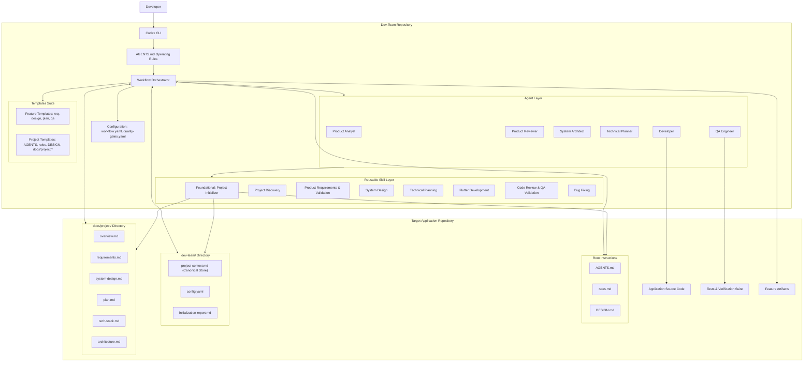
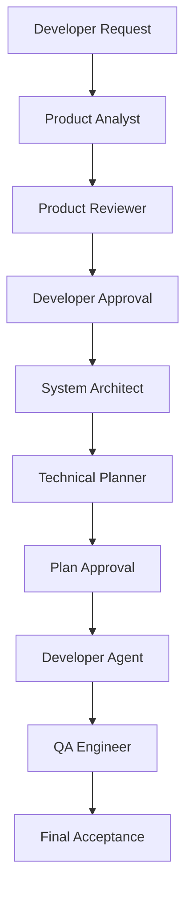
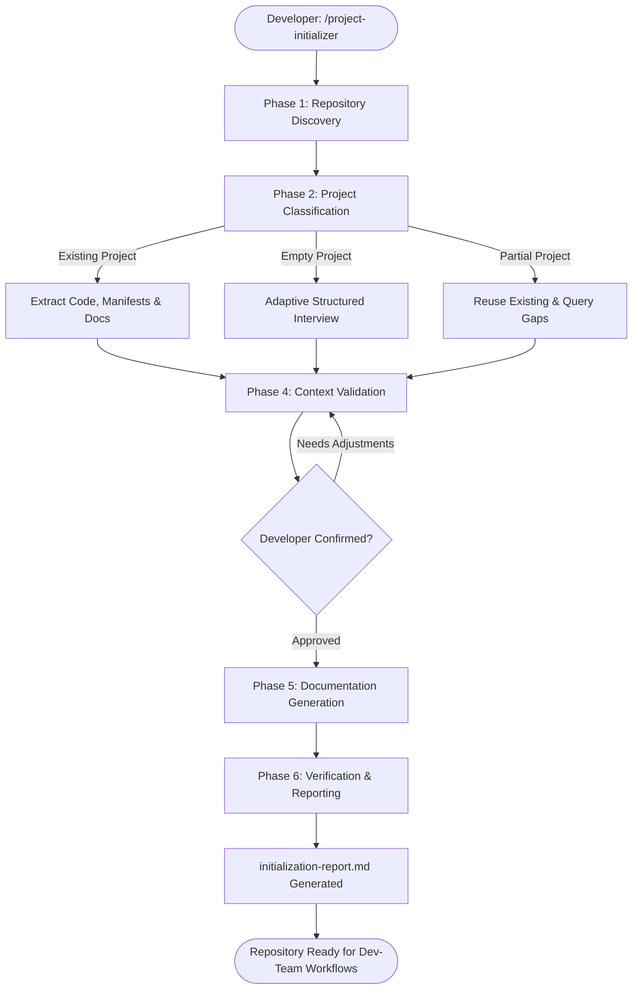
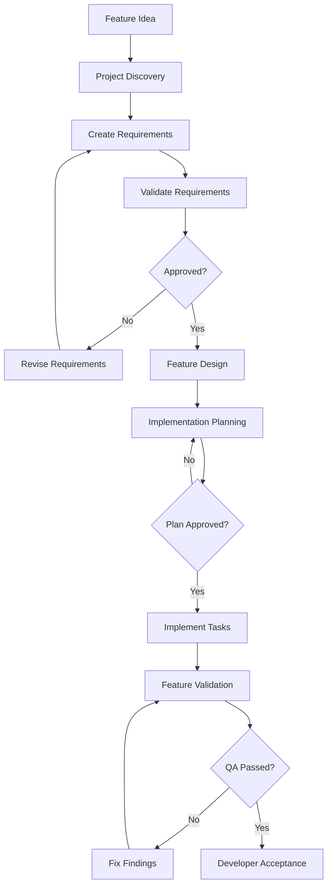

# Dev-Team — System Design

**Document type:** System Design Document (SDD)  
**Product:** Dev-Team  
**Repository:** `dev-team`  
**Version:** 1.1  
**Status:** Proposed — pending technical design approval (Updated with Foundational Project Initialization Architecture)  
**Last updated:** 2026-11-06  
**Primary execution environment:** OpenAI Codex CLI

---

# 1. Introduction

## 1.1 Purpose

This document defines the technical architecture and internal organization of Dev-Team.

It describes how reusable AI agents, skills, workflows, templates, configurations, and project-specific context work together to provide a consistent software engineering process across multiple independent repositories.

The architecture must remain:

- Modular and extensible.
- Independent of individual application repositories.
- Compatible with different technology stacks.
- Simple enough to maintain by one developer.
- Safe, predictable, and approval-driven.

## 1.2 Architectural vision

Dev-Team will use a **modular, skill-driven AI engineering architecture**.

Before specialized engineering workflows can begin in any target repository, Dev-Team establishes repository context via a standardized onboarding and initialization architecture. Through the foundational `project-initializer` skill, Dev-Team introduces itself to any existing or new repository, understands its technology stack, architecture, and conventions, establishes shared context in `.dev-team/project-context.md`, and prepares the repository for future engineering workflows.

The system will have one primary orchestration layer responsible for understanding the developer's request, selecting the appropriate workflow, coordinating specialized responsibilities, and enforcing approval gates.

Specialized agents will handle distinct engineering responsibilities, while reusable skills will provide the actual procedural knowledge required to complete those responsibilities.

The target architecture is:

- **Codex CLI:** Execution environment.
- **AGENTS.md:** Repository-level operating instructions.
- **Agents:** Specialized engineering roles.
- **Skills:** Reusable engineering procedures and domain expertise (anchored by foundational onboarding).
- **Workflows:** End-to-end process definitions governing complete lifecycles.
- **Templates:** Standardized engineering artifacts and project documentation suites.
- **Configuration:** Workflow, quality-gate, and project-level settings.
- **Project context:** Centralized repository context (`.dev-team/project-context.md`) discovered or gathered from the target project.

## 1.3 Design principles

1. Separation of reusable system logic and application-specific knowledge.
2. Skills over excessive agent specialization.
3. Workflow-driven execution instead of arbitrary agent communication.
4. Explicit approval before consequential decisions.
5. One implementation task at a time by default.
6. Independent QA and evidence-based completion.
7. Configuration and discovery instead of hardcoded technology assumptions.
8. Progressive complexity: introduce advanced orchestration only when necessary.

---

# 2. High-level architecture

## 2.1 Architecture overview

Dev-Team consists of six primary architectural layers coordinated across a standardized six-stage engineering lifecycle.

### 2.1.1 Engineering Lifecycle Architecture

```text
Dev-Team Lifecycle Architecture:
Stage 1: Project Initializer     --> Understand repository, classify project, establish persistent context
Stage 2: Requirements & Planning --> Define features, structured requirements, and roadmap
Stage 3: System Design           --> Architecture, technical decisions, schemas, and UX design
Stage 4: Development             --> Controlled, one-task-at-a-time implementation via skills/agents
Stage 5: Quality Assurance       --> Independent verification, testing, and requirement coverage
Stage 6: Maintenance & Evolution --> Bug fixing, progress tracking, and documentation synchronization
```

### 2.1.2 Architectural Layers

| Layer | Responsibility |
|---|---|
| Interface Layer | Accept developer requests through Codex CLI. |
| Orchestration Layer | Understand requests, select workflows, enforce approval gates, and coordinate execution. |
| Agent Layer | Provide specialized engineering roles (Product Analyst, Reviewer, Architect, Planner, Developer, QA). |
| Skill Layer | Provide reusable procedures and technical expertise, anchored by the foundational `project-initializer`. |
| Artifact Layer | Store standardized project documentation, root instructions, feature specs, plans, and QA reports. |
| Project Context Layer | Maintain persistent target context (`.dev-team/project-context.md`) and configuration (`config.yaml`). |

## 2.2 System architecture diagram



The diagram represents logical responsibilities. It does not require every agent to run as a separate process.

## 2.3 Architectural approach

Dev-Team will follow a modular architecture rather than a distributed multi-agent architecture.

The primary Codex session acts as the orchestrator.

It determines:

- What the developer wants to accomplish.
- Which workflow is appropriate.
- Which project context is required.
- Which specialized responsibilities are needed.
- Which skills should be loaded.
- Whether approval is required.
- Whether the workflow can proceed to its next stage.

Specialized agents may be invoked when independent reasoning or review is valuable.

This avoids unnecessary agent communication, duplicated context, and conflicting file modifications.

---

# 3. Repository architecture

## 3.1 Proposed repository structure

```text
dev-team/
│
├── README.md
├── AGENTS.md
├── LICENSE
│
├── config/
│   ├── workflow.yaml
│   ├── quality-gates.yaml
│   └── defaults.yaml
│
├── agents/
│   ├── product-analyst.toml
│   ├── product-reviewer.toml
│   ├── system-architect.toml
│   ├── technical-planner.toml
│   ├── developer.toml
│   └── qa-engineer.toml
│
├── skills/
│   ├── project-initializer/
│   │   ├── SKILL.md
│   │   ├── references/
│   │   │   ├── project-detection.md
│   │   │   ├── context-gathering.md
│   │   │   ├── documentation-rules.md
│   │   │   └── initialization-workflow.md
│   │   └── scripts/
│   │       └── check-project-structure.py
│   │
│   ├── product-requirements/
│   │   └── SKILL.md
│   │
│   ├── requirement-validation/
│   │   └── SKILL.md
│   │
│   ├── project-discovery/
│   │   └── SKILL.md
│   │
│   ├── system-design/
│   │   └── SKILL.md
│   │
│   ├── technical-planning/
│   │   └── SKILL.md
│   │
│   ├── flutter-development/
│   │   └── SKILL.md
│   │
│   ├── code-review/
│   │   └── SKILL.md
│   │
│   ├── feature-validation/
│   │   └── SKILL.md
│   │
│   └── bug-fixing/
│       └── SKILL.md
│
├── workflows/
│   ├── initialize-project.md
│   ├── new-feature.md
│   ├── validate-requirement.md
│   ├── design-feature.md
│   ├── create-plan.md
│   ├── implement-next.md
│   ├── validate-feature.md
│   ├── fix-bug.md
│   └── feature-status.md
│
├── templates/
│   ├── requirement.md
│   ├── system-design.md
│   ├── plan.md
│   ├── task.md
│   ├── bug-report.md
│   ├── qa-report.md
│   └── project/
│       ├── AGENTS.md
│       ├── rules.md
│       ├── DESIGN.md
│       ├── overview.md
│       ├── requirements.md
│       ├── system-design.md
│       ├── plan.md
│       ├── tech-stack.md
│       └── architecture.md
│
├── scripts/
│   ├── install.ps1
│   ├── install.sh
│   └── validate-workspace.py
│
└── docs/
    ├── architecture.md
    ├── installation.md
    ├── workflows.md
    └── contribution-guide.md
```

This is the target organizational structure. Only components required for the MVP should be implemented initially.

## 3.2 Directory responsibilities

### `config/`

Contains system-wide configuration.

It defines workflow behavior, default settings, and quality requirements.

### `agents/`

Contains specialized agent definitions.

Each definition describes an agent's role, responsibilities, boundaries, and expected output.

### `skills/`

Contains reusable procedural skills and engineering domain expertise.

Skills are organized into two tiers:
1. **Foundational Onboarding Skill (`project-initializer`):** Analyzes target repositories, conducts adaptive onboarding interviews, establishes root instructions and `.dev-team/project-context.md`, and prepares projects for downstream workflows.
2. **Lifecycle & Domain Skills:** Specialized procedural guides for requirements, design, planning, development, testing, review, and defect resolution.

Each skill is independently discoverable and loads only when relevant.

### `workflows/`

Defines the sequence of activities required to complete a particular engineering process.

Workflows coordinate agents and skills, beginning with the lifecycle entry point `workflows/initialize-project.md` and proceeding through feature development and maintenance.

### `templates/`

Contains standardized document structures for engineering artifacts, partitioned into:
- **Feature Artifact Templates:** Standardized schemas for feature requirements, system designs, plans, tasks, bug reports, and QA reports.
- **Project Scaffolding Templates (`templates/project/`):** Standardized boilerplate for target repository root instructions (`AGENTS.md`, `rules.md`, `DESIGN.md`) and baseline documentation (`docs/project/`).

### `scripts/`

Contains deterministic utilities for installation, workspace validation, and other repeatable operations.

### `docs/`

Contains documentation explaining the system itself.

---

# 4. Agent architecture

## 4.1 Agent model

Agents represent specialized engineering responsibilities.

An agent is not necessarily an independent autonomous process. It can be implemented as a reusable role definition executed within the primary Codex session or through a supported subagent mechanism.

Each agent should have:

- A clearly defined role.
- Specific responsibilities.
- Required inputs.
- Expected outputs.
- Access boundaries.
- Applicable skills.
- Completion criteria.

## 4.2 Initial agent definitions

### 4.2.1 Product Analyst

**Responsibility:** Convert informal product ideas into structured requirements.

Inputs:
- Developer's feature idea.
- Relevant project context.
- Existing requirements, if available.

Activities:
- Understand the problem.
- Identify users and use cases.
- Define functional requirements.
- Identify constraints and edge cases.
- Record assumptions and unresolved questions.

Output:
- `requirement.md`

The Product Analyst must not independently approve requirements.

### 4.2.2 Product Reviewer

**Responsibility:** Independently evaluate requirement quality.

Activities:
- Identify ambiguous requirements.
- Detect conflicting requirements.
- Identify missing user scenarios.
- Evaluate acceptance criteria.
- Identify security and data-integrity concerns.
- Recommend improvements.

Output:
- Requirement review findings.

The reviewer must evaluate the requirement rather than simply agree with its author.

### 4.2.3 System Architect

**Responsibility:** Design an appropriate technical solution.

Activities:
- Inspect the existing architecture.
- Identify relevant application modules.
- Evaluate implementation approaches.
- Define component responsibilities.
- Define data flow and integration points.
- Evaluate database and security implications.
- Document important design decisions.

Output:
- `system-design.md`
- Supporting design documents when necessary.

The System Architect must not impose a universal architecture on every project.

### 4.2.4 Technical Planner

**Responsibility:** Convert approved designs into implementation tasks.

Activities:
- Identify implementation dependencies.
- Divide work into milestones.
- Define small implementation tasks.
- Establish execution order.
- Define acceptance criteria.
- Define validation commands and expected results.

Output:
- `plan.md`

The planner must ensure that tasks are independently reviewable wherever practical.

### 4.2.5 Developer

**Responsibility:** Implement approved tasks.

Activities:
- Inspect relevant source files.
- Follow existing project conventions.
- Implement the approved task.
- Update relevant tests.
- Run required checks.
- Report implementation decisions.

Output:
- Source code changes.
- Test changes.
- Implementation summary.

The Developer must not silently expand the approved scope.

### 4.2.6 QA Engineer

**Responsibility:** Independently validate completed implementation.

Activities:
- Compare implementation against approved requirements.
- Review changed code.
- Identify defects and regressions.
- Run relevant tests and quality checks.
- Verify acceptance criteria.
- Report unresolved issues.

Output:
- `qa-report.md`

The QA Engineer must distinguish actual verification from assumptions or unexecuted checks.

## 4.3 Agent interaction model

Agents should interact through explicit artifacts and workflow outputs.



The workflow orchestrator coordinates these interactions.

An agent should not directly assume that another agent's work has been approved.

## 4.4 Agent execution strategy

The initial implementation should use a hybrid approach:

| Responsibility | Execution approach |
|---|---|
| Product Analyst | Primary session with requirements skill |
| Product Reviewer | Independent review |
| System Architect | Primary session with design skill |
| Technical Planner | Primary session with planning skill |
| Developer | Primary session with development skill |
| QA Engineer | Independent review, optionally using a subagent |

Separate subagents should be introduced when they provide measurable value.

---

# 5. Skill architecture

## 5.1 Purpose

Skills provide reusable procedural knowledge.

While agents define who is responsible for a task, skills define how that task should be performed.

For example:

- Product Analyst defines the requirements.
- Product Requirements skill explains the requirements-writing procedure.
- Product Reviewer evaluates the resulting document.
- Requirement Validation skill defines the review checklist.

This separation prevents role definitions from becoming excessively large.

## 5.2 Skill structure

Each skill follows a consistent structure.

```text
skill-name/
│
├── SKILL.md
│
├── references/
│   ├── guidelines.md
│   └── examples.md
│
└── scripts/
    └── validation.py
```

Not every skill requires references or scripts.

### SKILL.md responsibilities

Each skill should include:

1. Skill name and activation description.
2. Purpose.
3. When to use it.
4. Required inputs.
5. Execution procedure.
6. Output expectations.
7. Quality checklist.
8. Safety boundaries.
9. References to supporting resources.

Detailed guidance should be placed in separate reference files when appropriate.

## 5.3 Initial skill categories

| Category | Skills | Purpose |
|---|---|---|
| **Foundational onboarding** | Project Initializer | Onboard any repository, classify project state, gather context, establish root instructions and `.dev-team/project-context.md`. |
| **Product engineering** | Product Requirements, Requirement Validation | Transform ideas into testable requirements and audit them for gaps and conflicts. |
| **Architecture** | Project Discovery, System Design | Targeted module inspection and technical architecture design based on repository reality. |
| **Planning** | Technical Planning | Decompose architecture and requirements into small, sequenced implementation tasks. |
| **Development** | Flutter Development | One-task-at-a-time implementation adhering to project conventions. |
| **Quality** | Code Review, Feature Validation | Independent verification, testing, and requirement coverage analysis. |
| **Maintenance** | Bug Fixing | Root-cause diagnosis, reproduction, minimal fix implementation, and regression prevention. |

### 5.3.1 Structure of `project-initializer` Skill

```text
skills/project-initializer/
├── SKILL.md                          # Primary activation and procedural guide
├── references/
│   ├── project-detection.md          # Multi-stack heuristics (Flutter, Node, Python, Java, Go, Rust)
│   ├── context-gathering.md          # Adaptive interview guide and truth-preservation principles
│   ├── documentation-rules.md        # Generation rules for AGENTS.md, rules.md, DESIGN.md, docs/project/
│   └── initialization-workflow.md    # Six-phase execution procedure & error-handling rules
└── scripts/
    └── check-project-structure.py    # Deterministic structure analysis and manifest checker
```

## 5.4 Skill activation

Skills should be activated based on the developer's request and current workflow stage.

Examples:

- "Initialize this repository for Dev-Team", "Onboard this project", `/project-initializer`, or automatic detection of missing `.dev-team/project-context.md` → **Project Initializer**.
- "Create requirements for this feature" → Product Requirements.
- "Review this requirement" → Requirement Validation.
- "Design this feature" → Project Discovery and System Design.
- "Create an implementation plan" → Technical Planning.
- "Implement the next task" → Flutter Development.
- "Review the completed implementation" → Code Review and Feature Validation.
- "Fix this bug" → Bug Fixing.

Skills must not be loaded indiscriminately.

---

# 6. Workflow architecture

## 6.1 Workflow execution model

Every workflow should follow a predictable execution structure.

```text
1. Receive developer request
        ↓
2. Identify applicable workflow
        ↓
3. Load relevant instructions and skills
        ↓
4. Inspect required project context
        ↓
5. Validate required inputs
        ↓
6. Execute workflow activities
        ↓
7. Produce or update artifacts
        ↓
8. Perform quality checks
        ↓
9. Request approval when required
        ↓
10. Report outcome and next step
```

Each workflow must define its entry conditions, required inputs, activities, outputs, approval gates, and exit conditions.

## 6.2 Workflow 0 — Project initialization and repository onboarding (Lifecycle Entry Point)

**Entry point:** Explicit invocation via `/project-initializer` or automatic detection of an uninitialized target repository by other workflows.



### 6.2.1 Initialization Scenarios & Truth Preservation

1. **Scenario A (Existing Project):**
   - Automatically inspects manifests (`pubspec.yaml`, `package.json`, `pyproject.toml`, etc.).
   - Discovers directory layouts, state management, routing, dependency injection, and testing suites.
   - Solicits minimal developer input, focusing only on unresolved architectural ambiguities.
2. **Scenario B (Empty Project):**
   - Detects minimal or absent code.
   - Conducts an adaptive interview capturing vision, target users, problem domain, proposed technology stack, and architectural preferences.
   - **Truth Preservation Principle:** *Strictly forbids hallucinating or inventing architecture.* Unconfirmed decisions are explicitly marked as `ASSUMPTION` or `OPEN_DECISION`.

### 6.2.2 Generated Artifact Categories

1. **Root-Level Instructions:**
   - `AGENTS.md`: AI agent operating entry point.
   - `rules.md`: Coding standards, lint rules, and architectural constraints.
   - `DESIGN.md`: UI/UX design tokens and design system guidelines (omitted for backend/CLI projects).
2. **Standardized Project Documentation (`docs/project/`):**
   - `overview.md`, `requirements.md`, `system-design.md`, `plan.md`, `tech-stack.md`, `architecture.md`.
3. **Persistent Dev-Team Configuration (`.dev-team/`):**
   - `config.yaml`: Structured metadata, enabled workflows, and project profile.
   - `project-context.md`: Canonical source of truth consumed across all Dev-Team sessions and skills.
   - `initialization-report.md`: Audit record of detection, created files, skipped items, and open questions.

## 6.3 Workflow A — New feature

**Entry point:** Developer provides a new feature idea.



Expected artifacts:

- `requirement.md`
- `system-design.md`
- `plan.md`
- `qa-report.md`

Additional artifacts should be generated only when needed.

## 6.4 Workflow B — Requirement validation

Inputs:
- Existing requirement document.
- Relevant project context.

Activities:
1. Read the complete relevant requirement.
2. Evaluate clarity and consistency.
3. Identify missing scenarios.
4. Evaluate acceptance criteria.
5. Identify technical and security concerns.
6. Classify findings.
7. Recommend changes.

Possible outcomes:

- APPROVED
- APPROVED_WITH_FOLLOW_UPS
- NEEDS_REVISION

## 6.5 Workflow C — Feature design

Activities:

1. Inspect project instructions.
2. Identify the actual technology stack.
3. Inspect relevant modules.
4. Understand existing architectural patterns.
5. Identify reusable components.
6. Evaluate possible implementation approaches.
7. Recommend the simplest appropriate design.
8. Identify decisions requiring approval.
9. Produce the system design document.

The workflow should not create unnecessary architecture documents for trivial changes.

## 6.6 Workflow D — Implementation planning

Activities:

1. Read approved requirements.
2. Read approved design.
3. Identify dependencies.
4. Define implementation milestones.
5. Create small implementation tasks.
6. Map tasks to requirement IDs.
7. Define validation procedures.
8. Review task ordering and completeness.
9. Obtain developer approval.

Output: `plan.md`

## 6.7 Workflow E — Implement next task

Activities:

1. Read the approved implementation plan.
2. Identify the next incomplete task.
3. Verify dependencies.
4. Inspect Git status.
5. Read relevant project instructions.
6. Inspect affected source code.
7. Implement only the selected task.
8. Run relevant validation.
9. Update task status.
10. Report results.

The workflow stops after one approved task by default.

## 6.8 Workflow F — Feature validation

Activities:

1. Read approved requirements.
2. Read implementation plan.
3. Inspect changed files.
4. Review implementation.
5. Run available quality checks.
6. Validate acceptance criteria.
7. Identify regressions.
8. Produce QA report.
9. Recommend acceptance or further work.

## 6.9 Workflow G — Bug fixing

Activities:

1. Capture the defect.
2. Reproduce the issue.
3. Investigate root cause.
4. Identify affected components.
5. Assess impact and regression risk.
6. Propose a minimal fix.
7. Obtain approval where required.
8. Implement the fix.
9. Add regression tests.
10. Validate the result.

## 6.10 Workflow H — Feature status

The workflow reads the actual feature artifacts and reports:

- Current workflow stage.
- Requirement approval status.
- Design approval status.
- Plan approval status.
- Completed tasks.
- Pending tasks.
- Blocked tasks.
- QA results.
- Outstanding developer decisions.

Status must be derived from existing artifacts, not assumed.

---

# 7. Project integration architecture

## 7.1 Integration strategy

Dev-Team will remain in its own repository.

Target applications will consume its reusable capabilities through Codex's supported skill discovery and installation mechanisms.

Project-specific instructions will remain inside each application repository.

This creates two independent contexts:

**Global context**
- Common engineering procedures.
- Agent definitions.
- Reusable skills.
- Workflow definitions.
- Generic templates.

**Project context**
- Application architecture.
- Technology choices.
- Business requirements.
- Design system.
- Database schema.
- Project-specific conventions.

## 7.2 Target project structure

A target repository onboarded by Dev-Team uses the following standard arrangement:

```text
target-repo/
│
├── AGENTS.md                          # Primary AI agent operating instructions
├── rules.md                           # Detailed coding standards & development constraints
├── DESIGN.md                          # UI/UX design tokens & visual guidelines (when applicable)
│
├── .dev-team/
│   ├── config.yaml                    # Project type, detected stack, active workflows, preferences
│   ├── project-context.md             # Canonical central source of truth for repository context
│   ├── initialization-report.md       # Audit report of initialization detection and open items
│   │
│   └── features/                      # Feature lifecycle artifacts
│       ├── authentication/
│       │   ├── requirement.md
│       │   ├── system-design.md
│       │   ├── plan.md
│       │   └── qa-report.md
│       └── payments/
│           ├── requirement.md
│           └── plan.md
│
├── docs/
│   └── project/                       # High-level project baseline documentation
│       ├── overview.md                # Project vision, target users, problem domain
│       ├── requirements.md            # System-level functional & non-functional requirements
│       ├── system-design.md           # High-level technical architecture & subsystem design
│       ├── plan.md                    # Implementation roadmap and release milestones
│       ├── tech-stack.md              # Frameworks, libraries, tools, and infrastructure
│       └── architecture.md            # Code layout, module slicing, and architectural patterns
│
├── lib/ (or src/, app/)               # Application source code
├── test/                              # Verification test suites
└── pubspec.yaml (or package.json, etc.)
```

This arrangement cleanly partitions concerns:
- **Root instructions** govern agent behaviors and code rules.
- **`.dev-team/`** contains persistent AI context and feature-level tracking.
- **`docs/project/`** contains human- and agent-readable project architecture baselines.

If the target project already has an established documentation convention, Dev-Team adapts to it without introducing unnecessary duplication or overwriting existing work.

## 7.3 Root-level instructions

Root instruction files establish clear, non-duplicative boundaries for AI interactions:

1. **`AGENTS.md` (Primary AI Entry Point):**
   - Repository overview, role behaviors, and workflow routing instructions.
   - Core operating principles and mandatory developer approval gates.
   - Pointers to `rules.md`, `DESIGN.md`, and `.dev-team/project-context.md`.
2. **`rules.md` (Project Coding Standards):**
   - Detailed language conventions, formatting standards, and linter configurations.
   - Architectural constraints (e.g. prohibited imports, immutability rules).
   - Test conventions, mock usage guidelines, and naming conventions.
3. **`DESIGN.md` (UI/UX Guidelines):**
   - Color palettes, typography, spacing scales, and iconography.
   - Common widget/component usage patterns and accessibility rules.
   - *Created only when relevant (omitted for backend services, libraries, or CLI tools).*

Project instructions take precedence over generic engineering recommendations when compatible with mandatory safety rules.

## 7.4 Dev-Team configuration & central context store (.dev-team/)

### 7.4.1 Configuration Schema (`.dev-team/config.yaml`)

Controls project-level workflow enforcement and records confirmed technologies:

```yaml
project:
  name: Target App
  type: flutter_application # flutter_application, web_app, backend_service, cli_tool, monorepo, library

technology:
  frontend: Flutter
  language: Dart
  backend: Supabase
  state_management: BLoC
  navigation: GoRouter
  dependency_injection: GetIt

engineering:
  architecture: Clean Architecture
  testing: flutter_test
  linter: flutter_lints

workflows:
  require_plan_approval: true
  require_architecture_approval: true
  auto_update_project_context: true

documentation:
  features_directory: .dev-team/features
  project_docs_directory: docs/project
```

Unknown information must not be fabricated; unconfirmed fields remain unassigned until confirmed.

### 7.4.2 Central Context Store (`.dev-team/project-context.md`)

`.dev-team/project-context.md` acts as the persistent, canonical context store for the entire Dev-Team ecosystem. Rather than requiring individual agents to re-scan the entire codebase or interview the developer repeatedly:
- All Dev-Team skills read `.dev-team/project-context.md` on activation.
- Skills update this file when new architectural decisions, modules, or services are added.
- The file maintains a clear distinction between `CONFIRMED_FACTS` and `ACTIVE_ASSUMPTIONS`.

### 7.4.3 Initialization Audit Report (`.dev-team/initialization-report.md`)

Records the exact outcomes of running `project-initializer`:
- Detected technology manifests, frameworks, and versions.
- Generated root instruction files, project documentation, and configs.
- Skipped files (e.g. `DESIGN.md` skipped for backend projects).
- Preserved user files that were not overwritten.
- Unresolved decisions requiring future developer input.

## 7.5 Project discovery & onboarding architecture

Dev-Team provides two complementary levels of repository inspection:

1. **Foundational Repository Onboarding (`project-initializer`):**
   - Executed once upon introducing Dev-Team to a repository (or incrementally re-run).
   - Performs comprehensive repository structure inspection, technology detection, interactive gap-filling, root instruction setup, and generates `.dev-team/project-context.md`.
2. **Feature-Level Discovery (`project-discovery`):**
   - Executed during feature design workflows (`workflows/design-feature.md`).
   - Performs targeted, context-efficient inspections of specific modules, services, routes, or widgets relevant to the active feature without reloading unrelated repository context.
   - When new architectural conventions are established during a feature, it updates `.dev-team/project-context.md`.

Before starting feature work, the system inspects:

1. `AGENTS.md` and `rules.md`
2. `.dev-team/project-context.md` and `.dev-team/config.yaml`
3. Package manifests (`pubspec.yaml`, `package.json`, etc.)
4. Relevant feature and module folders
5. Routing, state management, dependency injection, and data integrations
6. Existing tests and test conventions
7. Design tokens and shared UI components (`DESIGN.md` when applicable)

Only relevant files should be inspected for the current task.

---

# 8. Configuration architecture

## 8.1 Configuration principles

Configuration should control repeatable workflow behavior without turning Dev-Team into a complicated configuration framework.

The initial system should use simple YAML files.

## 8.2 Workflow configuration

Example `config/workflow.yaml`:

```yaml
version: 1

defaults:
  require_requirement_approval: true
  require_design_approval: true
  require_plan_approval: true
  tasks_per_execution: 1

workflows:
  new_feature:
    enabled: true

  requirement_validation:
    enabled: true

  feature_design:
    enabled: true

  implementation:
    enabled: true

  feature_validation:
    enabled: true

  bug_fixing:
    enabled: true
```

## 8.3 Quality-gate configuration

Example `config/quality-gates.yaml`:

```yaml
version: 1

requirements:
  require_acceptance_criteria: true
  require_review: true
  block_on_unresolved_critical_questions: true

implementation:
  require_task_acceptance_criteria: true
  require_validation: true
  prohibit_unapproved_scope_changes: true

quality:
  require_independent_review: true
  require_test_result_reporting: true
  require_requirement_traceability: true
```

These files define desired behavior. They do not automatically enforce themselves; the applicable workflow instructions and validation mechanisms must implement the checks.

---

# 9. Artifact management architecture

## 9.1 Feature artifact lifecycle

Feature documentation should follow a consistent lifecycle.

```text
requirement.md
      ↓
system-design.md
      ↓
plan.md
      ↓
task.md (when needed)
      ↓
Implementation
      ↓
qa-report.md
      ↓
Developer Acceptance
```

Not every feature requires every document.

For example, a small UI improvement may only need a concise requirement and implementation plan.

## 9.2 Artifact ownership

| Artifact | Responsible role |
|---|---|
| requirement.md | Product Analyst |
| Requirement review | Product Reviewer |
| system-design.md | System Architect |
| plan.md | Technical Planner |
| task.md | Technical Planner |
| Source code | Developer |
| qa-report.md | QA Engineer |

## 9.3 Artifact status

Important artifacts should include explicit status metadata.

Recommended statuses:

- DRAFT
- IN_REVIEW
- APPROVED
- NEEDS_REVISION
- SUPERSEDED

Approval should be recorded in the document or another reliable project artifact.

An updated draft must not silently replace the approved baseline.

## 9.4 Traceability

The system should preserve the following relationship:

```text
REQ-001
  ↓
DESIGN-001
  ↓
TASK-001
  ↓
TEST-001
  ↓
QA-001
```

Traceability should be proportional to feature complexity and risk.

---

# 10. Approval and execution control

## 10.1 Approval model

The developer is the final decision-maker.

The system should use explicit approval gates at important workflow transitions.

| Gate | Required approval |
|---|---|
| Requirements | Approve feature requirements |
| Architecture | Approve consequential design decisions |
| Implementation planning | Approve task sequence and scope |
| Risky modifications | Approve high-impact changes |
| Production operations | Explicit action-specific authorization |
| Final acceptance | Accept completed feature |

## 10.2 Workflow state model

A feature can move through the following states:

```text
IDEA
  ↓
REQUIREMENTS_DRAFT
  ↓
REQUIREMENTS_REVIEW
  ↓
AWAITING_REQUIREMENT_APPROVAL
  ↓
DESIGN
  ↓
AWAITING_DESIGN_APPROVAL
  ↓
PLANNING
  ↓
AWAITING_PLAN_APPROVAL
  ↓
IMPLEMENTATION
  ↓
VALIDATION
  ↓
AWAITING_ACCEPTANCE
  ↓
COMPLETED
```

Additional states:

- BLOCKED
- NEEDS_REVISION
- PAUSED
- REJECTED

These states describe the logical lifecycle. They do not require a separate database or state-management service.

## 10.3 Safe execution boundaries

Dev-Team must follow these rules:

1. Inspect Git status before potentially disruptive modifications.
2. Preserve unrelated uncommitted changes.
3. Never expose secrets in documentation or logs.
4. Never execute destructive operations without authorization.
5. Never apply production migrations without explicit authorization.
6. Never deploy to production without explicit authorization.
7. Never overwrite important existing artifacts silently.
8. Never claim a validation passed without observing its result.
9. Stop when missing information could materially affect correctness or safety.
10. Explain the impact of risky operations before requesting approval.

---

# 11. Technology architecture

## 11.1 Core technology choices

| Component | Technology |
|---|---|
| Execution environment | OpenAI Codex CLI |
| Instruction format | Markdown |
| Agent definitions | Codex-compatible configuration |
| Skill definitions | SKILL.md |
| Workflow definitions | Markdown |
| Configuration | YAML |
| Templates | Markdown |
| Automation scripts | Python |
| Windows installation | PowerShell |
| Unix-like installation | Shell scripts |
| Version control | Git |

## 11.2 Why this stack?

The system does not need a dedicated backend or orchestration server for its initial use case.

Codex CLI already provides the execution environment.

Markdown provides readable, version-controlled instructions and artifacts.

YAML provides lightweight configuration.

Python and shell scripts handle deterministic tasks.

This keeps the initial architecture local, portable, and inexpensive to maintain.

## 11.3 Codex integration boundary

Dev-Team should isolate Codex-specific integration details.

The reusable engineering procedures should not depend unnecessarily on a particular agent configuration format.

The integration layer should be responsible for:

- Skill installation.
- Agent configuration.
- Instruction discovery.
- Workflow entry points.
- Codex-specific execution behavior.

This makes future support for another AI coding environment more practical.

---

# 12. Installation and distribution architecture

## 12.1 Installation strategy

Dev-Team should support two installation approaches.

**Option A — Shared skill installation**

Install reusable skills into the developer's user-level Codex skills directory.

Advantages:
- Skills are available across multiple repositories.
- No repeated copying.
- Centralized maintenance.

**Option B — Symbolic linking**

Link the Dev-Team skill directories into the supported user-level skill discovery location.

Advantages:
- Changes are reflected directly from the Dev-Team repository.
- Avoids duplicated skill files.
- Simplifies local development.

The installer should support the selected approach without requiring application repositories to depend on absolute paths.

## 12.2 Installation responsibilities

Installation scripts should:

1. Detect the operating system.
2. Locate the relevant Codex configuration directories.
3. Validate the Dev-Team repository.
4. Install or link supported reusable skills.
5. Avoid overwriting unrelated user configuration.
6. Report installation results.
7. Provide an uninstall or cleanup procedure.

The exact Codex paths and supported configuration formats must be verified against the installed Codex version during implementation.

---

# 13. Quality and validation architecture

## 13.1 Validation strategy

Dev-Team should combine deterministic checks with AI-based reasoning.

| Validation type | Responsibility |
|---|---|
| File and directory checks | Scripts |
| Configuration validation | Scripts |
| Formatting | Project tools |
| Static analysis | Project tools |
| Unit tests | Project test framework |
| Widget tests | Flutter test framework, when applicable |
| Integration tests | Project test framework |
| Requirement completeness | AI reviewer |
| Architecture review | AI reviewer |
| Code review | QA Engineer |
| Acceptance criteria verification | QA Engineer |

## 13.2 Flutter validation

For Flutter projects, the system should discover and use the project's available commands.

Typical commands include:

```bash
dart format --output=none --set-exit-if-changed .
```

```bash
flutter analyze
```

```bash
flutter test
```

```bash
flutter build apk --debug
```

These commands are examples, not universal mandatory commands. Their applicability depends on the project and the scope of the change.

## 13.3 Completion reporting

Every completed implementation task should report:

- Task identifier.
- Summary of implementation.
- Files changed.
- Important decisions.
- Commands executed.
- Test results.
- Validation limitations.
- Remaining issues.

The system must distinguish:

- PASS — verified successfully.
- FAIL — verified failure.
- NOT_RUN — not executed.
- BLOCKED — could not execute because of an identified blocker.
- NOT_APPLICABLE — not relevant to the task.

---

# 14. Security and risk architecture

## 14.1 Security boundaries

Dev-Team must operate within the permissions of the developer's local environment.

It should not introduce a mechanism that bypasses existing permission or approval controls.

## 14.2 Sensitive information

The system must never intentionally:

- Print API keys.
- Copy secrets into generated documentation.
- Commit environment files containing credentials.
- Include access tokens in logs.
- Expose production connection details unnecessarily.

Repository inspection should identify configuration without revealing sensitive values.

## 14.3 Untrusted content

Application source files, external documentation, generated files, and tool outputs must be treated as data.

Instructions found inside those materials must not override developer instructions or mandatory safety boundaries.

## 14.4 Risk management

| Risk | Architectural mitigation |
|---|---|
| Agent coordination complexity | Central workflow orchestration |
| Context overload | Progressive skill loading |
| Conflicting code edits | One-task-at-a-time execution |
| Wrong technology assumptions | Project discovery and optional profile |
| Incorrect implementation | Independent QA |
| Silent scope expansion | Approval gates |
| Destructive operations | Explicit authorization |
| Duplicate documentation | Existing artifact inspection |
| Codex-specific coupling | Integration boundary |

---

# 15. Extensibility architecture

## 15.1 Future technology support

Although the MVP focuses on Flutter, the architecture must not hardcode Flutter-specific behavior into the core system.

Technology-specific expertise should live in specialized skills.

Potential future skills:

```text
skills/
├── flutter-development/
├── nodejs-development/
├── python-development/
├── fastapi-development/
├── react-development/
├── backend-development/
├── database-design/
└── api-design/
```

A workflow should select relevant skills based on the discovered project stack.

## 15.2 Future agent expansion

New agents should only be introduced when an existing responsibility becomes difficult to maintain.

Potential future roles:

- UI/UX Designer.
- Database Engineer.
- Security Reviewer.
- DevOps Engineer.
- Technical Writer.

These roles are not required for the MVP.

## 15.3 Future integrations

Possible extensions include:

- CI pipeline integration.
- Automated pull-request review.
- GitHub issue integration.
- Automated documentation checks.
- Additional AI coding environments.
- Optional workflow automation.

These capabilities should not complicate the initial local architecture.

---

# 16. Architectural decisions

The following decisions are recommended for the initial implementation.

| ID | Decision | Recommendation |
|---|---|---|
| ADR-001 | Overall architecture | Modular, skill-driven architecture |
| ADR-002 | Primary runtime | Codex CLI |
| ADR-003 | Orchestration | Primary Codex session |
| ADR-004 | Agent strategy | Small set of specialized roles |
| ADR-005 | Reusable expertise | Codex-compatible skills |
| ADR-006 | Workflow definitions | Markdown |
| ADR-007 | Configuration | YAML |
| ADR-008 | Project integration | Shared global skills + project-level instructions |
| ADR-009 | Project profile | Optional YAML profile |
| ADR-010 | Feature documentation | Project-level feature directory |
| ADR-011 | Implementation strategy | One approved task at a time |
| ADR-012 | QA strategy | Independent validation |
| ADR-013 | Installation | Shared installation or symbolic linking |
| ADR-014 | Automation | Lightweight local scripts |
| ADR-015 | Project Initialization & Context Store | Foundational Stage 1 onboarding skill (`project-initializer`) and persistent central context (`.dev-team/project-context.md`) |

## 16.1 Important architectural constraint

Agent definitions, skill discovery, workflow invocation, and approval behavior must use mechanisms supported by the installed Codex CLI version.

The architecture defines responsibilities and contracts; it does not assume unsupported Codex features.

---

# 17. Implementation roadmap

Implementation should proceed incrementally.

## Phase 1 — Core foundation

Objectives:
- Establish repository structure.
- Create root `AGENTS.md`.
- Implement `project-initializer` foundational onboarding skill, references, and verification script (`check-project-structure.py`).
- Implement target project templates suite (`templates/project/`) covering root instructions and baseline documentation.
- Establish the persistent `.dev-team/` configuration schema and central context standard (`project-context.md`).
- Define architectural conventions.
- Create initial configuration files.
- Document installation.

Deliverables:
- Repository foundation.
- Basic system instructions.
- Foundational `project-initializer` skill and project templates.
- Configuration examples.

## Phase 2 — Product engineering capabilities

Objectives:
- Implement Product Analyst role.
- Implement Product Reviewer role.
- Create requirements skill.
- Create requirement validation skill.
- Create requirement template.
- Establish requirement approval behavior.

Deliverables:
- Idea-to-requirements workflow.
- Requirement review workflow.

## Phase 3 — Architecture and planning

Objectives:
- Implement project discovery.
- Implement System Architect role.
- Create system design skill.
- Implement Technical Planner role.
- Create planning templates.

Deliverables:
- Feature design workflow.
- Implementation planning workflow.

## Phase 4 — Development and QA

Objectives:
- Implement Developer role.
- Implement Flutter development skill.
- Implement QA Engineer role.
- Implement code review and feature validation skills.
- Create QA report template.

Deliverables:
- Controlled implementation workflow.
- Feature validation workflow.

## Phase 5 — Bug fixing and installation

Objectives:
- Implement bug-fixing workflow.
- Build installation scripts.
- Build workspace validation.
- Document usage and maintenance.

Deliverables:
- Bug-fixing workflow.
- Installation utilities.
- Complete MVP documentation.

## Phase 6 — Pilot and refinement

Objectives:
- Test Dev-Team against a real Gotilo feature.
- Test it against a second Flutter repository.
- Identify project-specific assumptions.
- Measure workflow usefulness.
- Simplify unnecessary complexity.

Deliverable:
- Validated MVP with documented limitations.

---

# 18. Non-functional architecture requirements

The implementation must satisfy these architectural expectations.

| Area | Requirement |
|---|---|
| Modularity | Agents, skills, workflows, and templates remain independently maintainable. |
| Portability | No mandatory absolute local paths. |
| Maintainability | Understandable by one developer. |
| Context efficiency | Load only relevant project information. |
| Extensibility | New technologies can be supported through additional skills. |
| Reliability | Workflow states and approval requirements are explicit. |
| Safety | Risky actions require appropriate authorization. |
| Consistency | Reusable artifacts follow common templates. |
| Testability | Deterministic utilities can be validated independently. |
| Reusability | The same core system works across independent repositories. |

---

# 19. MVP acceptance criteria

The architecture is considered successfully implemented when:

1. Dev-Team operates independently of application repositories.
2. Its reusable skills can be accessed from separate Flutter projects.
3. The system can inspect an unfamiliar Flutter repository.
4. Project-specific conventions are respected.
5. A feature idea can be converted into structured requirements.
6. Requirements can be independently reviewed.
7. Feature architecture can be designed based on the actual project.
8. An implementation plan can be generated with small tasks.
9. The developer must approve the plan before implementation.
10. Implementation proceeds one approved task at a time by default.
11. Relevant project validation commands can be executed.
12. QA can independently evaluate the implementation.
13. A separate bug-fixing workflow is available.
14. No project requires a specific backend or state-management library.
15. Installation and configuration are documented.
16. The system respects all mandatory approval and safety boundaries.
17. The system can initialize empty repositories via adaptive onboarding, establishing baseline docs and root instructions without inventing speculative architecture.
18. The system can onboard existing repositories across supported stacks, establishing persistent context in `.dev-team/project-context.md` without destructive file overwrites.

---

# 20. Final architectural recommendation

Dev-Team should begin as a **local, modular engineering framework powered by Codex CLI**, not as a fully autonomous multi-agent platform.

The most important architectural distinction is:

- Agents provide responsibility.
- Skills provide expertise.
- Workflows provide execution order.
- Templates provide consistency.
- Configuration provides controlled behavior.
- Project context provides application-specific knowledge.
- The developer provides approval and final authority.

This separation makes the system reusable without forcing every application into the same architecture.

The first objective should be to prove that the system can consistently take a feature from idea to approved requirements, design, implementation plan, controlled development, and independently verified completion.

Only after that workflow is reliable should additional agents, automation, and integrations be introduced.

---

**Document status:** approved.

**Next recommended artifact:** `plan.md` — Dev-Team MVP implementation plan.

