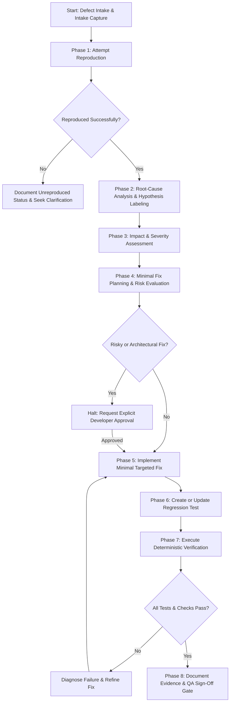
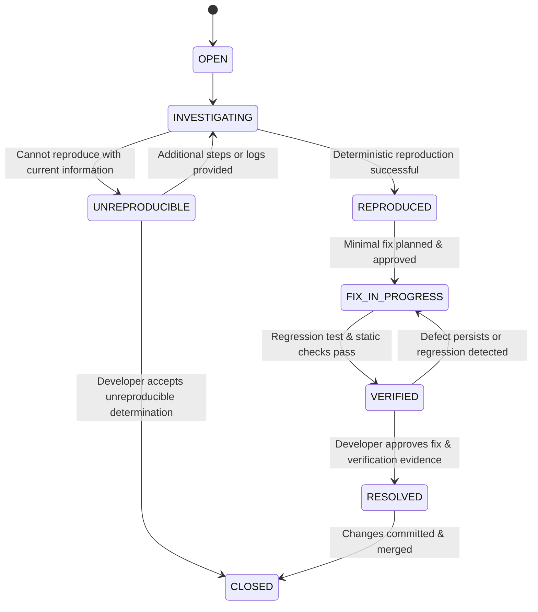

# Bug Fixing Skill

## 1. Overview & Purpose

This skill establishes the standard engineering procedure for diagnosing, reproducing, analyzing, fixing, and verifying software defects across target applications.

Bug fixing is governed by a dedicated defect lifecycle separate from ordinary feature implementation:
1. **Defect Intake & Capture:** Ingests observed symptoms, environment details, logs, and reproduction steps without demanding unnecessary boilerplate (`REQ-048`).
2. **Reproduction Before Modification:** Always attempts deterministic reproduction before altering any source code (`REQ-049`).
3. **Root-Cause Analysis Over Symptoms:** Distinguishes underlying root causes from superficial symptoms and explicitly labels unverified assumptions as hypotheses (`REQ-050`).
4. **Minimal Fix Discipline:** Prioritizes the smallest reasonable, maintainable fix while actively preventing unsolicited refactoring or scope creep (`REQ-051`, `REQ-034`).
5. **Mandatory Approval for Risky Changes:** Enforces explicit developer authorization prior to executing broad refactoring, database migrations, or architectural alterations (`REQ-052`, `SAFE-002`, `SAFE-006`, `SAFE-008`).
6. **Regression Prevention:** Mandates the addition or update of automated regression tests whenever practical to prevent defect re-emergence (`REQ-053`).
7. **Deterministic Verification:** Verifies fixes using tangible test outputs and exit codes, prohibiting unverified pass claims (`REQ-054`, `SAFE-009`).
8. **Honest Defect Accounting:** Prohibits declaring a defect fixed if it could not be reproduced or verified, unless limitations are explicitly documented and acknowledged (`REQ-055`).
9. **Preservation of User Work:** Inspects working tree status before changes and preserves uncommitted developer modifications (`SAFE-010`).

---

## 2. When to Use

Activate this skill when:
- Executing the bug-fixing workflow (`workflows/fix-bug.md`).
- Diagnosing a newly reported defect, runtime exception, or unexpected behavior.
- Investigating automated test failures during CI or local development.
- Remediating defects surfaced in a QA review report (`templates/qa-report.md`).
- Designing regression tests to safeguard critical application paths.

---

## 3. Required Inputs

1. **Defect Report or Description:**
   - Formal bug report (`.dev-team/features/<feature-slug>/bugs/<bug-id>.md` or `templates/bug-report.md`), or
   - Developer defect prompt containing actual behavior, expected behavior, and reproduction hints (`REQ-048`).
2. **Target Repository Context:**
   - Target project `AGENTS.md` and `.dev-team/project-profile.yaml`.
   - Existing automated test suites and test runner scripts.
   - Target codebase source files and dependency manifests (e.g. `pubspec.yaml`, `package.json`).
3. **Environment & Diagnostic Data:**
   - Stack traces, console logs, error messages, and reproduction steps.
   - Git working tree status (`git status`).

---

## 4. End-to-End Bug Lifecycle Procedure



### Phase 1: Defect Capture & Intake (`REQ-048`)
1. Ingest available defect details into a structured document conforming to `templates/bug-report.md`.
2. Capture core attributes:
   - **Bug Identifier:** Unique key (e.g. `BUG-001`).
   - **Title:** Actionable, concise summary of the failure.
   - **Environment:** OS, runtime/SDK version, commit hash, device or emulator (keep unknown fields optional).
   - **Expected Behavior:** What the application should do according to approved specifications.
   - **Actual Behavior:** What the application currently does wrong.
   - **Evidence:** Terminal output, stack traces, screenshots, or log snippets.

### Phase 2: Systematic Reproduction (`REQ-049`, `REQ-055`)
*Never edit application code to "fix" a bug before attempting reproduction.*
1. Review reported reproduction steps.
2. Attempt to trigger the defect deterministically:
   - Write a minimal failing test (unit, widget, or integration test) that mirrors the defect conditions, or
   - Run the exact application command or sequence reported in the defect.
3. Evaluate outcome:
   - **REPRODUCED:** Defect observed deterministically. Record command output, failure trace, or failing test assertion as reproduction evidence.
   - **UNREPRODUCIBLE:** Defect cannot be triggered. Record exact steps attempted, environment discrepancies, and mark status as `UNREPRODUCIBLE`. Request developer clarification (`SAFE-012`).
   - *Safety Rule (`REQ-055`):* If a defect cannot be reproduced, it cannot be marked as `FIXED` or `RESOLVED` on speculative grounds without developer sign-off and explicit documentation of limitations.

### Phase 3: Root-Cause Analysis vs Symptoms (`REQ-050`)
1. Separate superficial symptoms from underlying mechanisms:
   - *Symptom:* `NullPointerException in ProfileCard widget`.
   - *Root Cause:* `UserProfileRepository fails to initialize default avatar URL when caching is disabled`.
2. Manage diagnostic hypotheses:
   - When investigating, label unverified assumptions explicitly as `[HYPOTHESIS]`.
   - Once substantiated by debugger inspection, code tracing, or a failing test, transition label to `[CONFIRMED]`.
3. Locate exact component and line numbers responsible for the root cause.

### Phase 4: Impact Assessment & Severity Classification (`REQ-044`)
Assign a standard severity level:
- `BLOCKER`: Complete crash, catastrophic data corruption, security vulnerability, or blocking core release path.
- `CRITICAL`: Major business logic broken, severe performance degradation, or critical user flow inoperable with no workaround.
- `MAJOR`: Significant functional failure or incorrect data calculation, but a non-obvious workaround exists.
- `MINOR`: Non-critical UI glitch, formatting inconsistency, or minor usability defect with minimal impact.
- `TRIVIAL`: Minor typo, cosmetic imperfection, or non-functional cleanup suggestion.

### Phase 5: Minimal Fix Planning & Approval Gate (`REQ-051`, `REQ-052`)
1. Formulate a minimal, targeted fix strategy:
   - Make the smallest change that completely addresses the confirmed root cause.
   - Avoid opportunistic refactoring, aesthetic rewrites, or altering surrounding unrelated functions (`REQ-034`).
   - Identify potential side effects on dependent modules or shared contracts.
2. Assess fix risk:
   - **Low Risk:** Localized logic fix within a single method or component, fully covered by existing tests.
   - **High Risk:** Changes shared database schemas, alters public API contracts, replaces third-party libraries, modifies core architectural layers, or involves destructive file modifications.
3. *Explicit Approval Gate (`SAFE-002`, `SAFE-006`, `SAFE-008`, `REQ-052`):*
   - If the fix is classified as **High Risk**, halt execution.
   - Present the developer with:
     - Root cause explanation.
     - Proposed architectural/schema changes.
     - Impact analysis and potential regression risks.
     - Alternative considered and why this fix is recommended.
   - Await explicit developer approval before modifying files.

### Phase 6: Controlled Implementation (`REQ-033`, `REQ-034`)
1. Inspect Git status to ensure the working tree is clean or changes are accounted for (`SAFE-010`).
2. Implement the approved minimal fix.
3. Maintain existing project conventions:
   - Respect architectural layer boundaries (e.g., domain vs data vs presentation).
   - Use established error handling, logging, and naming patterns.
   - Do not add new external package dependencies unless explicitly authorized.

### Phase 7: Regression Test Suite Creation & Updates (`REQ-053`)
*Enforces `REQ-053`: Add or update regression tests where practical.*
1. If a failing test was created during Phase 2 (Reproduction), verify that it now passes with the fix applied.
2. If not already present, implement an automated regression test:
   - Add unit/widget test in the appropriate `test/` directory.
   - Assert both the previously broken condition and boundary edge cases.
   - Reference the defect ID in the test documentation (e.g. `// Regression test for BUG-001`).
3. If an automated regression test is genuinely impractical (e.g. requires physical sensor, third-party payment gateway, or external device interaction):
   - Explicitly document why automated regression is impossible.
   - Provide concrete manual verification steps in `bug-report.md`.

### Phase 8: Deterministic Verification & Evidence Logging (`REQ-054`, `SAFE-009`)
1. Execute the relevant automated test suite and capture command output:
   ```bash
   # Flutter / Dart example
   flutter test test/path/to/regression_test.dart
   ```
2. Execute project-wide static analysis and formatting checks:
   ```bash
   dart format --output=none --set-exit-if-changed lib/ test/
   flutter analyze --no-fatal-infos
   ```
3. Record in `bug-report.md`:
   - Exact commands executed.
   - Observed output summaries (e.g. `0 issues found`, `All 12 tests passed!`).
   - Exit codes (`0` required).
4. Present verification results to developer for final sign-off and ticket resolution.

---

## 5. Distinguishing Symptoms from Root Causes & Hypothesis Management

To prevent premature or superficial fixes, adhere to the diagnostic table below:

| Dimension | Symptom (What is Observed) | Root Cause (What Must Be Fixed) |
|---|---|---|
| **Error Handling** | UI displays generic "Something went wrong" alert. | Token refresh interceptor returns HTTP 401 instead of redirecting to login flow. |
| **Data Integrity** | Database record contains null timestamps. | Serialization layer omits default timezone conversion on ISO-8601 strings. |
| **State Management** | Button does not respond to clicks after page reload. | Event listener is not re-subscribed upon widget lifecycle rebuild. |
| **Race Condition** | List occasionally displays duplicate items. | Asynchronous fetch query does not cancel ongoing debounce timer before new request. |

### Hypothesis Tagging Convention (`REQ-050`)
- Tag assumptions in documentation and logs as `[HYPOTHESIS]`:
  - `[HYPOTHESIS]: Cache invalidation does not trigger because key hash excludes locale.`
- Only after reproducing the condition or confirming through code tracing:
  - `[CONFIRMED ROOT CAUSE]: Key hash calculation at cache_manager.dart:54 ignores locale parameter.`

---

## 6. Defect State Machine & Lifecycle Transitions

Track defect state using the standard lifecycle progression:



| State | Entry Condition | Required Evidence |
|---|---|---|
| `OPEN` | Defect logged with initial description. | `bug-report.md` initialized. |
| `INVESTIGATING` | Diagnostic reproduction underway. | Reproduction steps inspected; logs reviewed. |
| `REPRODUCED` | Defect triggered deterministically. | Terminal failure output, stack trace, or failing test log. |
| `UNREPRODUCIBLE` | Cannot trigger defect. | Documented attempts, environment matrix, clarification request. |
| `FIX_IN_PROGRESS` | Minimal fix being implemented. | Approved fix plan; developer sign-off if risky. |
| `VERIFIED` | Fix applied and tests passing. | Automated test run logs, exit code `0`, clean analysis. |
| `RESOLVED` | Developer confirms fix. | Final sign-off block completed in `bug-report.md`. |
| `CLOSED` | Fix merged into target baseline. | Commit hash recorded. |

---

## 7. Quality & Safety Boundaries

| Boundary Rule | Governing Code | System Requirement |
|---|---|---|
| **No Unverified Fix Claims** | `SAFE-009`, `REQ-054` | Never mark a defect as fixed without executing tests and observing tangible passing output. |
| **Reproduction First** | `REQ-049` | Do not modify code prior to attempting reproduction. |
| **Unreproduced Fix Prohibition** | `REQ-055` | Never mark an unreproduced bug as resolved without explicit documented limitations and developer approval. |
| **Risky Fix Approval Gate** | `REQ-052`, `SAFE-002` | Require explicit sign-off for fixes altering architecture, database schemas, or public APIs. |
| **Smallest Useful Solution** | `REQ-051`, `REQ-034` | Forbid opportunistic refactoring, style reformatting, or unsolicited library additions. |
| **Regression Coverage** | `REQ-053` | Must include an automated regression test unless proven impossible and documented. |
| **Working Tree Safety** | `SAFE-010` | Check `git status` before editing and preserve all unrelated developer modifications. |

