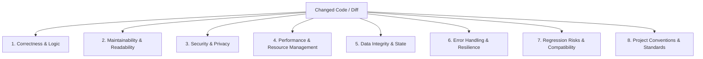

# Code Review Skill

## 1. Overview & Purpose

This skill provides a standardized, rigorous, and repeatable procedure for performing independent code reviews on modified files and pull requests within target application repositories.

The objective of independent code review is not to enforce subjective stylistic opinions, but to:
1. Verify logical **correctness** and edge case resilience.
2. Protect **security**, privacy, and credential boundaries (`SAFE-005`).
3. Ensure **data integrity** across persistence and state transitions.
4. Prevent **regressions** and breaking changes to shared interfaces or existing features.
5. Guarantee long-term **maintainability** and adherence to established project conventions.
6. Provide concrete, actionable remediations that developers can implement immediately.

---

## 2. When to Use

Activate this skill when:
- Executing the feature validation workflow (`workflows/validate-feature.md`).
- A developer completes an implementation task and requests an independent code review.
- Performing a pull request audit or reviewing git diffs before merging.
- Investigating regression risks after significant codebase modifications.

---

## 3. Required Inputs

1. **Git Diff / Modified File List:** The set of added, modified, or deleted files (obtained via `git diff` or task deliverable lists).
2. **Context & Conventions:**
   - Target project `AGENTS.md` and `.dev-team/project-profile.yaml`.
   - Existing codebase architectural patterns, naming conventions, and linter configurations.
3. **Approved Task / Feature Specification:**
   - The approved `requirement.md` and `plan.md` (or `task.md`) detailing expected behavior.

---

## 4. The 8-Dimension Review Procedure

Review changed code systematically across the following eight core dimensions. Every dimension must be evaluated; do not skip dimensions.



### Dimension 1: Correctness & Logic
- **Functional Alignment:** Does the code correctly implement the intended algorithm or business rule?
- **Boundary Conditions:** Are boundary values (e.g., `<` vs `<=`, `0`, empty collections, max values) handled properly?
- **Off-by-One Errors:** Are loop indices, slice offsets, and pagination offsets exact?
- **Null & Undefined Safety:** Are null checks complete, and does the code avoid unsafe force-unwrapping (e.g., `!` in Dart/TypeScript) where null is possible?
- **Asynchronous Logic:** Are async operations, futures, promises, and streams properly awaited, chained, and handled? Are unawaited futures intentional?

### Dimension 2: Maintainability & Readability
- **Single Responsibility:** Do functions, classes, and components have a focused, single responsibility?
- **Code Duplication:** Is repetitive boilerplate introduced that should be unified, or conversely, has premature abstraction made simple code difficult to understand?
- **Clarity & Intention:** Are variable, function, and class names descriptive and clear? Does the code read naturally?
- **Dead Code:** Are there unused imports, unreachable branches, orphaned variables, or obsolete comments?
- **Modular Boundaries:** Are architectural boundaries (Presentation -> Domain -> Data) respected, or is infrastructure logic leaking into UI widgets?

### Dimension 3: Security & Privacy (`SAFE-005`)
- **Credential & Secret Protection:** Are API keys, tokens, passwords, or secrets hardcoded into source files or test fixtures? (`SAFE-005` violation)
- **Input Sanitization & Injection:** Are external inputs (user inputs, URL params, deep links, queries) validated and sanitized before execution or storage?
- **Access Control & Permissions:** Are authorization and permission checks performed at both UI and domain/data levels?
- **Data Leakage in Logging:** Are sensitive user details, auth tokens, or PII dumped to console logs or unencrypted persistent storage?
- **Network Security:** Are network requests made over secure transport (HTTPS) with proper certificate and timeout configurations?

### Dimension 4: Performance & Resource Management
- **Unnecessary Rebuilds / Rerenders:** In UI frameworks (e.g., Flutter, React), do widgets or components trigger cascading rebuilds? Are expensive computations memoized or decoupled from UI build methods?
- **Resource Cleanup & Disposal:** Are controllers, timers, streams, subscriptions, and database connections properly closed/disposed in `dispose()` or cleanup routines?
- **Memory Footprint:** Are large datasets streamed or paginated rather than loaded entirely into in-memory lists?
- **Blocking Operations:** Are heavy calculations, file I/O, or JSON parsing run on background isolates/threads when necessary to keep the UI thread smooth?

### Dimension 5: Data Integrity & State Consistency
- **State Mutation Safety:** Is state mutated predictably? If immutable state patterns are used, are models properly cloned/copied?
- **Race Conditions:** Can concurrent async requests or rapid user taps cause stale state, double submissions, or out-of-order responses?
- **Schema & Model Validation:** Do data models validate incoming payload structures and types during deserialization?
- **Cache Invalidation:** If caching or local storage is updated, is the in-memory state or remote synchronization kept consistent?

### Dimension 6: Error Handling & Resilience
- **Explicit Failure Modes:** Are failure states represented explicitly (e.g., `Result<T>`, domain-specific `Failure` classes, sealed classes)?
- **Empty & Error UI States:** Does the UI render user-friendly error views, retry actions, and empty state placeholders instead of blank screens or perpetual loaders?
- **Catch Block Discipline:** Are catch blocks specific rather than blindly catching and swallowing `catch (e) {}` without logging or handling?
- **Graceful Degradation:** If an external network service or optional device sensor fails, does the core application remain usable?

### Dimension 7: Regression Risks & Compatibility
- **Contract Compatibility:** Did changes to public methods, signatures, model fields, or database tables break other modules or external consumers?
- **Shared Utilities:** If a shared utility or helper was modified, do all existing callers still function as expected?
- **Backward Compatibility:** Will users with older app versions, cached data, or existing local databases encounter migration errors?
- **Test Suite Health:** Did existing tests pass, or were tests silenced or deleted to mask regressions?

### Dimension 8: Project Conventions & Standards
- **Idiomatic Style:** Does the code follow standard language idioms and project formatting rules (e.g., `dart format`, `dart analyze`, lint rules)?
- **Architecture Consistency:** Does the code match the pattern discovered in the target repository (e.g., Riverpod, BLoC, Provider, Repository pattern)?
- **Test Coverage:** Are unit/widget tests provided for new logic, edge cases, and error paths, following existing test naming and assertion styles?

---

## 5. Finding Severity Classification

Every review finding must be assigned one of five standardized severity levels:

| Severity | Definition | Feature Impact | Gate Action |
|---|---|---|---|
| **BLOCKER** | Critical security flaw (e.g. leaked secret, auth bypass), severe data loss risk, crash in core user path, or direct violation of safety rules (`SAFE-001` - `SAFE-012`). | Prevents feature deployment and usage. | **Blocks approval.** Determination MUST be `NEEDS_REVISION`. |
| **CRITICAL** | Major functional defect breaking an approved requirement, unhandled runtime exception in primary flow, or severe regression risk. | Core functionality is broken or incomplete. | **Blocks approval.** Determination MUST be `NEEDS_REVISION`. |
| **MAJOR** | Notable defect in secondary user flow, unhandled edge case, resource leak, missing error state, or architectural violation. | Feature is functional but impaired or fragile. | Requires remediation; may permit `APPROVED_WITH_FOLLOW_UPS` only with explicit developer approval. |
| **MINOR** | Inefficient implementation, minor convention inconsistency, sub-optimal naming, or missing non-critical test case. | Minor quality or readability concern. | Remediation recommended; does not block feature approval. |
| **TRIVIAL** | Cosmetic formatting suggestion, typo in internal comment, or minor documentation enhancement. | Negligible impact. | Optional improvement. |

---

## 6. Actionable Finding Structure

To ensure findings are actionable and minimize false positives, every finding must follow this standardized schema:

```markdown
### Finding [ID]: [Concise Title]
- **Severity:** [BLOCKER | CRITICAL | MAJOR | MINOR | TRIVIAL]
- **Dimension:** [Correctness | Maintainability | Security | Performance | Data Integrity | Error Handling | Regression | Conventions]
- **Location:** `[filepath]:[line_number_or_range]`
- **Description:** [Clear, factual description of what the issue is and why it matters.]
- **Evidence / Reproduction:** [Code snippet, test failure, or step-by-step scenario demonstrating the defect.]
- **Actionable Remediation:** [Concrete code change, refactoring, or patch to resolve the issue.]
```

### False Positive Prevention Guidelines
1. **Verify Against Context:** Confirm whether a pattern is already established as standard in the target repository before flagging it as a convention violation.
2. **Distinguish Facts from Preferences:** Do not flag personal stylistic preferences (e.g. single vs double quotes, arrow vs block syntax) unless explicitly mandated by the target project's linter or `AGENTS.md`.
3. **Trace to Real Impact:** Always explain *how* the defect causes incorrect behavior, security vulnerability, or maintenance hazard.

---

## 7. Review Determination Rules

At the conclusion of the code review, determine the outcome:

1. **`APPROVED`**:
   - Zero `BLOCKER` or `CRITICAL` findings.
   - Zero or minimal `MINOR` / `TRIVIAL` suggestions.
   - All 8 dimensions satisfied.
2. **`APPROVED_WITH_FOLLOW_UPS`**:
   - Zero `BLOCKER` or `CRITICAL` findings.
   - Non-blocking `MAJOR` or `MINOR` items that the developer explicitly elects to address in a follow-up task.
3. **`NEEDS_REVISION`**:
   - One or more `BLOCKER` or `CRITICAL` findings exist.
   - Implementation does not meet quality gates or breaks core architecture.
   - Execution returns to the Developer role for remediation.

