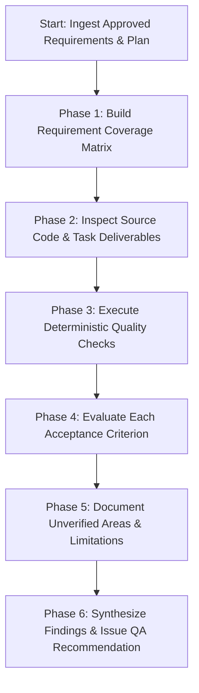

# Feature Validation Skill

## 1. Overview & Purpose

This skill establishes the standard procedure for independently verifying that a fully or incrementally implemented feature satisfies all approved functional, non-functional, and acceptance requirements.

Feature validation bridges the gap between raw code implementation and verified product readiness:
1. Validates code against the **approved requirements and plan**, not merely against what the developer intended or wrote (`REQ-040`).
2. Confirms that **every acceptance criterion** in `requirement.md` is evaluated and accounted for (`REQ-045`).
3. Executes and records **deterministic project checks** (tests, static analysis, builds) with concrete output evidence (`REQ-042`, `SAFE-009`).
4. Explicitly documents **environmental limitations and unverified areas** so untested code is never assumed to be working (`REQ-043`).
5. Enforces quality gates ensuring a feature with blocking defects or unmet mandatory criteria cannot be marked as complete (`REQ-046`).
6. Prepares the verified feature for final developer acceptance sign-off (`SAFE-001`, `REQ-047`).

---

## 2. When to Use

Activate this skill when:
- Running the `validate-feature` workflow (`workflows/validate-feature.md`).
- All tasks in an implementation milestone or feature plan have reached `COMPLETED` or `NEEDS_REVIEW`.
- Performing pre-merge acceptance audits for a feature branch.
- Verifying whether a bug fix or feature enhancement fully resolved its intended requirements without regressions.

---

## 3. Required Inputs

1. **Approved Requirement Document:** `.dev-team/features/<feature-slug>/requirement.md` (must have `Status: APPROVED`).
2. **Approved Implementation Plan:** `.dev-team/features/<feature-slug>/plan.md` (must have `Status: APPROVED`).
3. **Target Codebase Context:**
   - Modified files in working tree or git branch.
   - Target project `AGENTS.md` and `.dev-team/project-profile.yaml`.
   - Existing automated tests (unit, widget, integration) in the repository.

---

## 4. End-to-End Feature Validation Procedure



### Phase 1: Build the Requirement Coverage Matrix
1. Extract all functional requirements (`REQ-xxx`) and non-functional requirements (`NFR-xxx`) from `requirement.md`.
2. Extract all explicit acceptance criteria for each requirement.
3. Map each requirement to its implementing tasks in `plan.md`.
4. Initialize the verification status for each criterion:
   - `VERIFIED`: Confirmed by running automated tests or deterministic code inspection with recorded evidence.
   - `PARTIAL`: Partially implemented or tested; minor edge cases missing.
   - `UNMET`: Requirement or acceptance criterion is missing, broken, or fails verification.
   - `UNVERIFIED`: Requirement could not be validated due to lack of environment, emulator, mock services, or external dependency.

### Phase 2: Inspect Source Code & Task Deliverables
1. Review the git diff against the target baseline branch (e.g. `main` or `master`).
2. Verify that files listed in each task's `Expected Files` exist and adhere to the architectural design (`system-design.md`).
3. Ensure no unauthorized scope creep, speculative features, or dead code were introduced (`REQ-034`, `SAFE-004`).
4. Cross-reference code review findings gathered using `skills/code-review/SKILL.md`.

### Phase 3: Execute Deterministic Quality Checks
*Enforces `SAFE-009`, `REQ-042`, and `REQ-043`.*
1. Run automated code formatting verification:
   ```bash
   # Dart / Flutter example
   dart format --output=none --set-exit-if-changed lib/ test/
   ```
2. Run static analysis:
   ```bash
   # Dart / Flutter example
   flutter analyze --no-fatal-infos
   ```
3. Run automated test suites:
   ```bash
   # Unit and widget test execution
   flutter test test/features/<feature-slug>/
   ```
4. Record for every executed command:
   - Exact command line invoked.
   - Command exit code (`0` for success, non-zero for failure).
   - Observed stdout/stderr summary (e.g. `All 14 tests passed!`, `0 issues found`).
   - Timestamp of execution.
5. If a command fails:
   - Capture failure logs, failing test names, and stack traces.
   - File corresponding `BLOCKER`, `CRITICAL`, or `MAJOR` defect finding.

### Phase 4: Evaluate Each Acceptance Criterion
1. For every requirement in the coverage matrix:
   - Assess whether the implementation fulfills the expected inputs, outputs, and behaviors.
   - Confirm that error paths, empty states, and invalid inputs are tested and handled.
   - Verify that test assertions directly assert the requirement's acceptance conditions.
2. Mark status as `VERIFIED` only when test or deterministic inspection evidence exists.
3. If an acceptance criterion is not satisfied:
   - Mark as `UNMET`.
   - Log a defect finding linking directly to the Requirement ID.

### Phase 5: Document Unverified Areas & Environmental Limitations
*Enforces `REQ-043`.*
Never claim a check passed or assume a platform behavior works if it was not actually executed:
1. Identify any checks or test types that could not be run locally (e.g., end-to-end device integration tests, native push notification delivery, biometric hardware authentication, live payment gateway calls).
2. Explicitly document each limitation:
   - What was not verified.
   - Why it could not be verified (e.g., missing hardware emulator, missing staging credentials).
   - Recommended follow-up validation step (e.g., manual device test by developer before release).

### Phase 6: Synthesize Findings & Issue QA Recommendation
1. Calculate overall metrics:
   - Total requirements / acceptance criteria count.
   - Verified count, Partial count, Unmet count, Unverified count.
   - Defect counts grouped by severity (`BLOCKER`, `CRITICAL`, `MAJOR`, `MINOR`, `TRIVIAL`).
2. Apply Quality Gate Evaluation Rules:
   - **BLOCKING RULE 1:** If any `BLOCKER` or `CRITICAL` finding exists -> Outcome MUST be `NEEDS_REVISION`.
   - **BLOCKING RULE 2:** If any mandatory acceptance criterion is `UNMET` -> Outcome MUST be `NEEDS_REVISION` (`REQ-046`).
   - **CONDITIONAL RULE:** If all mandatory criteria are `VERIFIED`, zero `BLOCKER`/`CRITICAL` findings exist, but non-blocking `MAJOR` or `MINOR` items remain -> Outcome is `APPROVED_WITH_FOLLOW_UPS` (requires developer review).
   - **APPROVAL RULE:** If all criteria are `VERIFIED`, zero defects or only trivial suggestions exist -> Outcome is `APPROVED`.
3. Generate the completed QA report conforming to `templates/qa-report.md`.

---

## 5. Traceability Model

Maintain strict bidirectional traceability throughout the QA validation process:

```text
Requirement (REQ-xxx)
       │
       ▼
System Design Component (system-design.md)
       │
       ▼
Plan Task (M<x>-T<y>)
       │
       ▼
Source Code Implementation (lib/...)
       │
       ▼
Automated Test (test/...)
       │
       ▼
QA Report Evaluation (templates/qa-report.md)
```

Every QA report entry must explicitly reference:
- The `REQ-xxx` requirement ID it verifies.
- The `M<x>-T<y>` task ID that implemented it.
- The specific test file or check verifying it.

