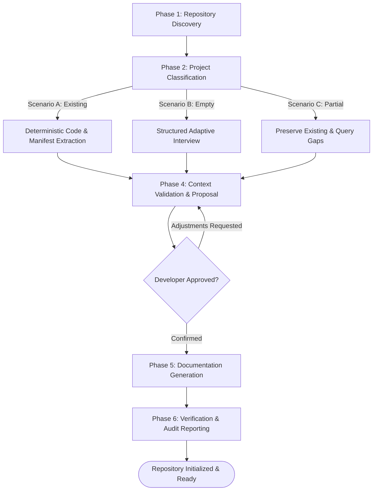

# Project Initializer Skill

## 1. Overview & Purpose

The `project-initializer` skill is the foundational entry point for introducing Dev-Team to any software repository—whether an established enterprise codebase, a newly generated framework template, or a completely empty directory.

Its objective is to establish an accurate, durable foundation of project reality before any feature development begins. Rather than making speculative assumptions or requiring individual agents to re-scan the entire codebase repeatedly, this skill builds and maintains a canonical central context store in `.dev-team/project-context.md` and generates standardized root instructions and documentation.

---

## 2. Activation Triggers & Scenarios

Activate this skill when:
- The developer runs `/project-initializer`, "Initialize this repository for Dev-Team", or "Onboard this project".
- Any downstream engineering workflow (`workflows/new-feature.md`, `workflows/design-feature.md`) detects that `.dev-team/project-context.md` or `.dev-team/config.yaml` is missing.
- Re-running initialization on an already onboarded project to reconcile or refresh project documentation following major architectural updates.

### Supported Scenarios:
1. **Scenario A (Existing Codebase):** Repository contains source files, package manifests, or existing documentation. Minimal developer friction; facts are extracted deterministically.
2. **Scenario B (Empty Repository):** Repository is completely or nearly empty (only `.git` or default README). Context is gathered via a structured adaptive interview without speculative invention.
3. **Scenario C (Partially Initialized):** Repository already has some root files or partial documentation. Existing assets are preserved, gap analysis is performed, and missing elements are generated.

---

## 3. Strict Safety Boundaries & Operating Principles

All executions of this skill must adhere to the following principles:

1. **Idempotency:** Re-running this skill must never corrupt, truncate, or duplicate existing configuration or documentation.
2. **Truth Preservation (No Speculation):** *Never invent speculative architecture for empty repositories.* If technology, routing, or state management decisions have not been made, record them explicitly under `ACTIVE_ASSUMPTIONS` or `OPEN_DECISIONS`.
3. **Non-Implementation Boundary:** Scope ends strictly upon establishing documentation, root instructions, and context stores. *Never generate application feature code or scaffold runtime logic within this skill.*
4. **Preserve User Assets (SAFE-010):** Never overwrite existing customized user documentation, READMEs, or instruction files without explicit developer authorization.
5. **Mandatory Approval Gate (SAFE-001, SAFE-002):** Present discovered facts, proposed configurations, and file write actions to the developer for explicit approval before writing to disk.

---

## 4. Six-Phase Initialization Procedure



### Phase 1: Repository Discovery
Deterministically inspect the target repository tree:
1. Execute the structure checker script:
   ```bash
   python skills/project-initializer/scripts/check-project-structure.py --path <target_dir> --json
   ```
2. Inspect package manifests (`pubspec.yaml`, `package.json`, `pyproject.toml`, `Cargo.toml`, `go.mod`, `build.gradle`, `pom.xml`, etc.).
3. Identify existing AI operating instructions (`AGENTS.md`, `CLAUDE.md`, `.cursorrules`, `.github/copilot-instructions.md`).
4. Identify existing documentation directories (`docs/`, `doc/`, `wiki/`).
5. Check Git repository status (`git status`, active branches).

### Phase 2: Project Classification
Classify the target project into one of three distinct categories:
- **`EXISTING`:** Package manifests and source code directories (`lib/`, `src/`, `app/`, `packages/`) exist with meaningful codebase volume.
- **`EMPTY`:** Directory is empty, contains only `.git`, or contains only default placeholder files (`README.md`, `.gitignore`, `LICENSE`).
- **`PARTIAL`:** Contains partial manifests or code, or already contains `.dev-team/` configuration without full documentation.

### Phase 3: Context Gathering
Select the appropriate procedure based on Phase 2 classification:

#### Branch A: Existing Codebase
1. Consult [`references/project-detection.md`](file:///skills/project-initializer/references/project-detection.md) for ecosystem heuristics (Flutter, Node, Python, Rust, Go, Java).
2. Extract verified facts:
   - Language and runtime versions.
   - Primary framework, routing, state management, dependency injection, and persistence libraries.
   - Linter configuration and test commands.
3. Formulate a list of `CONFIRMED_FACTS`.
4. Identify any architectural ambiguities and formulate minimal targeted questions.

#### Branch B: Empty Repository
1. Consult [`references/context-gathering.md`](file:///skills/project-initializer/references/context-gathering.md) for the adaptive interview guide.
2. Ask the developer focused questions across four essential dimensions:
   - **Product Vision & Target Domain:** Problem being solved and primary user personas.
   - **Target Platforms & Runtime:** Mobile, Web, Desktop, Cloud Backend, CLI.
   - **Technology Preferences:** Preferred language, framework, database, or architectural style.
   - **Workflow Preferences:** Approval gate rigor and documentation depth.
3. Record confirmed user answers as `CONFIRMED_FACTS`.
4. Record unchosen or deferred technical decisions explicitly as `ACTIVE_ASSUMPTIONS` or `OPEN_DECISIONS`.

#### Branch C: Partially Initialized Repository
1. Read existing `.dev-team/config.yaml` or `.dev-team/project-context.md` if present.
2. Reconcile on-disk reality with recorded configuration.
3. Isolate missing documentation or configuration elements.

### Phase 4: Context Validation & Approval Gate
Before writing or modifying any file:
1. Present the developer with a clear initialization plan:
   - Detected or gathered technology stack and project type.
   - Summary of `CONFIRMED_FACTS` versus `ACTIVE_ASSUMPTIONS`.
   - Complete list of files to be generated or updated.
   - Identification of existing files that will be preserved untouched.
   - Identification of files that will be skipped (e.g. `DESIGN.md` for backend services per [`references/documentation-rules.md`](file:///skills/project-initializer/references/documentation-rules.md)).
2. Request explicit confirmation:
   > *"Please review the detected project configuration and proposed documentation scaffolding above. Do you approve proceeding with file generation?"*
3. If the developer requests adjustments, update the plan and re-confirm before writing files.

### Phase 5: Documentation & Scaffolding Generation
Upon receiving explicit approval:
1. Ensure required directory structure exists:
   - `.dev-team/`
   - `.dev-team/features/`
   - `docs/project/`
2. Instantiate templates from `templates/project/`:
   - **Root Instructions:**
     - `AGENTS.md` (instantiated from `templates/project/AGENTS.md`)
     - `rules.md` (instantiated from `templates/project/rules.md`)
     - `DESIGN.md` (instantiated from `templates/project/DESIGN.md` — omitted for backend/CLI)
   - **Target Configuration & Context:**
     - `.dev-team/config.yaml` (instantiated from `templates/project/config.yaml`)
     - `.dev-team/project-context.md` (instantiated from `templates/project/project-context.md`)
   - **Baseline Project Documentation (`docs/project/`):**
     - `overview.md`, `requirements.md`, `system-design.md`, `plan.md`, `tech-stack.md`, `architecture.md`
3. Populate all instantiated files with confirmed facts, replacing placeholder tokens.
4. Leave unconfirmed architectural areas explicitly marked as `OPEN_DECISION` or `PENDING_VALIDATION`.

### Phase 6: Verification & Audit Reporting
1. Cross-verify consistency across all generated documents:
   - Ensure versions, framework names, and directory paths match across `config.yaml`, `AGENTS.md`, and `docs/project/`.
2. Generate `.dev-team/initialization-report.md` (instantiated from `templates/project/initialization-report.md`).
3. Present the completion summary to the developer, including pointers to key documents and handover commands.

---

## 5. Error Handling & Recovery

- **Target Directory Not Found:** Stop and report path error; do not create arbitrary root directories.
- **Unrecognized Tech Stack:** Do not abort; classify as `custom` or `generic`, record findings, and prompt developer for build/test commands.
- **File Collisions:** If target files already exist, preserve them by default and log them in `initialization-report.md`.
- **Interrupted Initialization:** Follow [`references/initialization-workflow.md`](file:///skills/project-initializer/references/initialization-workflow.md) to inspect `.dev-team/initialization-report.md` and resume from the last completed phase without repeating finished steps.

---

## 6. Downstream Workflow Handover

Once initialization is verified, guide the developer to the next appropriate workflow:
- For developing a new capability: `workflows/new-feature.md` (`/new-feature [name]`)
- For reporting or fixing a bug: `workflows/fix-bug.md` (`/fix-bug [description]`)
- For checking progress: `workflows/feature-status.md` (`/feature-status`)

