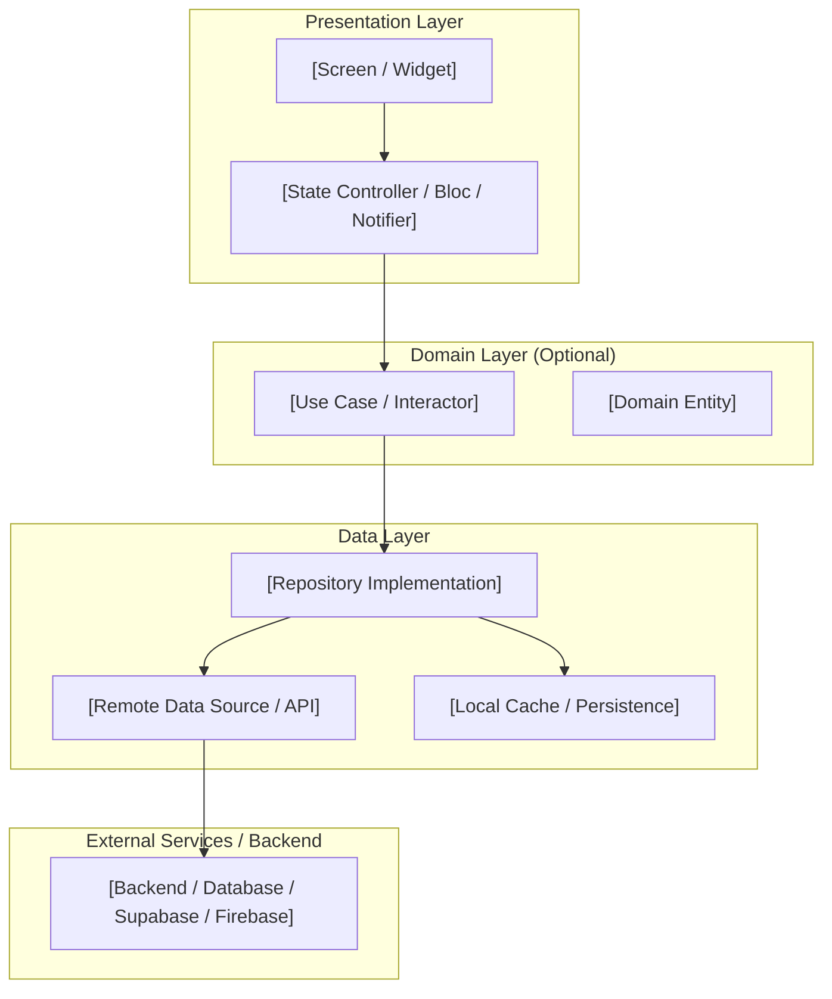

# System Design Specification: [Feature Name]

**Document Type:** Technical System Design  
**Feature ID:** `[feature-slug]`  
**Status:** DRAFT <!-- Allowed: DRAFT, IN_REVIEW, APPROVED, NEEDS_REVISION, SUPERSEDED -->  
**Version:** 1.0  
**Created Date:** [YYYY-MM-DD]  
**Last Updated:** [YYYY-MM-DD]  
**Author:** [System Architect / Author Name]  
**Approver:** [Developer Name] (Pending Approval)  
**Based On:**
- `requirement.md` — Approved ([Version], [Approval Date])
- `.dev-team/project-profile.yaml` — Discovered Project Conventions

---

## 1. Executive Summary & Requirement Mapping

### 1.1 Architectural Summary
<!-- Concise 1-2 paragraph technical summary of the proposed solution, its scope, and fit within the existing project architecture -->
[Provide a clear summary of how this feature will be implemented technically within the codebase.]

### 1.2 Requirement Traceability Matrix
<!-- Map every functional and non-functional requirement to the implementing components -->
| Requirement ID | Requirement Summary | Architectural Component(s) | Design Section |
|---|---|---|---|
| `REQ-001` | [Requirement 1 summary] | `[Component / Class / Module]` | Section 3.1 |
| `REQ-002` | [Requirement 2 summary] | `[Component / Class / Module]` | Section 3.2 |
| `NFR-001` | [Performance / Security summary] | `[Mechanism / Cache / Policy]` | Section 8 / 9 |

---

## 2. Architecture Overview

### 2.1 Context & Architecture Diagram
<!-- Provide a Mermaid diagram showing the relationship between UI, state management, services, repositories, and external systems -->



### 2.2 Architectural Pattern & Alignment
<!-- Explain how this design aligns with the project's discovered architecture (e.g. Feature-First, Clean Architecture, MVC) -->
- **Discovered Pattern:** [e.g., Feature-First with Riverpod / Clean Architecture with BLoC]
- **Target Location:** `[e.g., lib/features/property_reviews/ or lib/presentation/reviews/]`
- **Alignment Rationale:** [Why this structure maintains consistency with existing codebase modules]

---

## 3. Layer Architecture & Component Responsibilities

<!-- Define the components in each layer. Omit layers that do not apply to this project or feature. -->

### 3.1 Presentation Layer
- **Screens / Views:**
  - `[ScreenNameWidget]`: [Purpose, layout, user interactions]
- **Sub-Widgets / Components:**
  - `[WidgetName]`: [Reusable presentation component]
- **State Management:**
  - **State Holder:** `[Bloc / Notifier / Controller name]`
  - **State Model:** `[StateDataModel]` representing:
    - Initial / Loading state
    - Success / Content state
    - Empty state
    - Error state

### 3.2 Domain / Application Layer (if applicable)
<!-- Omit if the project does not use a domain layer -->
- **Entities / Models:**
  - `[EntityName]`: [Core immutable business object]
- **Use Cases / Interactors:**
  - `[UseCaseName]`: [Single-responsibility business operation]

### 3.3 Data / Infrastructure Layer
- **Repository Interface & Implementation:**
  - `[InterfaceName]`: Contract defining data access methods.
  - `[RepositoryImpl]`: Concrete data coordination between remote and local sources.
- **Data Transfer Objects (DTOs) / Serializers:**
  - `[DtoModel]`: JSON serialization / deserialization methods (`fromJson`, `toJson`).
- **Data Sources:**
  - `[RemoteDataSource]`: HTTP / RPC / SDK calls to backend.
  - `[LocalDataSource]`: Storage in local database or cache (if applicable).

---

## 4. Data Flow & Reactive State Lifecycle

<!-- Describe the step-by-step lifecycle of data during standard operations -->

### 4.1 Primary Flow (e.g., Load & Display)
1. User navigates to `[ScreenName]`.
2. UI triggers `[InitEvent / fetchMethod()]` on `[StateHolder]`.
3. `[StateHolder]` emits `[LoadingState]`.
4. `[StateHolder]` calls `[Repository / UseCase]`.
5. Data retrieved, parsed, and returned as `[Entity / Model]`.
6. `[StateHolder]` emits `[LoadedState(data)]`.
7. UI rebuilds with content.

### 4.2 Mutation Flow (e.g., Submit / Update)
1. User inputs data and taps `[SubmitButton]`.
2. UI performs client-side validation; if valid, dispatches `[SubmitEvent(params)]`.
3. `[StateHolder]` emits `[SubmittingState]`.
4. Data layer sends request to backend.
5. On success: `[StateHolder]` updates local state or invalidates cache, emits `[SuccessState]`, and UI displays confirmation.
6. On error: `[StateHolder]` emits `[ErrorState(message)]` without discarding user input; UI displays actionable error message.

---

## 5. Data Model & Database Changes

<!--
Omit this section if the feature does not introduce or modify database schemas, tables, or local storage.
-->

### 5.1 Schema Changes
<!-- Table definitions, columns, data types, constraints -->
```sql
-- Migration: [timestamp]_[migration_name].sql
CREATE TABLE IF NOT EXISTS [table_name] (
    id UUID PRIMARY KEY DEFAULT gen_random_uuid(),
    [column_name] [DATA_TYPE] [CONSTRAINTS],
    created_at TIMESTAMPTZ NOT NULL DEFAULT timezone('utc', now()),
    updated_at TIMESTAMPTZ NOT NULL DEFAULT timezone('utc', now())
);

-- Indexes for query optimization
CREATE INDEX IF NOT EXISTS idx_[table_name]_[column] ON [table_name] ([column]);
```

### 5.2 Row-Level Security (RLS) & Permissions (if applicable)
```sql
-- RLS Policy Example
ALTER TABLE [table_name] ENABLE ROW LEVEL SECURITY;

CREATE POLICY "[table_name]_select_policy"
ON [table_name] FOR SELECT
USING ([condition, e.g., auth.uid() = user_id]);
```

### 5.3 Local Storage / Cache Schema (if applicable)
- **Engine:** `[e.g., SharedPreferences, Hive, Drift, SQLite]`
- **Keys / Tables:** `[Key names or table specifications]`

---

## 6. API & Integration Design

<!--
Omit this section if the feature does not involve external APIs or network communication.
-->

### 6.1 Endpoints / Remote Calls
| Method | Endpoint / RPC | Purpose | Request Body | Response Status |
|---|---|---|---|---|
| `GET` | `/api/v1/[resource]` | Fetch resource list | None | 200 OK |
| `POST` | `/api/v1/[resource]` | Create resource | `[JsonPayload]` | 201 Created |

### 6.2 Contract Payloads
- **Request Schema:**
```json
{
  "field_name": "string",
  "value": 123
}
```
- **Success Response (200 OK):**
```json
{
  "id": "uuid-value",
  "field_name": "string",
  "created_at": "ISO-8601"
}
```

### 6.3 Network Resilience & Retry Policies
- **Timeout:** [e.g., 10,000 ms]
- **Retry Strategy:** [e.g., Exponential backoff for idempotent GET requests, max 3 attempts]
- **Offline Behavior:** [e.g., Cache-then-network, or show offline banner with cached data]

---

## 7. UI/UX & Routing

<!--
Omit this section if the feature has no user interface (e.g. background service or data module).
-->

### 7.1 Routes & Navigation
- **Route Path:** `[e.g., /properties/:id/reviews]`
- **Parameters:** `[e.g., path: id (string), query: sortBy (string)]`
- **Route Guards / Protection:** `[e.g., Requires authenticated session; redirects to /login]`

### 7.2 UI Hierarchy & Design System Tokens
- **Design Tokens Used:**
  - Colors: `[e.g., AppColors.primary, AppColors.surface]`
  - Typography: `[e.g., AppTypography.headlineSmall, AppTypography.bodyMedium]`
  - Spacing / Radius: `[e.g., AppSpacing.md, AppRadius.lg]`
- **Screen States:**
  - **Loading:** [Shimmer skeleton matching card layout]
  - **Empty:** [Centered illustration with friendly copy and primary action button]
  - **Error:** [Inline error banner with "Retry" action button]
  - **Success / Content:** [Responsive list / detail view]

---

## 8. Security, Privacy & Data Protection

- **Authentication:** [How the user's identity is verified]
- **Authorization:** [Role-based access control, RLS policies, ownership validation]
- **Input Validation & Sanitization:** [Client-side validation rules, server-side parameter checks, SQL/XSS injection safeguards]
- **Sensitive Data & PII:** [Identification of sensitive fields; encryption at rest/transit; avoidance of sensitive logging]
- **Secrets Management:** [No credentials, tokens, or keys stored in code (SAFE-005)]

---

## 9. Error Handling & Resilience

| Failure Scenario | Layer Detected | Handling / Recovery Strategy | User Experience |
|---|---|---|---|
| Network Disconnected | Data Source | Catch socket/client exception, return NetworkFailure | Display offline snackbar / cached data |
| Server 500 / Timeout | Data Source | Catch server exception, return ServerFailure | Display retry button |
| Validation Error | Presentation / UI | Client validation fails before submission | Display inline input error helper text |
| Unauthorized (401/403)| Repository / Interceptor | Clear session token, trigger re-authentication | Redirect to login with redirect back |

---

## 10. Testing & Verification Strategy

<!-- Outline the verification plan that Technical Planning and Development will follow -->
| Level | Scope / Target | Testing Tool | Verification Criteria |
|---|---|---|---|
| **Unit Tests** | State logic (`Bloc` / `Notifier`), Use Cases, Models | `flutter_test`, `mocktail` | 100% state transition coverage; serialization tests |
| **Widget Tests** | Screen rendering, loading/empty/error states | `testWidgets` | Verify states render expected widgets without exceptions |
| **Integration Tests** | End-to-end user flow | `integration_test` | Complete user journey from entry to confirmation |
| **Static Analysis** | Linting and type checking | `flutter analyze` | Zero analyzer warnings or errors |

---

## 11. Architectural Decision Records (ADRs)

<!-- Document significant architectural or technology choices. Add more ADR blocks as needed. -->

### ADR-001: [Title of Architectural Decision]
- **Status:** [Proposed | Accepted | Rejected]
- **Context:** [Describe the problem and architectural context that prompted this decision.]
- **Options Considered:**
  1. *Option A:* [Description, pros, cons]
  2. *Option B:* [Description, pros, cons]
- **Decision:** [Selected option]
- **Rationale:** [Why this option was selected over alternatives]
- **Consequences:** [Trade-offs, positive outcomes, and potential limitations]

---

## 12. Risks, Assumptions & Mitigations

| Category | Description | Likelihood | Impact | Mitigation Strategy |
|---|---|---|---|---|
| Technical | [e.g., Third-party API rate limits] | Low / Med / High | Low / Med / High | [e.g., Implement local cache layer] |
| Compatibility | [e.g., Schema migration on older app versions] | Low / Med / High | Low / Med / High | [e.g., Maintain backward-compatible columns] |
| Performance | [e.g., Large dataset rendering] | Low / Med / High | Low / Med / High | [e.g., Implement pagination with limit/offset] |

---

## 13. Consequential Decisions & Approval Gate

<!--
List decisions that require explicit developer sign-off before implementation begins (SAFE-002).
-->

### 13.1 Significant Architectural Decisions Requiring Approval
- [ ] **Data Model Changes:** [Summary of database migrations or new tables]
- [ ] **External Dependencies:** [List of any new package or library introduced, or "None"]
- [ ] **Security Boundaries:** [Summary of authorization or permission changes]
- [ ] **Architecture Deviations:** [Any deviation from existing project conventions, or "None"]

### 13.2 Developer Sign-Off
- **Approver:** [Developer Name]
- **Status:** Pending Approval <!-- Set to APPROVED upon explicit sign-off -->
- **Approval Date:** [YYYY-MM-DD or Pending]
- **Approval Notes:** [Developer feedback or conditions]

