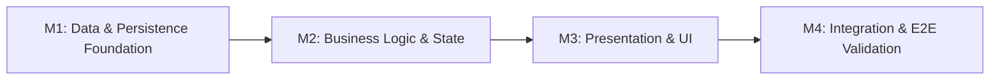
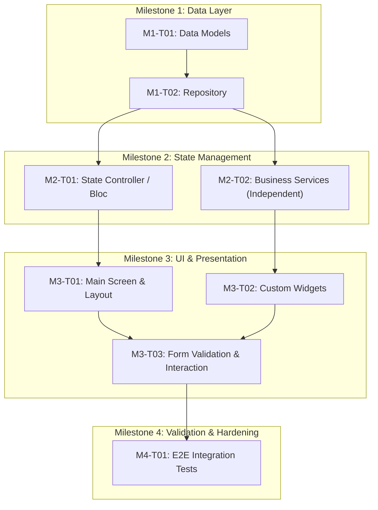

# Implementation Plan: [Feature Name]

**Document Type:** Technical Implementation Plan  
**Feature ID:** `[feature-slug]`  
**Project:** `[Target Project Name]`  
**Status:** DRAFT <!-- Allowed: DRAFT, IN_REVIEW, APPROVED, NEEDS_REVISION, SUPERSEDED -->  
**Version:** 1.0  
**Created Date:** [YYYY-MM-DD]  
**Last Updated:** [YYYY-MM-DD]  
**Author:** [Technical Planner / Author Name]  
**Approver:** [Developer Name] (Pending Approval)  
**Based On:**
- `requirement.md` — Approved ([Version], [Approval Date])
- `system-design.md` — Approved ([Version], [Approval Date])
- `.dev-team/project-profile.yaml` — Discovered Project Conventions

---

## 1. Implementation Overview

### 1.1 Objective
<!-- Concise 1-2 paragraph description of the technical implementation goal and overall outcome -->
[Describe what this plan will achieve and how the feature will be incrementally constructed.]

### 1.2 Implementation Principles
- **Smallest Useful Tasks First:** Break work into bite-sized units that can be developed and validated independently.
- **One Task at a Time:** By default, execute and verify one task per session to maintain control and traceability.
- **Evidence Over Assumptions:** Never mark a task completed without running explicit validation commands and observing output.
- **Strict Scope Boundaries:** Implement only the approved architecture. Any discovered scope gaps pause work for review (REQ-030).
- **Preserve Clean State:** Respect existing codebase conventions, formatting, and tests.

### 1.3 Scope Boundaries & Non-Goals
- **In Scope:** [Explicit list of modules, components, and integrations included in this plan]
- **Out of Scope:** [Explicitly deferred capabilities, future optimizations, or unapproved features]

### 1.4 Requirement-to-Task Traceability Matrix
<!-- Map every approved functional and non-functional requirement to one or more implementation tasks -->
| Requirement ID | Summary | Implementing Task ID(s) | Milestone | Verification Method |
|---|---|---|---|---|
| `REQ-001` | [Requirement 1 summary] | `M1-T01`, `M1-T02` | M1 | Unit test / Static analysis |
| `REQ-002` | [Requirement 2 summary] | `M2-T01` | M2 | State unit test |
| `REQ-003` | [Requirement 3 summary] | `M3-T01`, `M3-T02` | M3 | Widget test / Manual check |
| `NFR-001` | [Performance / Security summary] | `M4-T01` | M4 | Integration test / Benchmark |

---

## 2. Milestone Overview

| Milestone ID | Milestone Name | Focus / Layer | Tasks Count | Dependencies | Priority |
|---|---|---|---|---|---|
| **M1** | [Foundation & Data Layer] | Schemas, Models, Repositories | [N] | None | Must Have |
| **M2** | [Business Logic & State] | State management, Use Cases | [N] | M1 | Must Have |
| **M3** | [UI & Presentation] | Screens, Widgets, Routing | [N] | M2 | Must Have |
| **M4** | [Integration & Validation] | End-to-end tests, Edge cases | [N] | M3 | Must Have |

### Milestone Flowchart


---

## 3. Milestone & Task Specifications

<!-- Repeat this milestone block for each defined milestone -->

### Milestone 1 — [Milestone Title: e.g. Data & Persistence Foundation]

**Objective:** [What this milestone delivers in 1-2 sentences]  
**Dependencies:** [None / Previous Milestone ID]  
**Deliverable:** [Concrete deliverables produced by completing this milestone]

---

#### Task M1-T01 — [Task Title: e.g. Define Data Models and Serialization]

| Property | Value |
|---|---|
| **Task ID** | `M1-T01` |
| **Title** | [Descriptive task title] |
| **Type** | [Foundation \| Data \| State \| UI \| Integration \| Test] |
| **Requirements Covered** | `REQ-001`, `REQ-002` |
| **Architecture Reference** | `system-design.md` Section 3.3 (Data Layer) |
| **Dependencies** | None <!-- List prerequisite Task IDs or None --> |
| **Execution Mode** | Sequential <!-- Sequential | Independent --> |
| **Status** | PENDING <!-- Allowed: PENDING, IN_PROGRESS, BLOCKED, COMPLETED, NEEDS_REVIEW --> |

**Objective:**  
[Concise statement of the exact problem this task solves.]

**Scope & Target Files:**
- **Create:**
  - `[path/to/new_model.dart]`
  - `[path/to/test/new_model_test.dart]`
- **Modify:**
  - `[path/to/existing_barrel_file.dart]`
- **Inspect:**
  - `[path/to/reference_model.dart]` (for project conventions)

**Deliverables:**
- [List of tangible files and functions created or updated]

**Acceptance Criteria:**
- [ ] [Specific, testable condition 1]
- [ ] [Specific, testable condition 2]
- [ ] Unit tests pass with complete coverage of edge cases.
- [ ] Code follows target repository style and linter rules.

**Deterministic Validation Steps:**
```bash
# 1. Format and static analysis check
[command, e.g.: flutter analyze path/to/file.dart]

# 2. Targeted test execution
[command, e.g.: flutter test test/path/to/new_model_test.dart]
```
*Expected Output:* Zero analyzer issues; all tests pass.

---

#### Task M1-T02 — [Task Title: e.g. Implement Repository and Data Source]

| Property | Value |
|---|---|
| **Task ID** | `M1-T02` |
| **Title** | [Descriptive task title] |
| **Type** | Data |
| **Requirements Covered** | `REQ-002` |
| **Architecture Reference** | `system-design.md` Section 3.3 |
| **Dependencies** | `M1-T01` |
| **Execution Mode** | Sequential |
| **Status** | PENDING |

**Objective:**  
[Concise statement of the task objective.]

**Scope & Target Files:**
- **Create:**
  - `[path/to/repository.dart]`
  - `[path/to/test/repository_test.dart]`
- **Modify:**
  - `[path/to/dependency_injection_setup.dart]`

**Deliverables:**
- [Deliverable items]

**Acceptance Criteria:**
- [ ] [Condition 1]
- [ ] [Condition 2]

**Deterministic Validation Steps:**
```bash
[commands]
```
*Expected Output:* [Expected output]

---

<!-- Milestone 2, Milestone 3, Milestone 4 blocks follow the same structure -->

---

## 4. Task Dependency Graph

<!-- Visualize the sequenced execution path and identify parallelizable vs sequential branches -->



---

## 5. Verification & Quality Strategy

### 5.1 Verification Hierarchy
1. **Formatting & Static Analysis:** Run linter and formatting checks prior to committing changes.
2. **Unit Tests:** Execute focused unit tests verifying model serialization, business logic, and state transitions.
3. **Widget / Component Tests:** Verify UI widget rendering across loading, success, empty, and error states.
4. **Integration Tests:** Verify multi-component flow and external contract compliance.
5. **Regression Verification:** Run existing test suites to guarantee no existing capabilities were broken.

### 5.2 Deterministic Tooling & Environment
<!-- List the exact project commands used across all tasks -->
- **Analysis Command:** `[e.g. flutter analyze / npm run lint]`
- **Test Runner Command:** `[e.g. flutter test / npm test / pytest]`
- **Code Generation Command (if applicable):** `[e.g. dart run build_runner build --delete-conflicting-outputs]`

### 5.3 Evidence Capture Requirement (SAFE-009)
No task will transition to `COMPLETED` without tangible output recorded in the session or task notes. In the event of a test failure, execution must halt and diagnose the defect before proceeding.

---

## 6. Risk Management & Scope Containment

### 6.1 Identified Risks & Mitigations
| Risk Description | Severity | Mitigation Strategy | Contingency Plan |
|---|---|---|---|
| [e.g. Schema migration conflicts] | High | Isolate migration in early task; dry-run locally | Roll back migration script |
| [e.g. Third-party API rate limits] | Medium | Introduce local mock client for development/testing | Fallback to cached fixture |

### 6.2 Scope Change & Replanning Protocol (REQ-030)
If implementing any task exposes:
1. Missing or ambiguous requirements from `requirement.md`,
2. Architecture infeasibility in `system-design.md`, or
3. Downstream cascading defects,

The active task must be set to `BLOCKED`. Work is immediately paused, the issue is escalated to the developer, and an agreed adjustment is documented before work resumes.

---

## 7. Plan Review Audit & Approval Record

### 7.1 Independent Plan Review Audit (REQ-028)
<!-- Technical Planner / Plan Reviewer evaluation prior to requesting developer approval -->
| Dimension | Status | Review Notes |
|---|---|---|
| **Coverage** | [PASS / FAIL] | Every `REQ-xxx` is mapped to at least one task. |
| **Dependencies** | [PASS / FAIL] | Dependencies are acyclic, explicit, and logically ordered. |
| **Ordering** | [PASS / FAIL] | Sequential vs independent tasks are clearly distinguished. |
| **Scope** | [PASS / FAIL] | No unapproved scope or speculative abstractions introduced. |
| **Risk** | [PASS / FAIL] | High-impact changes isolated into dedicated verification tasks. |
| **Testability** | [PASS / FAIL] | Every task includes concrete commands and observable criteria. |

**Review Determination:** [APPROVED / NEEDS_REVISION]  
**Auditor:** [Technical Planner / Reviewer Name]  
**Audit Date:** [YYYY-MM-DD]

### 7.2 Developer Plan Approval Gate (SAFE-003, REQ-029)
<!-- Explicit developer sign-off is mandatory before implementation begins -->
- **Approval Status:** PENDING <!-- Allowed: PENDING, APPROVED, REVISIONS_REQUESTED -->
- **Approver:** [Developer Name]
- **Approval Date:** [YYYY-MM-DD]
- **Developer Feedback / Instructions:** [None / Specific developer constraints]

