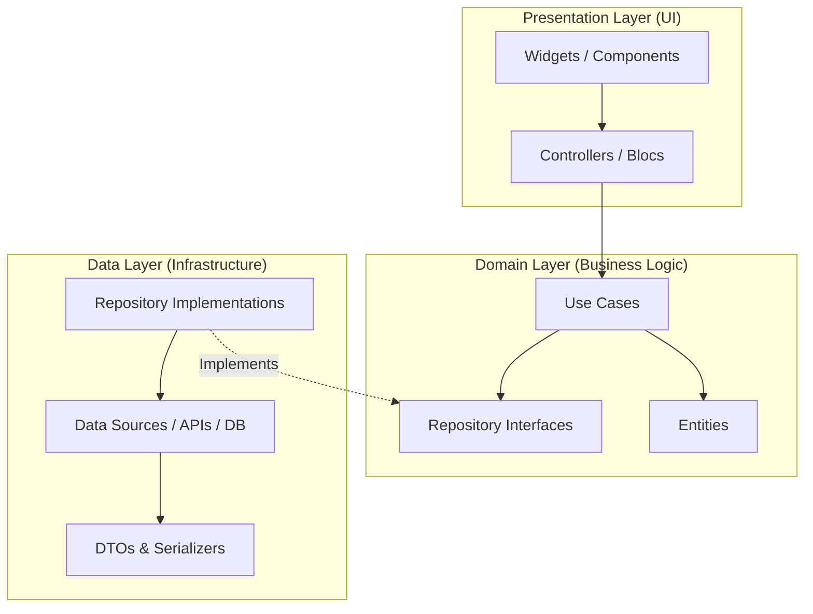

# Code Architecture & Directory Layout — [Project Name]

> **Target Repository Code Layout & Structural Patterns**  
> Source code layout, module boundaries, layer interactions, and coding idioms for [Project Name].

---

## Document Metadata

- **Status:** DRAFT <!-- Options: DRAFT, IN_REVIEW, APPROVED -->
- **Version:** 1.0.0
- **Last Updated:** [YYYY-MM-DD]
- **Governing Architecture:** [`docs/project/system-design.md`](file:///docs/project/system-design.md)

---

## 1. Source Directory Layout

```text
[src/ or lib/]
├── app/                  # App initialization, routes, theme, dependency injection
├── core/                 # Shared cross-cutting utilities, error types, network clients
│   ├── errors/           # Failures and domain exceptions
│   ├── network/          # HTTP client wrappers, interceptors
│   ├── theme/            # Design tokens, color schemes, typography definitions
│   └── utils/            # Shared formatting, validators, date helpers
├── features/             # Feature-sliced modules (self-contained vertical slices)
│   └── [feature_name]/
│       ├── data/         # Models, data sources, repository implementations
│       ├── domain/       # Entities, use cases, repository contracts
│       └── presentation/ # UI screens, widgets, controllers/blocs
└── main.[dart/ts/py]     # Application entry point
```

---

## 2. Layer Boundaries & Data Flow



### 2.1 The Dependency Inversion Principle
- The **Domain layer** is independent and pure; it has no dependencies on UI libraries, HTTP clients, or database drivers.
- The **Presentation layer** interacts with the domain layer exclusively via Use Cases or domain entities.
- The **Data layer** depends on domain layer abstractions (interfaces) and handles serialization and network requests.

---

## 3. Module & File Naming Conventions

| Artifact Type | File Naming Pattern | Example |
|---|---|---|
| Screen / Page | `[feature]_[page_name]_screen.[ext]` | `profile_edit_screen.dart` |
| Controller / Bloc | `[feature]_[name]_[controller/bloc].[ext]` | `auth_login_bloc.dart` |
| Use Case | `[verb]_[noun]_usecase.[ext]` | `get_user_profile_usecase.dart` |
| Entity | `[entity_name].[ext]` | `user_profile.dart` |
| Repository Contract | `[entity_name]_repository.[ext]` | `user_repository.dart` |
| Repository Impl | `[entity_name]_repository_impl.[ext]` | `user_repository_impl.dart` |
| Data Model / DTO | `[name]_model.[ext]` | `user_dto.dart` |
| Data Source | `[name]_[remote/local]_data_source.[ext]` | `auth_remote_data_source.dart` |

---

## 4. Architectural Constraints & Anti-Patterns

### 4.1 Enforced Constraints
1. **Unidirectional Flow:** Data flows downward from repositories to UI; user events trigger calls upward via controllers to use cases.
2. **DTO Separation:** Never leak external API payload models or database rows directly into UI widgets. Map them to domain entities first.
3. **No Stateful Leaks:** Widgets must not store domain business logic in mutable widget states.

### 4.2 Prohibited Anti-Patterns
- **Fat Controllers:** Putting business logic, API calls, and validation inside UI components.
- **Circular Dependencies:** Modules or layers importing each other circularity.
- **Direct Global Access:** Accessing singletons or globals without dependency injection wrappers.

