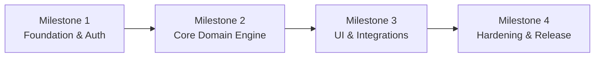

# Project Implementation Roadmap & Plan — [Project Name]

> **Master Implementation Plan & Milestone Roadmap**  
> Strategic implementation roadmap, milestone decomposition, task sequencing, and quality gates for [Project Name].

---

## Document Metadata

- **Status:** DRAFT <!-- Options: DRAFT, IN_REVIEW, APPROVED -->
- **Version:** 1.0.0
- **Last Updated:** [YYYY-MM-DD]
- **Governing Approval Gate:** Plan Gate (SAFE-003)

---

## 1. Roadmap & Milestone Summary

| Milestone ID | Name | Objective | Target Completion | Status |
|---|---|---|---|---|
| **M1** | Project Foundation & Auth | Establish baseline project scaffolding, CI, and authentication | [Date] | PENDING |
| **M2** | Core Domain Engine | Implement business logic, repository layer, and offline storage | [Date] | PENDING |
| **M3** | Primary User Experience | Complete presentation layer, user flows, and integrations | [Date] | PENDING |
| **M4** | QA Hardening & Launch | E2E testing, accessibility audit, performance tuning, and release | [Date] | PENDING |

---

## 2. Milestone Breakdown & Implementation Tasks

### Milestone 1: [Milestone Title]

#### Task M1-T01: [Task Title]
- **Status:** PENDING <!-- PENDING, IN_PROGRESS, BLOCKED, COMPLETED, NEEDS_REVIEW -->
- **Scope:** [Specific, atomic unit of work]
- **Dependencies:** None
- **Acceptance Criteria:**
  - [ ] [Verifiable acceptance criterion 1]
  - [ ] [Verifiable acceptance criterion 2]
- **Verification Command:** `[e.g., flutter test test/auth_test.dart]`

#### Task M1-T02: [Task Title]
- **Status:** PENDING
- **Scope:** [Scope description]
- **Dependencies:** M1-T01
- **Acceptance Criteria:**
  - [ ] [Criterion]
- **Verification Command:** `[Command]`

---

## 3. Critical Path & Dependencies

- **Critical Path:** M1-T01 $\rightarrow$ M1-T02 $\rightarrow$ M2-T01 $\rightarrow$ M3-T01
- **Key Risks & Mitigations:**
  - *Risk 1:* [e.g., Third-party API rate limits] $\rightarrow$ *Mitigation:* Implement caching and mock provider for local development.
  - *Risk 2:* [e.g., Schema migrations] $\rightarrow$ *Mitigation:* Automated migration verification scripts.

---

## 4. Definition of Done (DoD)

A task or milestone is marked `COMPLETED` only when:
1. Code strictly conforms to [`rules.md`](file:///rules.md) and [`DESIGN.md`](file:///DESIGN.md).
2. All unit and integration tests pass with tangible observed output.
3. Static analysis and linters report zero errors.
4. Git working tree is clean and changes are committed atomically.
5. Bidirectional traceability to system requirements is verified.

