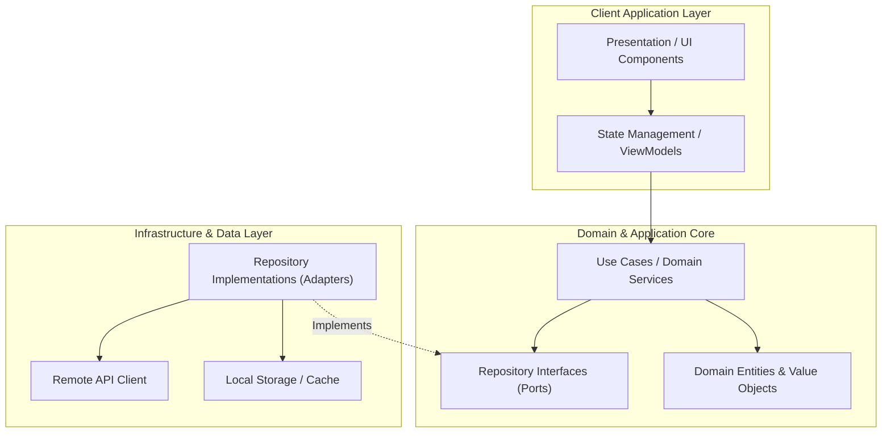

# System Design & Architecture — [Project Name]

> **Target Repository System Design Specification**  
> High-level architecture, subsystem boundaries, data models, and architectural patterns for [Project Name].

---

## Document Metadata

- **Status:** DRAFT <!-- Options: DRAFT, IN_REVIEW, APPROVED -->
- **Version:** 1.0.0
- **Last Updated:** [YYYY-MM-DD]
- **Architect:** [System Architect / AI Agent]
- **Approval Date:** [Pending / YYYY-MM-DD]

---

## 1. Architectural Overview & Topology

[Provide an executive summary of the system architecture, chosen architectural style (e.g., Clean Architecture, Modular Monolith, Microservices, Event-Driven), and system rationale.]

### 1.1 High-Level Architecture Diagram



---

## 2. Subsystem & Component Decomposition

### 2.1 Subsystem 1: [e.g., Authentication Subsystem]
- **Purpose:** [What this component manages]
- **Boundary:** [Files / packages encapsulating this subsystem]
- **Provided Interfaces:** [Public APIs / contracts exposed]
- **Dependencies:** [Other subsystems or external SDKs]

### 2.2 Subsystem 2: [e.g., Core Feature Subsystem]
- **Purpose:** [Purpose]
- **Boundary:** [Path / directory]
- **Provided Interfaces:** [Contracts]
- **Dependencies:** [Dependencies]

---

## 3. Data Models & Storage Schema

### 3.1 Domain Entities

```text
Entity: User
├── id: String (UUID, Unique)
├── email: String (Validated)
├── displayName: String
├── createdAt: Timestamp
└── status: UserStatus (ACTIVE | SUSPENDED | PENDING)
```

### 3.2 Persistence Strategy
- **Local Storage:** [e.g., SQLite / Hive / SharedPreferences / IndexedDB / Postgres]
- **Remote Persistence:** [e.g., Supabase / Firebase / REST API / GraphQL API]
- **Caching & Invalidation:** [Cache-first, network-first, TTL policies]

---

## 4. Communication Protocols & APIs

- **Client-Server Protocol:** [e.g., RESTful JSON over HTTPS, GraphQL, WebSockets, gRPC]
- **Authentication Scheme:** [e.g., OAuth 2.0 Bearer JWT via Authorization header]
- **Error Serialization:** Standardized error JSON envelope:
  ```json
  {
    "error": {
      "code": "RESOURCE_NOT_FOUND",
      "message": "The requested entity does not exist.",
      "details": []
    }
  }
  ```

---

## 5. Cross-Cutting Concerns

1. **State Management:** [BLoC / Riverpod / Redux / Zustand / Vuex]
2. **Dependency Injection:** [Composition root location and registration patterns]
3. **Security & Threat Mitigation:**
   - Input validation at boundary layers
   - Secure credential storage (OS Keychain / Keystore)
   - Certificate pinning / HTTPS enforcement
4. **Observability & Logging:** Structured log format, telemetry collection, crash analytics.

---

## 6. Architectural Decision Records (ADRs)

| ADR ID | Decision Title | Status | Rationale | Alternatives Considered |
|---|---|---|---|---|
| `ADR-001` | [e.g., Adopt Clean Architecture] | APPROVED | [Separates business logic from UI/framework] | [MVC, Feature-driven ad-hoc] |
| `ADR-002` | [e.g., Select BLoC for State Management] | APPROVED | [Predictable state transitions, testability] | [setState, Provider] |

