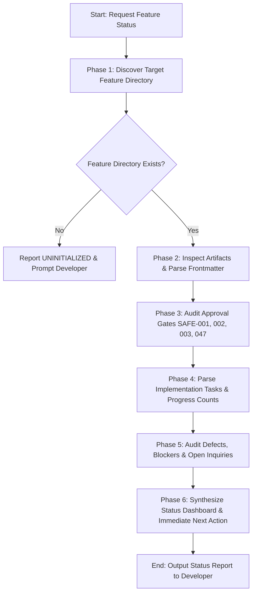

# Workflow: Feature Status (Progress Reporting & Artifact Audit)

**Workflow ID:** `feature_status`  
**Entry Point:** `workflows/feature-status.md`  
**Primary Roles:** Product Analyst, Technical Planner, Primary Orchestrator  
**Applicable Skills:**  
- `skills/project-discovery/SKILL.md`  
**Governing Gates:** `requirements`, `architecture`, `planning`, `implementation`, `testing`, `final_acceptance` (`config/quality-gates.yaml`)  

---

## 1. Purpose & Overview

The `feature_status` workflow provides an accurate, evidence-grounded summary of progress, approval states, active tasks, blockers, and outstanding decisions for any feature within target application repositories.

This workflow serves as the central observability mechanism for the engineering lifecycle:
- **Strict Anti-Hallucination Grounding:** Status is derived strictly from real artifacts stored in `.dev-team/features/<feature-slug>/` or git metadata; it never invents, estimates, or assumes progress without artifact evidence (`REQ-058`).
- **Comprehensive Lifecycle Stage Identification:** Detects the current engineering stage: `REQUIREMENTS`, `ARCHITECTURE`, `PLANNING`, `IMPLEMENTATION`, `VALIDATION`, or `ACCEPTED` (`REQ-056`).
- **Approval Gate Visibility:** Explicitly audits the four fundamental approval gates: Requirements (`SAFE-001`), Architecture (`SAFE-002`), Technical Plan (`SAFE-003`), and Final Acceptance (`SAFE-001`, `REQ-047`).
- **Concrete Task Accounting:** Counts verified task states (`COMPLETED`, `IN_PROGRESS`, `NEEDS_REVIEW`, `BLOCKED`, `PENDING`) directly from `plan.md` and discrete task cards (`REQ-057`).
- **Blocker & Risk Surfacing:** Highlights active blockers, open questions, critical review findings, and open defect reports (`REQ-057`, `SAFE-012`).
- **Single Actionable Next Step:** Provides an unambiguous recommendation directing the developer or agent to the immediate next workflow action.

---

## 2. Prerequisites & Entry Conditions

1. **Trigger:**
   - Developer requests progress reporting (e.g., *"show status of auth feature"*, *"what is the progress on ratings"*, *"list feature status"*, or *"where are we on the current feature"*).
   - Pre-flight status check before running next implementation or validation workflows.
2. **Target Feature Identifier:**
   - Feature slug specifying the subdirectory in `.dev-team/features/<feature-slug>/` (e.g., `user-profile`, `property-review`).
   - If no slug is specified and multiple features exist, list all available features with their high-level stages and prompt the developer.
3. **Artifact Discovery Mode:**
   - Operates in read-only inspection mode. Does not mutate existing documentation or source files.

---

## 3. Artifact Hierarchy & Lifecycle Determination

The workflow audits the existence and header status of the following standard artifacts:

```text
.dev-team/features/<feature-slug>/
├── requirement.md      # Product Requirements (Status: DRAFT, IN_REVIEW, APPROVED, NEEDS_REVISION)
├── system-design.md    # Technical Architecture (Status: DRAFT, IN_REVIEW, APPROVED, NEEDS_REVISION)
├── plan.md             # Technical Implementation Plan (Status: DRAFT, IN_REVIEW, APPROVED)
├── tasks/              # [Optional] Discrete task specifications (Status: PENDING, IN_PROGRESS, COMPLETED, etc.)
│   └── M<m>-T<nn>.md
├── qa-report.md        # Feature Validation Report (Status: DRAFT, APPROVED, NEEDS_REVISION)
└── bugs/               # Defect reports and bug lifecycle cards
    └── BUG-<nnn>.md
```

### Lifecycle Stage Mapping Rules (`REQ-056`, `REQ-058`)

| Stage | Trigger Criteria from Disk | Next Expected Action |
|---|---|---|
| `UNINITIALIZED` | Feature directory missing or empty. | Run `workflows/new-feature.md` |
| `REQUIREMENTS_DRAFT` | `requirement.md` exists with `Status: DRAFT` or `IN_REVIEW`. | Complete requirements / Run `workflows/validate-requirement.md` |
| `REQUIREMENTS_APPROVED` | `requirement.md` is `APPROVED`, `system-design.md` missing. | Run `workflows/design-feature.md` |
| `DESIGN_DRAFT` | `system-design.md` exists with `Status: DRAFT` or `IN_REVIEW`. | Complete architecture review / Obtain developer approval |
| `DESIGN_APPROVED` | `system-design.md` is `APPROVED`, `plan.md` missing. | Run `workflows/create-plan.md` |
| `PLAN_DRAFT` | `plan.md` exists with `Status: DRAFT` or `IN_REVIEW`. | Review plan / Obtain developer plan approval |
| `PLAN_APPROVED` | `plan.md` is `APPROVED`, all tasks are `PENDING`. | Run `workflows/implement-next.md` to begin first task |
| `IMPLEMENTATION_ACTIVE` | Tasks in `plan.md` are `IN_PROGRESS`, `NEEDS_REVIEW`, or partially `COMPLETED`. | Run `workflows/implement-next.md` to implement next task |
| `IMPLEMENTATION_BLOCKED` | One or more active tasks are marked as `BLOCKED`. | Resolve blocker / Escalate to developer |
| `IMPLEMENTATION_DONE` | All tasks in `plan.md` are `COMPLETED`, `qa-report.md` missing. | Run `workflows/validate-feature.md` |
| `VALIDATION_ACTIVE` | `qa-report.md` exists with `Status: DRAFT` or determination `NEEDS_REVISION`. | Remediate QA findings / Complete QA validation |
| `READY_FOR_ACCEPTANCE` | `qa-report.md` has determination `APPROVED` / `APPROVED_WITH_FOLLOW_UPS`, developer sign-off pending. | Await developer final sign-off (`SAFE-001`) |
| `ACCEPTED_COMPLETE` | `qa-report.md` signed off by developer; all gates satisfied. | Feature complete and ready for release |

---

## 4. Execution Sequence



### Phase 1: Discover Target Feature Directory
1. Locate feature directory at `.dev-team/features/<feature-slug>/` (or path configured in `defaults.yaml` / `project-profile.yaml`).
2. If directory does not exist, return an honest status indicating that no work has begun for this feature slug (`REQ-058`).

### Phase 2: Inspect Artifacts & Parse Frontmatter
1. Check for the existence of:
   - `requirement.md`
   - `system-design.md`
   - `plan.md`
   - `qa-report.md`
   - `tasks/` directory and `bugs/` directory
2. Parse document headers:
   - Extract `Status:` line.
   - Extract `Version:` and `Last Updated:` timestamps.
   - Extract `Approved By:` or `Sign-off:` blocks where present.

### Phase 3: Audit Approval Gates
Verify explicitly whether mandatory gates have been authorized:
- **Requirements Gate (`SAFE-001`):** Is `requirement.md` marked `APPROVED`?
- **Architecture Gate (`SAFE-002`):** Is `system-design.md` marked `APPROVED`?
- **Plan Gate (`SAFE-003`):** Is `plan.md` marked `APPROVED`?
- **Final Acceptance Gate (`SAFE-001`, `REQ-047`):** Is `qa-report.md` approved with recorded developer sign-off?

### Phase 4: Parse Implementation Tasks & Progress Counts (`REQ-057`)
1. Ingest `plan.md` task lists and any `tasks/*.md` files.
2. Count tasks in each recognized state:
   - `COMPLETED`: Verified with tangible test evidence.
   - `NEEDS_REVIEW`: Code implemented, awaiting code review.
   - `IN_PROGRESS`: Actively undergoing development.
   - `BLOCKED`: Work paused due to external dependency or missing decision.
   - `PENDING`: Not yet started.
3. Calculate completion percentage:
   $$\text{Progress \%} = \left( \frac{\text{COMPLETED Tasks}}{\text{Total Tasks}} \right) \times 100$$
4. *Anti-Hallucination Rule (`REQ-058`):* Never report a task as `COMPLETED` if it is missing from `plan.md` or marked as `PENDING`/`IN_PROGRESS`.

### Phase 5: Audit Defects, Blockers & Open Inquiries
1. Scan `plan.md` and `tasks/*.md` for any task marked `BLOCKED`. Extract the documented blocker reason.
2. Ingest `bugs/*.md` (or `bug-report.md`):
   - Count open, in-progress, and resolved defects.
   - List any `BLOCKER` or `CRITICAL` defects preventing completion (`REQ-046`).
3. Scan `requirement.md` and `system-design.md` for unresolved open questions (`SAFE-012`).

### Phase 6: Synthesize Status Dashboard & Immediate Next Action
Generate a standardized Markdown Status Dashboard conforming to Section 5 below.

---

## 5. Standard Feature Status Dashboard Format

The output must be formatted using the following clear markdown structure:

```markdown
# Feature Status: [Feature Title] (`[feature-slug]`)

**Current Lifecycle Stage:** `[STAGE_NAME]`  
**Overall Status:** `[ON_TRACK | BLOCKED | AWAITING_APPROVAL | COMPLETED]`  
**Audit Timestamp:** [YYYY-MM-DD HH:MM:SS]  

---

## 1. Approval Gate Summary

| Gate | Target Artifact | Required Authority | Current State | Sign-off Date |
|---|---|---|---|---|
| **Requirements Gate** | `requirement.md` | Developer | `[APPROVED / DRAFT / MISSING]` | `[Date / Pending]` |
| **Architecture Gate** | `system-design.md` | Developer | `[APPROVED / DRAFT / MISSING]` | `[Date / Pending]` |
| **Implementation Plan Gate** | `plan.md` | Developer | `[APPROVED / DRAFT / MISSING]` | `[Date / Pending]` |
| **Final Acceptance Gate** | `qa-report.md` | Developer | `[APPROVED / DRAFT / MISSING]` | `[Date / Pending]` |

---

## 2. Implementation Progress

**Completion:** `[X]%` (`[Completed]` / `[Total]` tasks)  
`[Progress Bar: e.g. [████████░░░░] 60%]`

| Status | Count | Tasks |
|---|---|---|
| **COMPLETED** | `[Count]` | `[e.g., M1-T01, M1-T02]` |
| **NEEDS_REVIEW** | `[Count]` | `[e.g., M2-T01]` |
| **IN_PROGRESS** | `[Count]` | `[e.g., M2-T02]` |
| **BLOCKED** | `[Count]` | `[e.g., M2-T03]` |
| **PENDING** | `[Count]` | `[e.g., M3-T01, M3-T02]` |

---

## 3. Active Blockers & Open Inquiries

<!-- If none exist, output "No active blockers or unresolved inquiries." -->
- **Blockers:**
  - `[Task ID / Defect ID]`: [Description of blocking issue and dependency]
- **Open Critical Questions:**
  - `[Question ID]`: [Summary of unresolved question requiring developer decision (SAFE-012)]

---

## 4. Defect Tracking Summary

| Severity | Open | In Progress | Verified / Resolved | Total |
|---|---|---|---|---|
| **BLOCKER / CRITICAL** | `[Count]` | `[Count]` | `[Count]` | `[Count]` |
| **MAJOR** | `[Count]` | `[Count]` | `[Count]` | `[Count]` |
| **MINOR / TRIVIAL** | `[Count]` | `[Count]` | `[Count]` | `[Count]` |

---

## 5. Immediate Next Recommended Action

> [!TIP]
> **Next Action:** [Exact action command or workflow entry point, e.g.:]  
> `Run workflows/implement-next.md to begin Task M2-T02: Implement User Profile Cache.`
```

---

## 6. Multi-Feature Repository Summary (Aggregate Mode)

When the developer requests status across the entire repository (e.g. *"list all features"* or *"overall project status"*):
1. Scan `.dev-team/features/` for all feature directories.
2. Ingest `plan.md` and `requirement.md` for each feature.
3. Produce a consolidated summary table:

| Feature Slug | Title | Stage | Progress | Open Blockers | Next Action |
|---|---|---|---|---|---|
| `auth` | User Authentication | `IMPLEMENTATION` | 75% (6/8 tasks) | None | `workflows/implement-next.md` |
| `reviews` | Property Reviews | `PLANNING` | 0% (0/10 tasks) | Plan Approval Pending | Await plan sign-off |
| `messaging` | Host Messaging | `REQUIREMENTS` | N/A | Missing schema decision | Resolve Open Question 3 |

