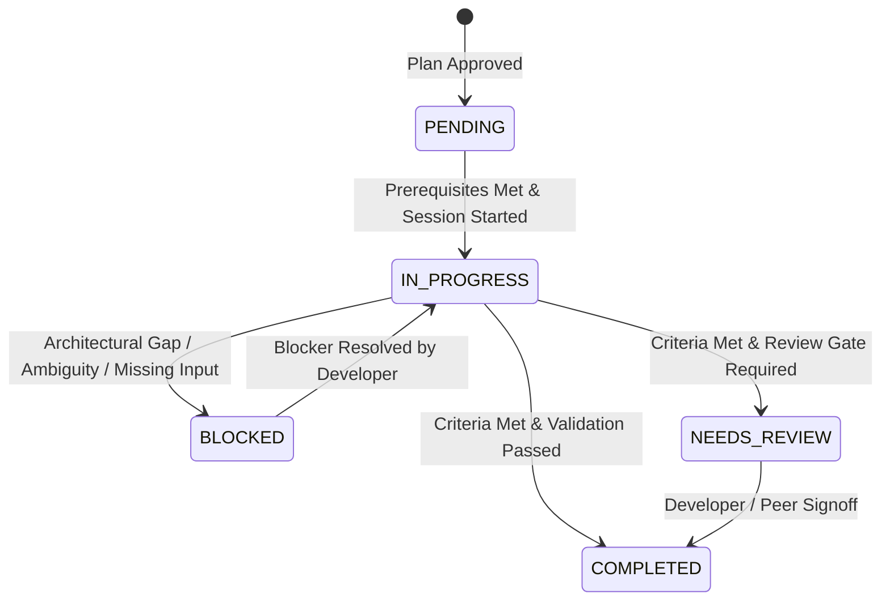

# Workflow: Implement Next Task (Controlled Implementation)

**Workflow ID:** `implementation`  
**Entry Point:** `workflows/implement-next.md`  
**Primary Roles:** Developer, QA Engineer (Handover)  
**Applicable Skills:**  
- `skills/flutter-development/SKILL.md` (or applicable technology skill)  
- `skills/project-discovery/SKILL.md`  
**Governing Gate:** Implementation Gate (`config/quality-gates.yaml`)  

---

## 1. Purpose & Overview

The `implementation` workflow governs the controlled, incremental execution of approved engineering tasks. It translates individual task specifications from an approved implementation plan (`plan.md`) or task card (`task.md`) into production code and tests within the target application repository.

This workflow enforces the core engineering principles of Dev-Team:
- **One Task at a Time:** By default, execute exactly one approved task per session to maintain strict control, observability, and traceability (`REQ-031`, `REQ-039`, `config/workflow.yaml`).
- **Inspect Before Modifying:** Inspect existing repository context, Git status, conventions, and target source files prior to making edits (`SAFE-010`, `REQ-032`).
- **Respect Existing Architecture:** Conform strictly to target project patterns (naming, DI, state management, routing, testing) without introducing unsolicited refactoring or foreign dependencies (`REQ-033`, `REQ-034`).
- **Evidence Over Assumptions:** Execute deterministic validation commands and observe actual terminal outputs before marking tasks completed (`SAFE-009`, `REQ-036`, `REQ-037`).
- **Strict Scope Boundaries:** Implement only the approved scope. If unforeseen architectural gaps or ambiguities arise, immediately pause, flag the task as `BLOCKED`, and escalate to the developer (`SAFE-004`, `SAFE-012`, `REQ-030`).

---

## 2. Prerequisites & Entry Conditions

1. **Trigger:**
   - Follows successful approval of `plan.md` in the `create_plan` workflow (`workflows/create-plan.md`).
   - Developer requests implementation (e.g., *"implement next task"*, *"start working on M1-T01"*, or *"implement feature tasks"*).
2. **Approved Plan Check (Mandatory Precondition):**
   - The target feature directory `.dev-team/features/<feature-slug>/` must contain an approved `plan.md`.
   - Verify that `plan.md` has status `APPROVED` (per `SAFE-003` and `PLAN-GATE-3`).
   - If missing, draft, or pending approval, **halt execution** and notify the developer that plan sign-off is required before any code can be written.
3. **Working Tree Cleanliness Check (`SAFE-010`):**
   - Execute `git status`.
   - Inspect uncommitted changes. If untracked or modified files conflict with target task files, warn the developer and seek instructions before proceeding. Never overwrite or revert uncommitted developer changes.
4. **Task Eligibility Check:**
   - If a specific Task ID is requested, verify its prerequisite dependencies in `plan.md` are in `COMPLETED` status.
   - If no task is specified, select the next sequential task in `PENDING` status whose prerequisites are all `COMPLETED`.
   - If all tasks are completed, notify developer that implementation is complete and recommend transitioning to `workflows/validate-feature.md`.

---

## 3. Quality Gates Enforced

Per `config/quality-gates.yaml` and system safety boundaries:
- [x] **IMPL-GATE-1 (Task Acceptance Criteria):** Every implemented task must address all explicit acceptance criteria (`require_task_acceptance_criteria: true`, `REQ-037`).
- [x] **IMPL-GATE-2 (Validation Before Completion):** Deterministic validation commands must be executed and tangible outputs observed before transitioning to `COMPLETED` (`require_validation_before_completion: true`, `SAFE-009`, `REQ-036`).
- [x] **IMPL-GATE-3 (Prohibit Unapproved Scope Changes):** Changes must remain strictly confined to the task scope; foreign refactoring is forbidden (`prohibit_unapproved_scope_changes: true`, `REQ-034`, `REQ-035`).
- [x] **IMPL-GATE-4 (Enforce One-Task Limit):** The workflow executes exactly one approved task and halts by default (`enforce_one_task_limit: true`, `REQ-031`, `REQ-039`).
- [x] **IMPL-GATE-5 (Preserve Unrelated Modifications):** Working tree integrity is inspected to safeguard existing developer work (`preserve_unrelated_modifications: true`, `SAFE-010`).

---

## 4. Execution Sequence

```mermaid
flowchart TD
    A[Start: Request Implement Next Task] --> B[Phase 1: Task Selection & Dependency Check]
    B --> C{Eligible Task Found & Plan Approved?}
    C -->|No| D[Halt: Missing Approval or Blocked Dependency]
    C -->|Yes| E[Phase 2: Working Tree & Context Inspection (SAFE-010, REQ-032)]
    E --> F[Phase 3: Transition Status to IN_PROGRESS]
    F --> G[Phase 4: Controlled Implementation (Developer)]
    G --> H{Discrepancy / Scope Gap Detected?}
    H -->|Yes| I[Transition Status to BLOCKED & Escalate (REQ-030)]
    H -->|No| J[Phase 5: Deterministic Validation (SAFE-009, REQ-036)]
    J --> K{All Checks & Criteria Passed?}
    K -->|Failure / Errors| G
    K -->|Passed| L[Phase 6: Update Status to COMPLETED / NEEDS_REVIEW]
    L --> M[Phase 7: Stop & Report Summary (REQ-038, REQ-039)]
    M --> N[End: Await Developer Instruction]
```

### Phase 1: Task Selection & Dependency Check
1. Ingest `.dev-team/features/<feature-slug>/plan.md`.
2. Verify plan header indicates `Status: APPROVED`. If draft or missing, halt.
3. Identify the target task:
   - If a specific `Task ID` was specified (e.g., `M1-T02`), locate its specification.
   - If no task specified, traverse the plan's task list in order and identify the first task with `Status: PENDING` whose prerequisite tasks are all marked `COMPLETED`.
4. If prerequisites are not complete:
   - Halt execution and inform developer: *"Cannot start task [Task ID] because prerequisite [Prerequisite ID] is not yet COMPLETED."*
5. If discrete task card exists in `.dev-team/features/<feature-slug>/tasks/<task-id>.md`, load it alongside `plan.md`.

### Phase 2: Working Tree & Context Inspection
*Enforces `SAFE-010`, `REQ-032`, and `skills/project-discovery/SKILL.md`.*
1. Run `git status` to verify repository working tree state.
2. Ingest project guidelines:
   - Target repository `AGENTS.md`.
   - `.dev-team/project-profile.yaml` (validation commands, directory layout, coding conventions).
3. Inspect target files specified in the task (`Files to Create`, `Files to Modify`, `Files to Inspect`):
   - Review existing imports, naming conventions, and layer structures.
   - Review relevant test files to mirror existing testing style and assertions.

### Phase 3: Transition Status to IN_PROGRESS
1. Update active task status in `plan.md` (and `tasks/<task-id>.md` if applicable) from `PENDING` to `IN_PROGRESS`.
2. Record transition timestamp in task execution log.

### Phase 4: Controlled Implementation
*Activate `skills/flutter-development/SKILL.md` (Developer role).*
1. Implement the minimal necessary code to fulfill the task scope:
   - Create or edit target files listed in task scope.
   - Follow project conventions (formatting, null safety, immutability, DI, error handling).
   - Strictly avoid touching unrelated files or introducing speculative abstractions (`REQ-034`, `REQ-035`).
2. Implement or update automated tests:
   - Create targeted unit, widget, or integration tests verifying the new code.
   - Cover normal execution, failure paths, and edge cases.
3. If an unforeseen architectural conflict, missing requirement, or breaking ambiguity is discovered:
   - Do NOT guess or make unilateral modifications (`SAFE-012`).
   - Transition task to `BLOCKED`.
   - Execute the Escalate Protocol (Section 6).

### Phase 5: Deterministic Validation
*Enforces `SAFE-009` and `REQ-036`.*
1. Execute the concrete validation commands specified in the task specification:
   ```bash
   # Example: Format check
   dart format lib/features/<feature_slug>/
   
   # Example: Static analysis
   flutter analyze lib/features/<feature_slug>/
   
   # Example: Targeted automated tests
   flutter test test/features/<feature_slug>/path/to/test.dart
   ```
2. Observe actual command exit codes and terminal outputs.
3. If errors or warnings occur:
   - Refine implementation within the task scope.
   - Re-run validation until clean exit (exit code 0, 0 issues, all tests pass).

### Phase 6: State Transition & Execution Log
*Enforces `REQ-037` and Task Progress Convention (Section 5).*
1. Confirm that every acceptance criterion listed in the task specification has been met.
2. Transition task status:
   - To `COMPLETED` if all criteria and tests pass.
   - Or to `NEEDS_REVIEW` if project rules mandate external peer signoff before proceeding.
3. Update task execution log in `plan.md` (and `tasks/<task-id>.md`):
   - Record completion timestamp.
   - Record modified and created files.
   - Record tangible validation command output (test count, exit code, static analysis status).

### Phase 7: Stop & Report Summary
*Enforces `REQ-038` and `REQ-039`.*
1. Prepare a clear, concise implementation summary for the developer:
   - **Task Completed:** `[Task ID] — [Task Title]`
   - **Status:** `COMPLETED`
   - **Files Created / Modified:** Absolute or relative repo paths.
   - **Key Implementation Decisions:** Architectural choices and patterns applied.
   - **Validation Evidence:** Observed test results, static analysis output, and exit codes.
   - **Next Eligible Task:** Identify the subsequent task ready for execution.
2. **Halt execution.** Do not begin subsequent tasks without explicit developer authorization (`REQ-039`).

---

## 5. Task Progress Tracking & State Machine

Task progress tracking establishes a deterministic, auditable record of engineering progress across `plan.md` and `task.md` artifacts.

### 5.1 Allowed Task Statuses
| Status | Meaning | Transition Prerequisites |
|---|---|---|
| `PENDING` | Task defined in approved plan; not yet started. | Initial state upon plan approval. |
| `IN_PROGRESS` | Task is actively being implemented in the current session. | Prerequisites `COMPLETED`; Git status verified; task started. |
| `BLOCKED` | Work cannot proceed due to external blocker, ambiguity, or gap. | Blocker reason, category, and proposed resolution recorded. |
| `COMPLETED` | Implementation finished, acceptance criteria met, tests passed. | Validation executed; tangible output recorded in artifact. |
| `NEEDS_REVIEW` | Implemented and verified; awaiting developer/peer review. | Validation executed; review items specified. |

### 5.2 Valid State Transitions


### 5.3 Anti-Hallucination & Evidence Rules
1. **Never Infer Completion:** An agent must never mark a task `COMPLETED` without actually running the specified validation commands and observing clean terminal outputs (`SAFE-009`).
2. **Artifact Persistence:** Status changes must be committed directly to the markdown artifact (`plan.md` and/or `task.md`), not merely asserted in chat prose.
3. **Evidence Requirement:** Every `COMPLETED` task record must include:
   - Date and timestamp of completion.
   - List of exact files created or modified.
   - Observed validation command output (e.g., `0 issues found`, `All tests passed!`).

---

## 6. Scope Change & Blocker Escalation Protocol (REQ-030)

If implementation reveals that an approved requirement is impossible, contradictory, or requires modifying database schemas / architectures outside task scope:

1. **Pause Implementation Immediately:**
   - Do not make speculative or unapproved modifications (`SAFE-004`).
   - Do not attempt workarounds that violate system architecture (`SAFE-002`).
2. **Update Task State:**
   - Set active task status to `BLOCKED`.
3. **Record Blocker Details in Artifact:**
   - Document the specific obstacle in Section 10 of `task.md` or the task entry in `plan.md`:
     - **Blocker Description:** What failed or broke.
     - **Category:** Architecture Flaw / Requirement Gap / External Dependency / Broken Test.
     - **Impact:** What downstream components are affected.
     - **Proposed Remediation:** Smallest clean solution or alternative options.
4. **Escalate to Developer:**
   - Present the blocker clearly and ask for direction (`SAFE-012`).
   - Await developer decision before resuming work.

---

## 7. Artifact Lifecycle & Handover

```text
Approved plan.md (Status: APPROVED)
       |
       v
Select Next Task (Status: PENDING -> IN_PROGRESS)
       |
       v
Implement & Run Deterministic Validation (SAFE-009)
       |
       v
Record Tangible Evidence & Update Status (Status: COMPLETED)
       |
       v
Stop & Report to Developer (REQ-038, REQ-039)
       |
       +---> If all plan tasks COMPLETED -> Handover to workflows/validate-feature.md
       +---> If more tasks pending -> Developer triggers next implement-next cycle
```

