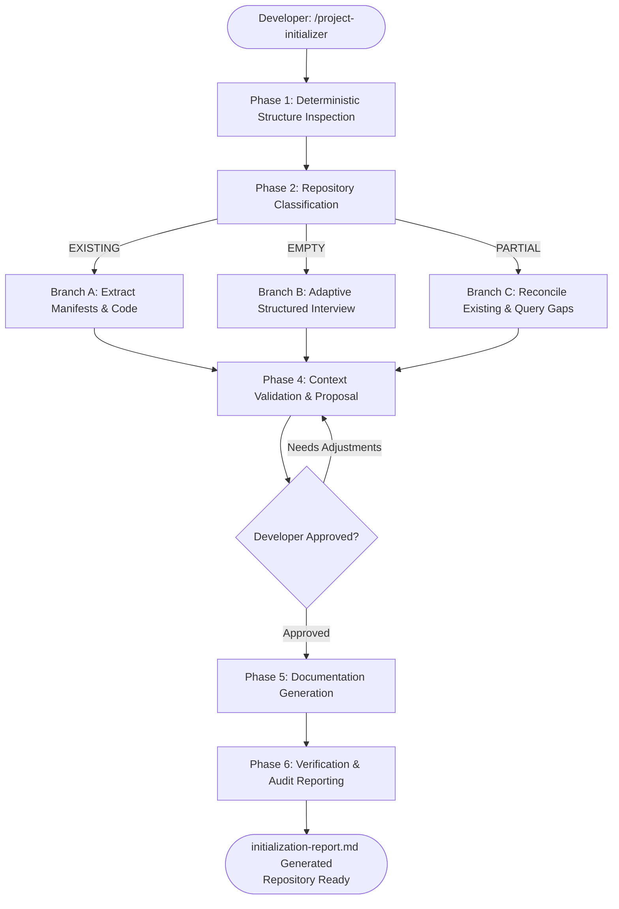

# Workflow: Initialize Project (Repository Onboarding & Scaffolding)

> **Standard Operating Procedure (SOP)**  
> **Workflow ID:** `initialize_project`  
> **Entry Point:** `workflows/initialize-project.md`  
> **Primary Roles:** Developer (Orchestrator & Approver), System Architect  
> **Applicable Skills:**  
> - `skills/project-initializer/SKILL.md`  
> **Governing Gate:** Foundational Initialization Gate (`SAFE-001`, `SAFE-002`, `SAFE-006`, `SAFE-010`, `SAFE-012`)  

---

## 1. Purpose & Overview

The `initialize_project` workflow is the lifecycle entry point for introducing Dev-Team to any software repository. It governs the end-to-end process of:

1. Deterministically analyzing directory structures and package manifests without bias.
2. Classifying repositories into `EXISTING`, `EMPTY`, or `PARTIAL`.
3. Gathering verified facts (via code extraction or adaptive interviews) without inventing speculative architecture.
4. Securing explicit developer approval before creating or modifying any file.
5. Scaffolding standardized root instructions (`AGENTS.md`, `rules.md`, `DESIGN.md`), target configuration (`.dev-team/config.yaml`), canonical context (`.dev-team/project-context.md`), and baseline documentation (`docs/project/`).
6. Generating an audit record in `.dev-team/initialization-report.md`.

---

## 2. Prerequisites & Entry Conditions

1. **Trigger:**
   - Explicit developer command: `/project-initializer`, "Initialize this project", or "Onboard this repository".
   - Automatic detection: Any engineering workflow (`workflows/new-feature.md`, `workflows/design-feature.md`) detects that `.dev-team/project-context.md` is missing.
2. **Git Working Tree Inspection (SAFE-010):**
   - Inspect `git status` prior to executing file creation steps.
   - If uncommitted changes exist, inform the developer and ensure they are preserved.
3. **Collision & Idempotency Check:**
   - If `.dev-team/config.yaml` or root `AGENTS.md` already exists, do not overwrite silently.
   - Perform a partial gap-analysis to update missing documentation without corrupting existing user content.

---

## 3. Quality Gates Enforced

Per system safety boundaries and `config/quality-gates.yaml`:
- [x] **INIT-GATE-1 (Truth Preservation):** Never invent speculative architecture, foreign frameworks, or fictitious schemas for empty repositories (`SAFE-004`, `SAFE-012`).
- [x] **INIT-GATE-2 (Non-Destructive Scaffolding):** Never overwrite existing user documentation, instructions, or README files without explicit consent (`SAFE-006`, `SAFE-010`).
- [x] **INIT-GATE-3 (Explicit Approval Checkpoint):** Present detected stack and proposed file actions to developer; obtain explicit approval before writing (`SAFE-001`, `SAFE-002`).
- [x] **INIT-GATE-4 (Audit Verifiability):** Produce a complete audit report in `.dev-team/initialization-report.md` capturing all actions (`SAFE-009`).

---

## 4. Execution Sequence



### Phase 1: Deterministic Structure Inspection
*Activate `skills/project-initializer/SKILL.md`.*
1. Run the project structure inspection script:
   ```bash
   python skills/project-initializer/scripts/check-project-structure.py --path . --json
   ```
2. Parse the resulting JSON:
   - Identify package manifests (`pubspec.yaml`, `package.json`, `pyproject.toml`, etc.).
   - Identify existing AI instruction files (`AGENTS.md`, `CLAUDE.md`, `.cursorrules`).
   - Identify existing source and test directories.

### Phase 2: Repository Classification
Based on the inspector output:
- **`EXISTING`:** Source code and manifests are present.
- **`EMPTY`:** Directory is empty or contains only initial git/README files.
- **`PARTIAL`:** Incomplete manifests or existing `.dev-team/` files requiring reconciliation.

### Phase 3: Context Gathering
1. **Branch A (Existing Project):**
   - Read manifests and lockfiles to determine exact framework and library versions.
   - Extract state management, routing, dependency injection, and test runners.
   - Formulate `CONFIRMED_FACTS`.
2. **Branch B (Empty Project):**
   - Conduct structured adaptive interview per `skills/project-initializer/references/context-gathering.md`.
   - Ask for: Product Vision, Target Platforms, Language/Framework Preferences, Quality Gates.
   - Record confirmed answers as `CONFIRMED_FACTS`.
   - Record unchosen items as `ACTIVE_ASSUMPTIONS` or `OPEN_DECISIONS`.
3. **Branch C (Partial Project):**
   - Reconcile existing files and identify missing documentation.

### Phase 4: Context Validation & Approval Checkpoint (Mandatory Gate)
1. Formulate the initialization proposal:
   - Summary of detected/gathered project identity and technology stack.
   - Separation of `CONFIRMED_FACTS` vs `ACTIVE_ASSUMPTIONS`.
   - List of files to generate from `templates/project/`.
   - List of files to skip (e.g., `DESIGN.md` for backend services per `documentation-rules.md`).
   - List of existing user files that will be preserved untouched.
2. Present the proposal clearly to the developer.
3. Prompt for explicit developer approval:
   > *"Please review the project profile and scaffolding plan above. May I proceed with generating the project files?"*
4. **Halt execution until affirmative confirmation is received.**

### Phase 5: Documentation & Configuration Scaffolding
Upon developer approval:
1. Create directories: `.dev-team/`, `.dev-team/features/`, `docs/project/`.
2. Instantiate templates from `templates/project/`:
   - `templates/project/AGENTS.md` $\rightarrow$ `AGENTS.md`
   - `templates/project/rules.md` $\rightarrow$ `rules.md`
   - `templates/project/DESIGN.md` $\rightarrow$ `DESIGN.md` (skip if backend/CLI)
   - `templates/project/config.yaml` $\rightarrow$ `.dev-team/config.yaml`
   - `templates/project/project-context.md` $\rightarrow$ `.dev-team/project-context.md`
   - Baseline documentation in `docs/project/`:
     - `overview.md`, `requirements.md`, `system-design.md`, `plan.md`, `tech-stack.md`, `architecture.md`
3. Substitute placeholder tokens with confirmed facts.

### Phase 6: Verification & Audit Reporting
1. Validate YAML syntax of `.dev-team/config.yaml`.
2. Perform cross-document consistency check (verify project name and paths match across files).
3. Instantiate `templates/project/initialization-report.md` $\rightarrow$ `.dev-team/initialization-report.md` recording all audit metrics.
4. Report completion to the developer with next step recommendations.

---

## 5. Downstream Workflow Handover

Upon successful initialization, hand off to downstream engineering workflows:
- **New Feature Development:** Trigger `workflows/new-feature.md` with `/new-feature [Feature Name]`.
- **Feature Status:** Run `workflows/feature-status.md` with `/feature-status`.
- **Bug Fixes:** Run `workflows/fix-bug.md` with `/fix-bug [Defect Description]`.

