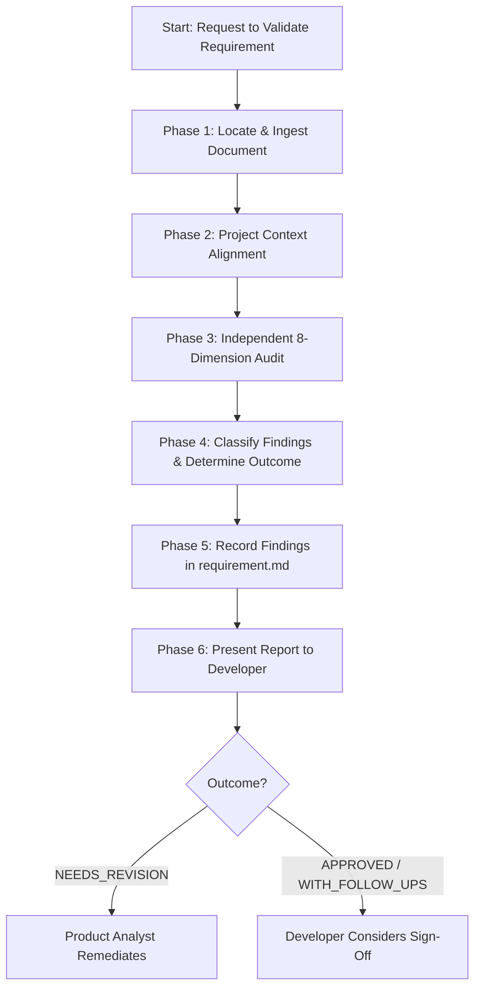

# Workflow: Validate Requirement

**Workflow ID:** `requirement_validation`  
**Entry Point:** `workflows/validate-requirement.md`  
**Primary Roles:** Product Reviewer, Developer (Authority)  
**Applicable Skills:**  
- `skills/requirement-validation/SKILL.md`  
**Governing Gate:** Requirements Gate (`config/quality-gates.yaml`)  

---

## 1. Purpose & Overview

The `validate-requirement` workflow provides a standalone, independent quality audit of an existing `requirement.md` specification.

It verifies that requirements are unambiguous, mutually consistent, technologically feasible, secure, and verifiable with objective acceptance criteria before substantial engineering effort is committed.

---

## 2. Prerequisites & Entry Conditions

1. **Trigger:**
   - Developer requests an audit of a feature requirement (e.g., *"validate requirements for notifications"* or *"review .dev-team/features/auth/requirement.md"*).
   - Invoked as a sub-workflow within `new-feature.md`.
   - Triggered when an existing requirement has undergone revisions.
2. **Input Artifact:**
   - A target `requirement.md` located in `.dev-team/features/<feature-name>/requirement.md` (or path specified by developer).
3. **Precondition Check:**
   - Verify that the target `requirement.md` file exists and is readable.
   - If missing, halt and prompt the developer with instructions to first run `new-feature.md`.

---

## 3. Quality Criteria Evaluated

Per `config/quality-gates.yaml`:
- **Clarity:** Unambiguous statements; no vague buzzwords or unquantified targets.
- **Completeness:** Problem, goals, non-goals, functional/non-functional requirements, edge cases, error states, and empty states.
- **Consistency:** No internal contradictions between requirements, goals, or non-goals.
- **Feasibility:** Compatible with target technology stack discovered via project profile or `AGENTS.md`.
- **Testability:** Measurable acceptance criteria for every functional requirement.
- **Security:** Appropriate authorization, authentication, data privacy, and sanitization boundaries.
- **Zero Critical Gaps:** No unresolved BLOCKER or CRITICAL findings.

---

## 4. Execution Sequence

### Phase 1: Locate & Ingest Document
1. Identify the target `requirement.md` path.
2. Read the entire document into context.
3. Check document status:
   - If status is `APPROVED` and no changes were proposed, inform the developer that this document was previously approved and ask if a re-audit is requested.
   - If status is `DRAFT` or `IN_REVIEW`, proceed with standard audit.

### Phase 2: Project Context Alignment
1. Inspect target project `AGENTS.md` and `.dev-team/project-profile.yaml` to discover:
   - Target framework (e.g. Flutter, backend, database).
   - Known architecture patterns and technology constraints.
2. Ensure evaluation criteria reflect actual project constraints rather than generic assumptions.

### Phase 3: Independent 8-Dimension Audit
*Activate `skills/requirement-validation/SKILL.md` (Product Reviewer role).*
Evaluate the document across the eight required dimensions:
1. **Clarity & Precision:** Identify vague, untestable terms (*"fast"*, *"smooth"*, *"intuitive"*).
2. **Completeness:** Verify all essential sections exist; check for unaddressed personas.
3. **Consistency:** Check for contradictions between requirements or conflicts with Non-Goals.
4. **Feasibility:** Verify compatibility with discovered project technology.
5. **Testability:** Verify every requirement has explicit, verifiable acceptance criteria.
6. **Security & Privacy:** Check authentication, permissions, input sanitization, and data handling.
7. **User Scenarios & Edge Cases:** Check alternative flows, boundary conditions, and cancellations.
8. **Error, Loading & Empty States:** Check network loss, empty lists, loading indicators, and retry UX.

### Phase 4: Classify Findings & Determine Outcome
1. Assign standard severity to each finding:
   - `BLOCKER`: Halts workflow; prevents design or implementation.
   - `CRITICAL`: Major missing user flow, unhandled error with severe UX/security impact.
   - `MAJOR`: Business logic ambiguity or missing acceptance criteria.
   - `MINOR`: Minor wording ambiguity or non-blocking open question.
   - `TRIVIAL`: Formatting, typo, or minor clarity improvement.
2. Issue determination:
   - **`APPROVED`:** 0 Blockers, 0 Criticals, testable criteria satisfied.
   - **`APPROVED_WITH_FOLLOW_UPS`:** 0 Blockers, 0 Criticals; non-blocking items noted.
   - **`NEEDS_REVISION`:** 1+ Blockers or Criticals present.

### Phase 5: Update Artifact
1. Update Section 9.1 (*Independent Review Summary*) of `requirement.md`:
   - Set `Review Outcome` to determination.
   - Record date and concise summary of findings.
2. If outcome is `NEEDS_REVISION`, update document header status to `NEEDS_REVISION`.
3. If outcome is `APPROVED` or `APPROVED_WITH_FOLLOW_UPS`, update status to `IN_REVIEW` (awaiting developer approval).

### Phase 6: Report to Developer
Present the concise audit report:
- Overall determination.
- Grouped findings with recommended remedies.
- Clear recommendation for next step (remedy blockers OR developer sign-off).

---

## 5. Safety & Boundary Rules

- **SAFE-001:** Reviewer determination is an audit gate, NOT developer approval. Only the developer can approve requirements.
- **SAFE-004:** The reviewer must not unilaterally rewrite requirements; proposed changes must be reviewed and accepted by author and developer.
- **SAFE-012:** If requirements lack critical business domain knowledge, flag as BLOCKER and request developer clarification.

